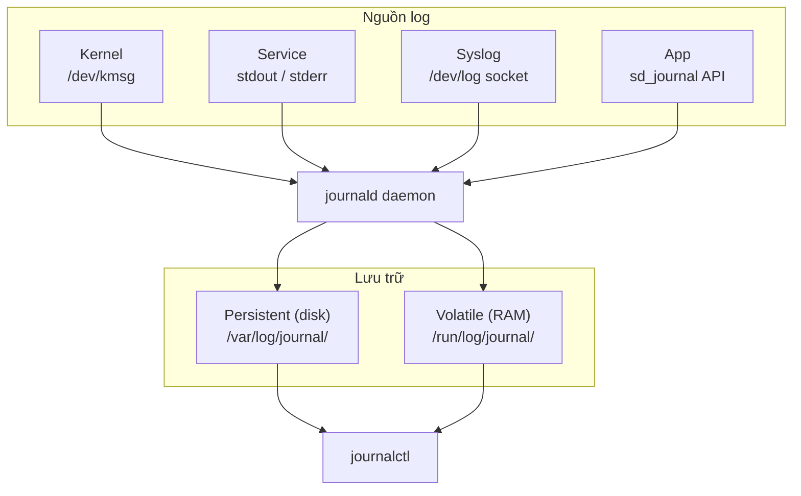

# Init system

## 1. Tổng quan

Init system là chương trình đầu tiên được kernel chạy sau khi kernel hoàn tất quá trình boot, luôn mang PID 1. Nó đóng vai trò là cha của mọi process trong hệ thống.

Init system không bị kill bởi các signal thông thường và mọi process chết mà không có parent thì kernel sẽ chuyển về cho init system xử lý. Nếu init system chết, hệ thống sẽ kernel panic - tức là sập hoàn toàn.

Nói đơn giản, init system giống như một quản lý tòa nhà - nó mở cửa mọi thứ khi bắt đầu, đảm bảo mọi dịch vụ hoạt động, xử lý sự cố và đóng cửa mọi thứ đúng trình tự khi kết thúc.

Một số init system phổ biến: SysInit, systemd,...

**Nhiệm vụ chính của init system:**

Khởi tạo userspace - tức là đưa hệ thống từ trạng thái kernel vừa load xong sang trạng thái sẵn sàng sử dụng. Cụ thể:
- Mount các file system quan trọng: `/proc`, `/sys`, `/dev`,...
- Thiết lập mạng
- Khởi động các service cần thiết như network, sshd, udevd,...
- Quản lý vòng đời process  - init system giám sát các service đang chạy, tự động restart nếu service bị crash.
- Xử lý shutdown/reboot - khi ta tắt máy, init system chịu trách nhiệm dừng các service theo đúng thứ tự, unmount filesystem, và tắt hệ thống an toàn.

:::tip Orphan process
Một process chết mà không có parent thì được gọi là Orphan Process. Kernel sẽ chuyển process này về cho init system xử lý.
:::

:::tip Kernel tìm init system
Kernel sẽ tìm đường dẫn đến init system theo thứ tự: `/sbin/init`, `/etc/init`, `/bin/init`, `/bin/sh`.
:::

## 2. Daemon

Daemon là một background process được tách khỏi terminal, thường hoạt động liên tục trong hệ thống để cung cấp một dịch vụ nào đó.

**Đặc điểm của daemon:**

Daemon không có terminal điều khiển. Khi ta mở terminal chạy một lệnh thông thường, lệnh đó gắn với terminal - đóng terminal thì lệnh chết. Daemon thì khác, nó tách hoàn toàn khỏi terminal nên cứ chạy mãi cho đến khi bị dừng hoặc hệ thống tắt.

Daemon thường chạy từ lúc boot đến lúc shutdown. Ví dụ quen thuộc là `sshd` (lắng nghe kết nối SSH), `nginx` hay `httpd` (phục vụ web),...Ta sẽ thấy hầu hết daemon có tên kết thúc bằng chữ `d` - đó là quy ước đặt tên trong Unix/Linux để nhận biết daemon.

Một số init system như systemd sẽ chịu trách nhiệm quản lý vòng đời của daemon.

**Cách một process trở thành daemon (theo kiểu truyền thống):**

Trong cách làm cổ điển trước thời systemd, một daemon được tạo ra thông qua các bước được gọi là **daemonize** như sau:
- Đầu tiên nó `fork()` ra một process con, rồi exit process cha đi để shell nghĩ rằng lệnh đã kết thúc.
- Process con sau đó gọi `setsid()` để tạo session mới, tách khỏi terminal.
- Thực hiện `fork()` lần 2 để chắc chắn tách khỏi terminal (option).
- Chuyển thư mục làm việc về `/` để không tránh filesystem.
- Đóng tất cả stdin, stdout, stderr vì không còn terminal để giao tiếp.
- Cuối cùng ghi PID vào file (thường trong `/var/run/`) để các công cụ khác biết daemon đang chạy với PID nào.

## 3. Cơ bản về systemd

### 3.1. Unit là gì?

Unit là đơn vị quản lý cơ bản của systemd, mọi thứ systemd quản lý đều được trừu tượng hóa thành một unit.

Mỗi unit được mô tả bằng một unit file (file văn bản kiểu `INI`).

**Các loại unit phổ biến:**

| Loại | Đuôi file | Dùng để |
| --- | --- | --- |
| Service |	`.service`  | Quản lý daemon/process             |
| Target  |	`.target`   | Nhóm các unit lại, thay runlevel   |
| Timer   |	`.timer`    | Lên lịch chạy (thay cron)          |
| Socket  |	`.socket`   | Socket activation                  |
| Mount   |	`.mount`    | Mount filesystem                   |
| Path    |	`.path`     | Theo dõi file/folder thay đổi      |
| Slice   |	`.slice`    | Nhóm cgroup để giới hạn tài nguyên |
| Device  |	`.device`   | Thiết bị phần cứng                 |

**Vị trí của unit file**

Một unit file thường nằm ở:

```
/lib/systemd/system/  <- Distro cài vào (không sửa trực tiếp)
/etc/systemd/system/  <- Custom service
/run/systemd/system/  <- Runtime, tạm thời, mất sau reboot
```

Muốn custom service thì cần tạo file override trong `/etc/systemd/system/` thay vì sửa trực tiếp trong `/lib/systemd/system/`.

Cách tạo override an toàn:

```bash
systemctl edit nginx.service
# -> tạo /etc/systemd/system/nginx.service.d/override.conf
```

File `override.conf` này gọi là drop-in, xem chi tiết ở mục 3.8.

### 3.2. Cấu trúc unit file

Cấu trúc một unit file gồm các section, mỗi section phục vụ một vai trò rõ ràng:

```ini
[Unit]
Description=My Web Application
Documentation=https://example.com/docs
After=network.target postgresql.service
Requires=postgresql.service

[Service]
Type=simple
User=webapp
WorkingDirectory=/opt/webapp
EnvironmentFile=/etc/webapp/env
ExecStart=/opt/webapp/bin/server --port 8080
ExecReload=/bin/kill -HUP $MAINPID
Restart=on-failure
RestartSec=5s

[Install]
WantedBy=multi-user.target
```

Mỗi section trả lời một câu hỏi:

```
[Unit]     -> Unit này là gì? Phụ thuộc vào ai? Chạy khi nào?
[Service]  -> Chạy chương trình nào? Với quyền gì? Được phép làm gì?
[Install]  -> Khi enable, unit được gắn vào đâu để tự chạy lúc boot?
```

#### 3.2.1. Section [Unit]

Có trong mọi loại unit (service, mount, timer...).

**Mô tả**

| Cấu hình | Ý nghĩa |
| --- | --- |
| `Description=` | Mô tả ngắn, hiển thị trong `systemctl status` và log `Started ...` |
| `Documentation=` | Link tới man page hoặc URL docs, ví dụ `man:sshd(8)` |

**Thứ tự và phụ thuộc** (vì sao cần cả hai loại, xem mục 3.5)

`After=B` / `Before=B` chỉ quy định **thứ tự**: nếu cả A và B cùng được start thì B start trước A (với `After=B`). Hai option này không kéo B vào.

Các option dưới đây quy định **phụ thuộc** (A là unit đang viết, B là unit được khai báo):

| Trong A khai báo | A start có kéo B vào không? | B start lỗi | B bị stop / chết sau đó |
| --- | --- | --- | --- |
| `Wants=B` | Có | A vẫn chạy | A vẫn chạy |
| `Requires=B` | Có | A không start | B bị stop bằng tay -> A stop theo. B tự crash -> A vẫn chạy |
| `Requisite=B` | Không, B phải đang chạy sẵn | A không start | Giống `Requires` |
| `BindsTo=B` | Có | A không start | A luôn stop theo, kể cả khi B tự chết (ví dụ thiết bị bị rút ra) |
| `PartOf=B` | Không | - | B stop/restart -> A stop/restart theo |
| `Conflicts=B` | - | - | A start thì B bị stop và ngược lại |

`Requires`, `Requisite`, `BindsTo` thường phải đi kèm `After=` cùng unit, nếu không A và B start song song và B start lỗi không chặn được A.

**Phụ thuộc vào đường dẫn: `RequiresMountsFor=`**

App ghi dữ liệu vào thẻ SD mount ở `/mnt/data`. Nếu app start trước khi thẻ được mount, nó sẽ ghi vào thư mục rỗng trên rootfs.

```ini
[Unit]
RequiresMountsFor=/mnt/data/logs
```

systemd tự tìm các mount unit cần thiết để đường dẫn này dùng được (ở đây là `mnt-data.mount` và `-.mount` cho `/`) rồi thêm `Requires=` + `After=` cho chúng. Tương đương viết tay:

```ini
[Unit]
Requires=mnt-data.mount
After=mnt-data.mount
```

Ưu điểm: không cần biết tên mount unit và không cần biết `/mnt/data` là partition riêng hay chỉ là thư mục thường. Sau này đổi cách mount thì unit vẫn đúng.

**Điều kiện chạy: `Condition...=` và `Assert...=`**

Kiểm tra điều kiện ngay trước khi start:

| Cấu hình | Đúng khi |
| --- | --- |
| `ConditionPathExists=/path` | Đường dẫn tồn tại. Thêm `!` để phủ định: `=!/path` |
| `ConditionFileNotEmpty=/path` | File tồn tại và không rỗng |
| `ConditionKernelCommandLine=debug` | Kernel cmdline có tham số `debug` |
| `ConditionVirtualization=no` | Không chạy trong VM/container |
| `ConditionFirstBoot=yes` | Đây là lần boot đầu tiên của hệ thống |

- `Condition...` sai -> unit bị **bỏ qua** (skip), không tính là lỗi.
- `Assert...` (cùng các biến thể: `AssertPathExists=`...) sai -> unit **failed**.

Ví dụ: service chỉ chạy một lần để khởi tạo dữ liệu, chạy xong thì tạo file đánh dấu:

```ini
[Unit]
ConditionPathExists=!/var/lib/myapp/initialized

[Service]
Type=oneshot
ExecStart=/usr/local/bin/myapp-init
ExecStartPost=/bin/touch /var/lib/myapp/initialized
```

Lần boot sau file đã có, `systemctl status` sẽ báo:

```
Condition: start condition failed at ...
           `- ConditionPathExists=!/var/lib/myapp/initialized was not met
```

**Khi service lỗi**: `OnFailure=`, `StartLimitIntervalSec=`, `StartLimitBurst=`, `StartLimitAction=` - xem mục 3.6.

#### 3.2.2. Section [Service]

**Type và các lệnh chạy**

| Type | Ý nghĩa |
| --- | --- |
| `simple` | ExecStart là tiến trình chính, systemd theo dõi PID này (mặc định, dùng cho hầu hết các service hiện đại) |
| `forking` | Process sẽ fork rồi exit process cha (dành cho daemon kiểu cũ) |
| `oneshot` | Process chạy một lần rồi thoát (dùng cho script khởi tạo) |
| `notify` | Process phải thông báo cho systemd khi đã sẵn sàng qua `sd_notify()` (xem mục 3.7) |
| `dbus` | Sẵn sàng khi đã đăng ký tên trên D-Bus |
| `idle` | Chờ tất cả job khác xong mới chạy |

Các lệnh `Exec...` được gọi theo vòng đời:

```
systemctl start  : ExecStartPre -> ExecStart -> ExecStartPost
systemctl reload : ExecReload
systemctl stop   : ExecStop -> gửi KillSignal cho các process còn lại -> ExecStopPost
```

`ExecStopPost=` chạy cả khi service crash nên hay dùng để dọn dẹp.

Một số prefix đặt trước đường dẫn lệnh:

| Prefix | Ý nghĩa | Ví dụ |
| --- | --- | --- |
| `-` | Lệnh lỗi cũng bỏ qua, không làm service failed | `ExecStartPre=-/bin/rm /tmp/myapp.lock` |
| `+` | Chạy với quyền root, bỏ qua `User=` và sandbox | `ExecStartPre=+/bin/chown myapp /dev/ttyS1` |

:::warning ExecStart không chạy qua shell
`ExecStart=/usr/bin/myapp > /tmp/log` **không** redirect được: `>` và `/tmp/log` được truyền vào như tham số của `myapp`. Các ký tự `|`, `>`, `&&` chỉ dùng được khi gọi shell.
:::

**User và môi trường**

| Cấu hình | Ý nghĩa |
| --- | --- |
| `User=`, `Group=` | Chạy với user/group nào (mặc định root) |
| `WorkingDirectory=` | Thư mục làm việc hiện tại của process |
| `Environment=` | Đặt biến môi trường: `Environment="PORT=8080" "LOG_LEVEL=info"` |
| `EnvironmentFile=` | Đọc biến môi trường từ file, thường là `/etc/default/<tên>` (xem mục 3.10) |

**Thư mục do systemd quản lý**

Thay vì tự `mkdir` + `chown` trong `ExecStartPre` (như mosquitto ở mục 4.2), ta chỉ cần khai báo tên thư mục. systemd tự tạo trước khi start và chown cho `User=`:

| Cấu hình | Thư mục tạo ra | Khi service stop | Dùng cho |
| --- | --- | --- | --- |
| `RuntimeDirectory=myapp` | `/run/myapp` | Bị xoá | Socket, file PID |
| `StateDirectory=myapp` | `/var/lib/myapp` | Giữ lại | Dữ liệu cần lưu lâu dài |
| `CacheDirectory=myapp` | `/var/cache/myapp` | Giữ lại | Cache, xoá đi không sao |
| `LogsDirectory=myapp` | `/var/log/myapp` | Giữ lại | File log riêng |
| `ConfigurationDirectory=myapp` | `/etc/myapp` | Giữ lại | File config |

**Sandbox - giới hạn những gì service được phép đụng tới**

Khi có các option dưới đây, systemd tạo một **mount namespace** riêng cho service: service nhìn thấy filesystem khác với phần còn lại của hệ thống (một số thư mục bị mount lại thành read-only hoặc bị ẩn). Nếu app có bug ghi bừa hoặc bị tấn công, thiệt hại chỉ nằm trong phạm vi được cho phép.

| Cấu hình | Ý nghĩa |
| --- | --- |
| `ProtectSystem=yes` | `/usr`, `/boot` thành read-only |
| `ProtectSystem=full` | Như `yes`, thêm `/etc` read-only |
| `ProtectSystem=strict` | **Toàn bộ** filesystem read-only, trừ `/dev`, `/proc`, `/sys` |
| `ReadWritePaths=` | Ngoại lệ: các đường dẫn này vẫn ghi được |
| `ReadOnlyPaths=` | Các đường dẫn này chỉ đọc được |
| `InaccessiblePaths=` | Các đường dẫn này bị ẩn hoàn toàn |
| `ProtectHome=yes` | Không truy cập được `/home`, `/root`, `/run/user` |
| `PrivateTmp=yes` | Service có `/tmp` riêng, bị xoá khi service stop |
| `NoNewPrivileges=yes` | Process và các con không thể tăng quyền (qua setuid, `sudo`...) |

Ví dụ: app chỉ cần ghi vào thẻ SD và thư mục dữ liệu của nó.

```ini
[Service]
User=myapp
ExecStart=/usr/local/bin/myapp
ProtectSystem=strict
ReadWritePaths=/mnt/data/logs
StateDirectory=myapp
PrivateTmp=yes
ProtectHome=yes
```

Filesystem mà `myapp` nhìn thấy:

```
Đường dẫn              Quyền với myapp
---------------------  -------------------------------------------
/usr, /etc, /opt, ...  read-only           (ProtectSystem=strict)
/mnt/data/logs         read-write          (ReadWritePaths)
/var/lib/myapp         read-write          (StateDirectory tự được mở)
/tmp                   read-write, nhưng là /tmp riêng (PrivateTmp)
/home, /root           không truy cập được (ProtectHome)
```

Nếu app thử ghi `/etc/test`, `open()` sẽ trả về lỗi `EROFS` (`Read-only file system`), kể cả khi service chạy bằng root.

Lưu ý:
- `ReadWritePaths=` chỉ gỡ bỏ chặn read-only, không cấp thêm quyền Unix: user `myapp` vẫn phải có quyền ghi vào `/mnt/data/logs`.
- Đường dẫn trong `ReadWritePaths=` phải tồn tại, nếu không service sẽ không start được. Thêm `-` phía trước để bỏ qua nếu không có: `ReadWritePaths=-/mnt/data/logs`.
- `systemd-analyze security myapp.service` chấm điểm mức độ sandbox của service và gợi ý option còn thiếu.

**Các option đã nói ở mục khác**

| Cấu hình | Xem mục |
| --- | --- |
| `Restart=`, `RestartSec=` | 3.6 |
| `WatchdogSec=`, `NotifyAccess=` | 3.7 |
| `MemoryMax=`, `CPUQuota=`, `TasksMax=`, `KillMode=` | 3.9 |
| `StandardOutput=`, `StandardError=` (mặc định `journal`) | 5.6 |
| `TimeoutStartSec=`, `TimeoutStopSec=` | Thời gian chờ start/stop tối đa (mặc định 90s), quá thì kill |

#### 3.2.3. Section [Install]

Section này chỉ được đọc khi chạy `systemctl enable/disable`, systemd không dùng nó lúc đang chạy. `enable` thực chất chỉ là tạo symlink:

```bash
systemctl enable myapp.service
# Created symlink /etc/systemd/system/multi-user.target.wants/myapp.service
#              -> /etc/systemd/system/myapp.service.
```

Khi boot, `multi-user.target` được kích hoạt. systemd thấy `myapp.service` nằm trong thư mục `multi-user.target.wants/`, coi như `multi-user.target` có `Wants=myapp.service` nên kéo nó vào. `disable` chỉ là xoá symlink này.

| Cấu hình | Khi enable sẽ | Ví dụ |
| --- | --- | --- |
| `WantedBy=` | Tạo symlink trong `<target>.wants/` | `WantedBy=multi-user.target` |
| `RequiredBy=` | Tạo symlink trong `<target>.requires/` (phụ thuộc cứng) | Ít dùng |
| `Alias=` | Tạo thêm một tên khác cho unit | `ssh.service` có `Alias=sshd.service`, nên `systemctl status sshd` cũng chạy |
| `Also=` | Enable luôn các unit khác cùng lúc | `Also=myapp.socket` |

Giá trị `WantedBy=` hay dùng: `multi-user.target` cho service thông thường, `graphical.target` cho app cần GUI, `timers.target` cho `.timer`, `sockets.target` cho `.socket`.

Unit không có `[Install]` thì không enable được (`systemctl is-enabled` báo `static`). Nó chỉ chạy khi được unit khác kéo vào qua `Wants=`/`Requires=`.

### 3.3. Target unit

Target là unit dùng để nhóm các unit lại và đại diện cho một trạng thái hệ thống mà systemd dùng để kéo các unit liên quan vào.

Nhìn vào file `multi-user.target` thực tế:

```ini
# # /lib/systemd/system/multi-user.target
[Unit]
Description=Multi-User System
Documentation=man:systemd.special(7)
Requires=basic.target
Conflicts=rescue.service rescue.target
After=basic.target rescue.service rescue.target
AllowIsolate=yes
```

Ta thấy target unit không có `[Service]`, không có `ExecStart` - chỉ có metadata và dependency.

Khi kernel bàn giao quyền điều khiển cho systemd, systemd nhìn vào default target (thường là `graphical.target`) rồi đi ngược lại chuỗi dependency để biết cần khởi động những gì. Systemd kích hoạt cả một chuỗi như sau:

```
graphical.target
│
├── Requires ──► multi-user.target
│                   │
│                   ├── Requires ──► basic.target
│                   │                   │
│                   │                   ├── Requires ──► sysinit.target
│                   │                   │                   │
│                   │                   │                   ├── local-fs.target
│                   │                   │                   ├── swap.target
│                   │                   │                   └── systemd-journald.service
│                   │                   │
│                   │                   ├── sockets.target
│                   │                   └── timers.target
│                   │
│                   ├── Wants ──► nginx.service
│                   ├── Wants ──► postgresql.service
│                   └── Wants ──► sshd.service
│
└── Wants ──► display-manager.service (gdm, sddm...)
```

Mỗi tầng giải quyết một nhóm nhiệm vụ:

| Thứ tự | Target | Nhiệm vụ |
| --- | --- | --- |
| 1 | `sysinit.target` | Mount filesystem, khởi động journald để ghi log, udev để nhận diện phần cứng |
| 2 | `basic.target` | Khởi động socket, timer, chuẩn bị các thứ cơ bản nhất |
| 3 | `multi-user.target` | Tất cả service thông thường |
| 4 | `graphical.target` | Display manager để có giao diện đồ hoạ |

`nginx`, `postgresql`, `sshd`... không phụ thuộc nhau nên systemd khởi động tất cả cùng lúc sau khi `multi-user.target` được kích hoạt. Đây chính là lý do systemd boot nhanh hơn SysV - thay vì khởi động tuần tự từng cái, nó tận dụng song song hóa tối đa.

Ngoài ra, `display-manager` là nhánh riêng của `graphical.target` - chỉ được kéo vào ở tầng này, không phải `multi-user.target`. Nếu ta boot vào `multi-user.target` thì sẽ không có GUI, hoàn toàn hợp lệ với server.

### 3.4. Mount unit

Mount unit là cách systemd quản lý việc mount filesystem, thay thế và mở rộng vai trò của `/etc/fstab` truyền thống.

Mỗi mount point trên hệ thống đều có một mount unit tương ứng.

```
/etc/fstab  (cách cũ)          systemd mount unit (cách mới)
--------------------------     -----------------------------
/dev/sda1 /home ext4 ...   ->  home.mount
/dev/sda2 /data ext4 ...   ->  data.mount
tmpfs /tmp tmpfs ...       ->  tmp.mount
```

**Quy tắc đặt tên**

Tên file `.mount` phải khớp chính xác với mount point, thay `/` bằng `-` và bỏ `/` đầu tiên.

```
Mount point              ->  Tên unit file
---------------------------------------------------
/                        ->  -.mount
/home                    ->  home.mount
/var/log                 ->  var-log.mount
/mnt/data                ->  mnt-data.mount
/mnt/usb/backup          ->  mnt-usb-backup.mount
```

Nếu đặt tên sai -> systemd không nhận và mount sẽ không hoạt động.

Tạo tên chính xác bằng lệnh:

```bash
systemd-escape --path /mnt/usb/backup
# -> mnt-usb-backup

# Ngược lại, từ tên unit ra mount point
systemd-escape --unescape --path mnt-usb-backup
# -> /mnt/usb/backup
```

**Cấu trúc mount unit:**

```ini
[Unit]
Description=Data Storage Mount
Documentation=man:mount(8)
After=local-fs-pre.target network.target
Before=local-fs.target

[Mount]
What=/dev/sdb1          # thiết bị source cần mount
Where=/mnt/data         # mount point
Type=ext4               # loại filesystem
Options=defaults,noatime,nodiratime  # mount options
TimeoutSec=30           # timeout nếu mount không xong sau 30s

[Install]
WantedBy=local-fs.target
```

Ý nghĩa từng trường trong section mount:

| Trường | Ý nghĩa |
| --- | --- |
| `What=` | Thiết bị hoặc nguồn cần mount. Ví dụ: `/dev/sdb1`, `UUID=xxxx-xxxx`, `192.168.1.10:/share` |
| `Where=` | Mount point, phải khớp tên file unit |
| `Type=` | Loại filesystem. Ví dụ: `ext4`, `nfs`, `tmpfs`, `vfat`... |
| `Options=` | Tùy chọn mount, giống cột thứ 4 trong fstab. |

Với `Type=none` và `Options=bind` -> đây là bind mount.

**Tại sao dùng mount unit thay vì fstab**

fstab hoạt động tốt cho các mount đơn giản lúc boot. Nhưng mount unit cho phép ta kiểm soát thứ tự và dependency chính xác. Ví dụ ta có thể mount partition /data trước, rồi mới mount bind từ `/data/lib/NetworkManager` vào `/var/lib/NetworkManager` rồi mới start `NetworkManager` service. Với `fstab` ta không thể diễn đạt dependency kiểu này.

Mount unit cũng có thể được start và stop lúc runtime:

```bash
systemctl start var-lib-NetworkManager.mount
systemctl stop var-lib-NetworkManager.mount
```

Và systemd theo dõi trạng thái mount. Nếu mount fail, các service phụ thuộc vào nó sẽ không được start và ta thấy rõ lỗi trong log.

**Mối quan hệ giữa fstab và mount unit**

systemd tự động tạo mount unit từ `/etc/fstab` khi boot. Ta không cần tạo thủ công nếu đã có fstab.

Nghĩa là fstab vẫn hoạt động bình thường, systemd tự chuyển đổi mỗi dòng fstab thành mount unit khi boot.

```bash
# Xem mount unit được tạo từ fstab
systemctl list-units --type=mount
```

Ví dụ output:

```
-.mount            loaded active mounted Root Mount
home.mount         loaded active mounted /home
boot-efi.mount     loaded active mounted /boot/efi
mnt-data.mount     loaded active mounted /mnt/data
```

Dùng fstab khi:
- Mount đơn giản, không cần dependency phức tạp
- Quen thuộc, dễ đọ

Dùng `.mount` unit khi:
- Cần dependency phức tạp
- Cần điều kiện mount đặc biệt (network sẵn sàng, VPN kết nối...)
- Cần kiểm soát thứ tự mount chặt chẽ
- Dùng kết hợp với automount

**Mount unit kết hợp service unit**

Đây là phần thực sự mạnh, service phụ thuộc vào mount và mount có thể phục vụ riêng cho service đó.

Ví dụ: Service cần data directory

File `/etc/systemd/system/srv-webapp-data.mount`:

```ini
[Unit]
Description=Bind mount data for webapp

[Mount]
What=/home/shared/webapp-data
Where=/srv/webapp/data
Type=none
Options=bind

[Install]
WantedBy=multi-user.target
```

File `/etc/systemd/system/webapp.service`:

```ini
[Unit]
Description=My Web Application
Requires=srv-webapp-data.mount
After=srv-webapp-data.mount

[Service]
Type=simple
User=webapp
ExecStart=/opt/webapp/bin/server
WorkingDirectory=/srv/webapp

[Install]
WantedBy=multi-user.target
```

Khi start `webapp.service`:
1. systemd thấy `Requires=srv-webapp-data.mount`
2. Mount `/home/shared/webapp-data` -> `/srv/webapp/data`
3. Sau khi mount xong -> start webapp
  
Khi stop `webapp.service`: mount vẫn còn (Requires chỉ kéo vào, không tự stop)
  
Khi mount bị fail: `webapp.service` cũng fail (vì Requires)

### 3.5. Cơ chế dependency graph

Khi systemd khởi động, nó đọc tất cả unit file, xây dựng một đồ thị có hướng (DAG - Directed Acyclic Graph) mô tả mối quan hệ giữa các unit, rồi dựa vào đồ thị đó để quyết định thứ tự khởi động và mức độ song song.

```
         sysinit.target
           ↙       ↘
    basic.target   swap.target
       ↙    ↘
 network    syslog
   ↓          ↓
 nginx    postgresql
       ↘   ↙
      webapp
```

Mọi unit không nằm trên cùng đường đi thì sẽ được chạy song song.

Cơ chế song song của systemd chính là nó khởi động nhanh hơn SysV:

```
SysV:   A -> B -> C -> D -> E     (tuần tự, chờ từng cái)

systemd phân tích dependency:
        A ──┐
        B ──┼──► D ──► E
        C ──┘
        (A, B, C không phụ thuộc nhau -> chạy song song)
```

Dependency graph có hai chiều hoàn toàn độc lập:

**Chiều 1 - Ordering**

Dùng `After=` hoặc `Before=`:

```ini
# nginx.service
[Unit]
After=network.target
```

Ý nghĩa: nếu cả `nginx` và `network.target` đều cần khởi động thì network sẽ được khởi động trước. Nhưng nếu `network.target` không cần khởi động thì directive này không có ý nghĩa gì.

**Chiều 2 - Requirement**

Dùng `Wants=`, `Requires=`, `BindsTo=`:

```ini
# nginx.service
[Unit]
Requires=network.target
```

Ý nghĩa: khi `nginx` khởi động, systemd kéo `network.target` vào. Nhưng hai unit này không có thứ tự -> có thể chạy đồng thời!

Độ phụ thuộc của các loại requirement:

```
Yếu                                                     Mạnh
  <------------------------------------------------------->
    Wants=       Requisite=        Requires=      BindsTo=
```

**Kết hợp cả hai chiều**

Đây mới là pattern đúng trong thực tế:

```ini
[Unit]
Requires=network.target
After=network.target
```

Dòng 1: đảm bảo `network.target` phải được kéo vào

Dòng 2: đảm bảo `network.target` chạy xong trước

### 3.6. Tự động restart khi process chết

Mọi service do systemd start đều là process con của systemd (PID 1) và nằm trong cgroup riêng. Khi main process thoát hoặc bị kill, systemd nhận `SIGCHLD`, đọc exit code/signal rồi dựa vào `Restart=` để quyết định có start lại hay không.

```
 main process thoát / bị kill
          |
          v
 systemd nhận SIGCHLD, đọc exit code / signal
          |
          v
 Restart= cho phép? ---- không ----> inactive / failed
          | có
          v
 chờ RestartSec
          |
          v
 vượt StartLimitBurst? -- có ----> failed (ngừng restart)
          | không
          v
 start lại service
```

:::tip Stop bằng tay không bị restart
`systemctl stop` là hành động có chủ đích nên systemd không restart service dù `Restart=always`.
:::

**Các giá trị của `Restart=`** (`x` = có restart):

| `Restart=` | Exit 0 | Exit khác 0 | Bị kill bởi signal | Watchdog timeout |
| --- | --- | --- | --- | --- |
| `no` (mặc định) | | | | |
| `always` | x | x | x | x |
| `on-success` | x | | | |
| `on-failure` | | x | x | x |
| `on-abnormal` | | | x | x |
| `on-abort` | | | x | |
| `on-watchdog` | | | | x |

Thực tế hay dùng nhất là `on-failure` (thoát lỗi thì chạy lại, thoát bình thường thì thôi) và `always` (daemon phải luôn chạy).

**Các option đi kèm**

`Restart=` chỉ quyết định có restart hay không. Các option còn lại trả lời những câu hỏi tiếp theo:

```
 crash --> (1) chờ bao lâu? --> restart --> crash --> ... (2) tối đa mấy lần?
                                                                 |
                                                           vượt giới hạn
                                                                 v
                                                       (3) bỏ cuộc rồi làm gì?

 (4) Trường hợp nào thì không restart?
```

**(1) `RestartSec=` - chờ bao lâu trước khi restart**

```ini
[Service]
Restart=on-failure
RestartSec=5
```

App crash -> systemd chờ 5s rồi mới start lại. Mặc định chỉ chờ 100ms. Nếu app crash vì thứ nó cần chưa sẵn sàng (network chưa lên, thiết bị chưa sẵn sàng...) thì restart ngay lập tức sẽ crash tiếp nên thường đặt vài giây.

**(2) `StartLimitIntervalSec=` + `StartLimitBurst=` - tối đa mấy lần**

Hai option này đi cùng nhau, đọc là: *"trong `StartLimitIntervalSec` giây, chỉ được start tối đa `StartLimitBurst` lần"*.

```ini
[Unit]
StartLimitIntervalSec=60
StartLimitBurst=3
```

Nghĩa là trong 60s chỉ được start tối đa 3 lần. Lần thứ 4 bị từ chối, service chuyển sang `failed` và systemd không restart nữa. Mặc định là 5 lần / 10s.

Mục đích: nếu app hỏng nặng (ví dụ file config sai) thì restart bao nhiêu lần cũng crash. Không nên để nó lặp vô hạn, vừa tốn CPU vừa làm đầy log.

Lưu ý: hai option này nằm trong `[Unit]`, không phải `[Service]`.

**(3) Bỏ cuộc rồi làm gì? - `StartLimitAction=` và `OnFailure=`**

`StartLimitAction=` - tác động lên **cả hệ thống** khi vượt giới hạn ở (2). Mặc định là `none` (không làm gì). Hay dùng nhất là `reboot`:

```ini
[Unit]
StartLimitIntervalSec=60
StartLimitBurst=3
StartLimitAction=reboot
```

Trên board embedded, nếu app chính restart 3 lần trong 60s vẫn chết thì reboot cả board, hy vọng trạng thái sạch sau khi khởi động lại sẽ hết lỗi.

`OnFailure=` - start **một unit khác** khi service chuyển sang `failed`. Ví dụ dùng để gửi cảnh báo:

```ini
# /etc/systemd/system/myapp.service
[Unit]
OnFailure=alert.service
```

```ini
# /etc/systemd/system/alert.service
[Service]
Type=oneshot
ExecStart=/bin/sh -c 'echo "myapp failed" >> /var/log/alert.log'
```

Khi `myapp` bị `failed` (ví dụ vượt giới hạn ở (2)), systemd tự start `alert.service`. Unit này không chạy ở mỗi lần auto restart, chỉ chạy khi systemd đã bỏ cuộc.

**(4) `RestartPreventExitStatus=` - ngoại lệ không restart**

App có thể tự quy ước exit code. Ví dụ `exit(2)` nghĩa là "config sai" - trường hợp này restart cũng vô ích.

```ini
[Service]
Restart=on-failure
RestartPreventExitStatus=2
```

- App `exit(1)` -> restart như bình thường.
- App `exit(2)` -> không restart, chuyển thẳng sang `failed`.

**Tóm tắt:**

| Option | Trả lời câu hỏi | Ví dụ |
| --- | --- | --- |
| `RestartSec=` | Chờ bao lâu rồi restart? | `5` -> chờ 5s |
| `StartLimitIntervalSec=` + `StartLimitBurst=` | Tối đa mấy lần? | `60` + `3` -> 3 lần / 60s |
| `StartLimitAction=` | Bỏ cuộc thì hệ thống làm gì? | `reboot` -> reboot máy |
| `OnFailure=` | Bỏ cuộc thì chạy unit nào? | `alert.service` |
| `RestartPreventExitStatus=` | Exit code nào không restart? | `2` -> lỗi config |

**Ví dụ:** một service cứ 3 giây lại crash.

```ini
# /etc/systemd/system/crashy.service
[Unit]
Description=Crash demo
StartLimitIntervalSec=60
StartLimitBurst=3

[Service]
ExecStart=/bin/sh -c 'echo "Started"; sleep 3; exit 1'
Restart=on-failure
RestartSec=2
```

Diễn biến theo thời gian:

```
t=0s   start lần 1  -> t=3s  exit 1 -> chờ 2s
t=5s   start lần 2  -> t=8s  exit 1 -> chờ 2s
t=10s  start lần 3  -> t=13s exit 1 -> chờ 2s
t=15s  start lần 4  -> vượt 3 lần / 60s -> failed, ngừng restart
```

Log khi xem bằng `journalctl -u crashy`:

```
crashy.service: Main process exited, code=exited, status=1/FAILURE
crashy.service: Scheduled restart job, restart counter is at 1.
...
crashy.service: Start request repeated too quickly.
crashy.service: Failed with result 'exit-code'.
```

Muốn chạy lại sau khi đã `failed` vì vượt giới hạn:

```bash
systemctl reset-failed crashy.service
systemctl start crashy.service
```

:::warning Bẫy hay gặp
Với giá trị mặc định (5 lần / 10s), nếu đặt `RestartSec=5s` thì trong 10s chỉ start được tối đa 2-3 lần -> **không bao giờ** chạm giới hạn, service sẽ restart vô hạn. Muốn giới hạn có tác dụng thì phải tăng `StartLimitIntervalSec` sao cho lớn hơn `StartLimitBurst x RestartSec`.
:::

`Restart=` chỉ phát hiện được process **chết**. Nếu process vẫn sống nhưng bị treo (deadlock, vòng lặp vô hạn), systemd không biết gì cả -> cần đến watchdog ở mục tiếp theo.

### 3.7. Type=notify và software watchdog

#### 3.7.1. Vấn đề của Type=simple

Với `Type=simple`, systemd chỉ biết process còn sống hay đã chết:
- Ngay khi `exec()` xong, systemd coi service là `active` dù app chưa khởi tạo xong (chưa mở socket, chưa load config...).
- Nếu app bị treo nhưng không chết, systemd vẫn báo `active (running)`.

`Type=notify` giải quyết cả hai: app **chủ động báo** trạng thái cho systemd.

#### 3.7.2. Cơ chế hoạt động

Khi start service `Type=notify`, systemd tạo một unix datagram socket và truyền đường dẫn của nó cho app qua biến môi trường `NOTIFY_SOCKET`. App gửi các chuỗi text ngắn vào socket này, thường qua hàm `sd_notify()` của libsystemd.

| Message | Ý nghĩa |
| --- | --- |
| `READY=1` | Khởi tạo xong, service chuyển sang `active` |
| `WATCHDOG=1` | Heartbeat cho watchdog |
| `STATUS=<text>` | Chuỗi hiển thị trong `systemctl status` |
| `STOPPING=1` | App đang tự dừng |

Khi có `WatchdogSec=`, systemd truyền thêm biến `WATCHDOG_USEC` cho app rồi bật một bộ đếm thời gian. Mỗi lần nhận `WATCHDOG=1`, bộ đếm được reset. Nếu hết thời gian mà không có ping, systemd coi service bị treo.

```
 systemd (PID 1)                              myapp
       |                                        |
       | fork + exec, set env:                  |
       |   NOTIFY_SOCKET=/run/systemd/notify    |
       |   WATCHDOG_USEC=3000000                |
       |--------------------------------------->|
       | state: activating                      | khởi tạo...
       |                                        |
       |<------------ "READY=1" ----------------|
       | state: active (running)                |
       | -> start các unit After=myapp          |
       |                                        |
       |<------------ "WATCHDOG=1" -------------| mỗi 1s
       | reset timer 3s                         |
       |<------------ "WATCHDOG=1" -------------|
       | reset timer 3s                         |
       |                                        | bị treo, không ping nữa
       |        ... 3s không có ping ...        |
       |                                        |
       | Watchdog timeout -> gửi SIGABRT ------>| chết (core dump)
       | Restart=on-failure -> start lại        |
```

Một số điểm quan trọng:
- systemd kiểm tra PID người gửi (qua `SCM_CREDENTIALS` của unix socket). Mặc định `NotifyAccess=main` - chỉ nhận message từ main process, message từ process khác bị bỏ qua.
- Nếu không nhận `READY=1` trong `TimeoutStartSec` (mặc định 90s), service bị coi là start thất bại.
- Hết `WatchdogSec`, systemd gửi `WatchdogSignal` (mặc định `SIGABRT` để có core dump debug). Watchdog chỉ **kill**, còn có restart hay không là do `Restart=`.
- Quy tắc: ping với chu kỳ nhỏ hơn một nửa `WatchdogSec`.

#### 3.7.3. Ví dụ

App đơn giản: in `Working...` mỗi giây và ping watchdog. Đến lần thứ 10 thì giả lập bị treo.

```c
// myapp.c
// Build: gcc myapp.c -o myapp -lsystemd   (cần gói libsystemd-dev)
#include <stdio.h>
#include <stdint.h>
#include <unistd.h>
#include <systemd/sd-daemon.h>

int main(void)
{
    uint64_t usec = 0;

    /* Tắt buffer để log hiện ngay trong journal */
    setvbuf(stdout, NULL, _IONBF, 0);

    /* Đọc WatchdogSec mà systemd truyền qua biến WATCHDOG_USEC */
    if (sd_watchdog_enabled(0, &usec) <= 0) usec = 0;

    /* Khởi tạo xong -> báo systemd service đã sẵn sàng */
    sd_notify(0, "READY=1\nSTATUS=Running");
    printf("Ready, watchdog = %llu us\n", (unsigned long long)usec);

    for (int count = 1; ; count++) {
        printf("Working... %d\n", count);

        if (count == 10) {
            printf("Simulate hang\n");
            for (;;)
                pause();    /* giả lập bị treo: không ping nữa */
        }

        /* Ping watchdog sau khi làm xong 1 vòng công việc */
        sd_notify(0, "WATCHDOG=1");
        sleep(1);
    }
}
```

Unit file:

```ini
# /etc/systemd/system/myapp.service
[Unit]
Description=Watchdog demo

[Service]
Type=notify
ExecStart=/usr/local/bin/myapp
WatchdogSec=3
Restart=on-failure
RestartSec=2
```

Chạy thử:

```bash
gcc myapp.c -o myapp -lsystemd
sudo cp myapp /usr/local/bin/
sudo systemctl daemon-reload
sudo systemctl start myapp
journalctl -u myapp -f
```

Log:

```
myapp[1234]: Ready, watchdog = 3000000 us
systemd[1]: Started Watchdog demo.
myapp[1234]: Working... 1
...
myapp[1234]: Working... 10
myapp[1234]: Simulate hang
systemd[1]: myapp.service: Watchdog timeout (limit 3s)!
systemd[1]: myapp.service: Killing process 1234 (myapp) with signal SIGABRT.
systemd[1]: myapp.service: Main process exited, code=dumped, status=6/ABRT
systemd[1]: myapp.service: Failed with result 'watchdog'.
systemd[1]: myapp.service: Scheduled restart job, restart counter is at 1.
systemd[1]: Started Watchdog demo.
myapp[1250]: Ready, watchdog = 3000000 us
```

Giải thích:
- `Started` chỉ xuất hiện sau khi app gửi `READY=1`, không phải ngay khi `exec()`.
- Từ lần 1 đến 9, app ping mỗi 1s (< 3s/2), bộ đếm luôn được reset.
- Lần 10 app treo, 3s sau systemd báo `Watchdog timeout`, kill bằng `SIGABRT`, kết quả `'watchdog'`.
- Vì `Restart=on-failure` có bao gồm watchdog timeout, service được start lại với PID mới.

:::warning Đặt ping ở đâu?
Ping phải nằm trong vòng lặp làm việc chính, ngay sau khi xong một vòng công việc. Không nên tạo một thread riêng chỉ để ping theo timer - nếu main loop deadlock thì thread đó vẫn ping đều, watchdog trở nên vô dụng.
:::

:::tip Không dùng C?
Script shell có thể dùng lệnh `systemd-notify --ready` và `systemd-notify WATCHDOG=1`. Vì `systemd-notify` là process con của script (không phải main process), cần đặt `NotifyAccess=all`.
:::

:::tip Chuỗi watchdog trên embedded
systemd cũng có thể ping hardware watchdog (`/dev/watchdog`) qua `RuntimeWatchdogSec=` trong `/etc/systemd/system.conf`. Ta có chuỗi: app -> systemd -> hardware watchdog. App treo thì systemd restart app, systemd treo thì hardware reset cả board.
:::

### 3.8. Drop-in

#### 3.8.1. Drop-in là gì?

Drop-in là các file `.conf` nhỏ đặt trong thư mục `<tên-unit>.d/`, chứa một phần cấu hình để ghi đè hoặc bổ sung vào unit file gốc. systemd đọc file gốc trước, sau đó merge lần lượt các drop-in lên trên.

Tại sao không sửa thẳng file gốc?
- File trong `/lib/systemd/system/` thuộc về package, update package là bị ghi đè mất.
- Drop-in chỉ chứa phần thay đổi -> nhìn vào biết ngay mình đã sửa gì.
- Xoá drop-in là quay về cấu hình gốc.

```
/lib/systemd/system/mosquitto.service              <- file gốc (của distro)
/etc/systemd/system/mosquitto.service.d/
            +-- override.conf                      <- drop-in (của ta)
            +-- 10-watchdog.conf                   <- drop-in khác

                         |
                         v
          cấu hình cuối cùng = file gốc + drop-in
```

Drop-in có thể nằm ở `/lib/systemd/system/`, `/run/systemd/system/` hoặc `/etc/systemd/system/` (thêm `.d/` sau tên unit). Các file được đọc theo **thứ tự tên file** (alphabet), file đọc sau ghi đè file đọc trước. Vì vậy người ta hay đặt tên có số đứng đầu: `10-restart.conf`, `20-watchdog.conf`.

#### 3.8.2. Quy tắc merge

| Loại option | Ví dụ | Khi drop-in khai báo lại |
| --- | --- | --- |
| Một giá trị | `Restart=`, `User=`, `RestartSec=` | Giá trị mới thay thế giá trị cũ |
| Danh sách | `After=`, `Wants=`, `Environment=`, `ExecStartPre=`, `ExecStart=` | Giá trị mới được cộng thêm vào |

Muốn thay thế một option dạng danh sách, phải gán rỗng trước để xoá giá trị cũ:

```ini
[Service]
ExecStart=
ExecStart=/usr/sbin/mosquitto -c /etc/mosquitto/custom.conf -v
```

- Dòng 1: `ExecStart=` rỗng -> xoá `ExecStart` của file gốc.
- Dòng 2: khai báo `ExecStart` mới.

Nếu quên dòng rỗng, service (không phải `oneshot`) sẽ có 2 `ExecStart` và systemd báo lỗi: `Service has more than one ExecStart= setting`.

#### 3.8.3. Ví dụ: thêm auto restart cho mosquitto

Mosquitto của distro không có `Restart=`. Ta muốn nó tự chạy lại khi crash mà không đụng vào file gốc.

**Cách 1 - dùng `systemctl edit` (khuyên dùng):**

```bash
sudo systemctl edit mosquitto.service
```

Editor mở ra, nhập nội dung:

```ini
[Service]
Restart=always
RestartSec=3
Environment=LOG_LEVEL=debug
```

Lưu lại, systemd tự tạo file `/etc/systemd/system/mosquitto.service.d/override.conf` và tự chạy `daemon-reload`.

**Cách 2 - tạo file thủ công** (hay dùng trong script hoặc khi build image Yocto):

```bash
sudo mkdir -p /etc/systemd/system/mosquitto.service.d
sudo tee /etc/systemd/system/mosquitto.service.d/10-restart.conf <<EOF
[Service]
Restart=always
RestartSec=3
EOF
sudo systemctl daemon-reload     # bắt buộc khi tạo file thủ công
sudo systemctl restart mosquitto
```

**Kiểm tra kết quả:**

```bash
systemctl cat mosquitto.service
```

```
# /lib/systemd/system/mosquitto.service
[Unit]
Description=Mosquitto MQTT Broker
...
[Service]
Type=notify
ExecStart=/usr/sbin/mosquitto -c /etc/mosquitto/mosquitto.conf
...

# /etc/systemd/system/mosquitto.service.d/10-restart.conf
[Service]
Restart=always
RestartSec=3
```

`systemctl cat` in file gốc rồi đến từng drop-in, kèm đường dẫn. Để xem giá trị **sau khi merge**:

```bash
systemctl show mosquitto.service -p Restart -p RestartUSec
# Restart=always
# RestartUSec=3s
```

`systemctl status` cũng hiện dòng `Drop-In:` để biết service đang có drop-in:

```
● mosquitto.service - Mosquitto MQTT Broker
     Loaded: loaded (/lib/systemd/system/mosquitto.service; enabled; ...)
    Drop-In: /etc/systemd/system/mosquitto.service.d
             `-10-restart.conf
```

**Các lệnh hữu ích:**

```bash
# Liệt kê tất cả unit đang bị override / có drop-in trên hệ thống
systemd-delta --type=extended,overridden

# Xoá toàn bộ drop-in trong /etc, quay về cấu hình gốc
sudo systemctl revert mosquitto.service
```

**So sánh các cách tuỳ chỉnh unit:**

| Cách | File tạo ra | Khi nào dùng |
| --- | --- | --- |
| `systemctl edit` | `/etc/.../xxx.service.d/override.conf` | Sửa vài option (cách nên dùng) |
| `systemctl edit --full` | `/etc/.../xxx.service` (bản copy toàn bộ) | Thay đổi gần như toàn bộ unit. Nhược điểm: không nhận được thay đổi khi package update file gốc |
| Sửa thẳng `/lib/...` | Không | Không nên - mất khi update package |

### 3.9. cgroups

#### 3.9.1. cgroups là gì?

cgroups (control groups) là tính năng của kernel cho phép gom các process thành từng nhóm rồi làm 3 việc sau trên cả nhóm:
- **Theo dõi**: biết chính xác process nào thuộc nhóm nào.
- **Giới hạn tài nguyên**: CPU, RAM, số process, IO... cho cả nhóm.
- **Thống kê**: nhóm đang dùng bao nhiêu RAM, bao nhiêu CPU.

Kernel đưa cgroups ra userspace dưới dạng một filesystem ảo tại `/sys/fs/cgroup/`. Mỗi nhóm là một thư mục, mỗi thông số là một file:

```
/sys/fs/cgroup/system.slice/myapp.service/
|-- cgroup.procs      <- danh sách PID trong nhóm
|-- memory.current    <- RAM đang dùng (byte)
|-- memory.max        <- giới hạn RAM
|-- cpu.max           <- giới hạn CPU
`-- pids.max          <- số process/thread tối đa
```

Đây là cgroups **v2**, mặc định trên các distro mới. Kiểm tra bằng:

```bash
stat -fc %T /sys/fs/cgroup
# cgroup2fs -> v2
```

Một đặc điểm rất quan trọng: **process con luôn được sinh ra trong cùng cgroup với cha** và process thường không tự rời khỏi cgroup được.

#### 3.9.2. systemd dùng cgroups như thế nào?

**Mỗi unit là một cgroup.** systemd tạo cây cgroup theo slice -> service:

```
-.slice (root)
|-- system.slice                   <- các service hệ thống
|   |-- ssh.service
|   |-- mosquitto.service
|   `-- myapp.service
|       |-- 1234 /usr/local/bin/myapp
|       `-- 1240 /usr/local/bin/myapp --worker
`-- user.slice                     <- các phiên đăng nhập của user
    `-- user-1000.slice
        `-- session-2.scope
            `-- 2001 -bash
```

Xem cây thật trên máy bằng `systemd-cgls`. Xem một process thuộc cgroup nào:

```bash
cat /proc/1240/cgroup
# 0::/system.slice/myapp.service
```

**Tại sao systemd cần cgroups?**

Trước đây, init system theo dõi service bằng PID (file PID trong `/var/run/`). Cách này có vấn đề:

```
Theo dõi bằng PID                      Theo dõi bằng cgroup
------------------                     --------------------
myapp (1234) fork -> 1240              myapp (1234) fork -> 1240
myapp (1234) exit                      myapp (1234) exit
-> init chỉ biết 1234 đã chết          -> 1240 vẫn nằm trong myapp.service
-> 1240 thành mồ côi, không ai quản    -> systemd vẫn biết 1240 thuộc myapp
```

Nhờ cgroups:
- `Type=forking` hoạt động đúng: daemon fork bao nhiêu lần thì các process con vẫn nằm trong cgroup của service.
- `systemctl stop` kill toàn bộ process trong cgroup, không còn process sót lại.
- `systemctl status` hiện được dòng `CGroup:` liệt kê mọi process của service.

Cách systemd kill khi stop được điều khiển bởi `KillMode=`:

| `KillMode=` | Khi stop |
| --- | --- |
| `control-group` (mặc định) | Kill tất cả process trong cgroup |
| `mixed` | Gửi `SIGTERM` cho main process, sau đó `SIGKILL` cho các process còn lại |
| `process` | Chỉ kill main process, các process con còn sống |
| `none` | Không kill gì, chỉ chạy `ExecStop` |

#### 3.9.3. Giới hạn tài nguyên cho service

Ta không cần ghi trực tiếp vào `/sys/fs/cgroup/`, chỉ cần khai báo trong `[Service]`, systemd sẽ ghi vào file cgroup tương ứng:

| Option | Ghi vào file | Ví dụ | Ý nghĩa |
| --- | --- | --- | --- |
| `MemoryMax=` | `memory.max` | `50M` | Vượt 50MB -> OOM killer kill process |
| `MemoryHigh=` | `memory.high` | `40M` | Vượt 40MB -> kernel ép thu hồi bộ nhớ, app chạy chậm lại nhưng không bị kill |
| `CPUQuota=` | `cpu.max` | `20%` | Tối đa 20% của 1 core |
| `TasksMax=` | `pids.max` | `10` | Tối đa 10 process/thread, `fork()` thứ 11 bị lỗi |
| `IOWeight=` | `io.weight` | `50` | Độ ưu tiên đọc/ghi disk (1-10000, mặc định 100) |

Trên embedded, các giới hạn này rất hữu ích: một app bị memory leak sẽ chỉ làm chết chính nó, không kéo theo cả hệ thống.

**Ví dụ:** service ăn RAM liên tục, giới hạn 50MB.

```ini
# /etc/systemd/system/memhog.service
[Unit]
Description=Memory limit demo

[Service]
# Chuỗi x tăng gấp đôi mỗi vòng -> RAM tăng liên tục
ExecStart=/bin/sh -c 'x=a; while true; do x=$x$x; sleep 1; done'
MemoryMax=50M
MemorySwapMax=0
```

`MemorySwapMax=0` để không cho dùng swap, nếu không process sẽ bị đẩy sang swap thay vì bị kill.

```bash
sudo systemctl daemon-reload
sudo systemctl start memhog

# Xem giới hạn systemd đã ghi vào cgroup
cat /sys/fs/cgroup/system.slice/memhog.service/memory.max
# 52428800

# Theo dõi RAM đang dùng
watch cat /sys/fs/cgroup/system.slice/memhog.service/memory.current
```

Khoảng 25 giây sau (khi chuỗi vượt 50MB), log:

```
systemd[1]: memhog.service: A process of this unit has been killed by the OOM killer.
systemd[1]: memhog.service: Main process exited, code=killed, status=9/KILL
systemd[1]: memhog.service: Failed with result 'oom-kill'.
```

Chỉ `memhog` bị kill, các service khác không bị ảnh hưởng. Nếu thêm `Restart=on-failure` thì service sẽ được restart (mục 3.6).

**Thay đổi giới hạn lúc runtime**, không cần sửa unit file:

```bash
sudo systemctl set-property myapp.service MemoryMax=100M CPUQuota=50%
```

Lệnh này áp dụng ngay và tự tạo drop-in (mục 3.8) trong `/etc/systemd/system.control/myapp.service.d/` để giữ lại sau reboot. Thêm `--runtime` nếu chỉ muốn áp dụng tạm thời.

**Giới hạn chung cho một nhóm service bằng slice:**

```ini
# /etc/systemd/system/apps.slice
[Slice]
MemoryMax=200M
```

```ini
# Trong app1.service và app2.service
[Service]
Slice=apps.slice
```

`app1` và `app2` nằm chung `apps.slice`, **tổng** RAM của cả hai không vượt quá 200MB.

#### 3.9.4. Các lệnh theo dõi

```bash
# Cây cgroup và process
systemd-cgls

# Giống top nhưng theo cgroup: CPU, RAM, IO của từng service
systemd-cgtop

# Thống kê tài nguyên của một service
systemctl show myapp.service -p MemoryCurrent -p CPUUsageNSec -p TasksCurrent
```

### 3.10. File default và file rules

Ngoài unit file và drop-in, một service thường còn đi kèm một số loại file khác:

```
/lib/systemd/system/myapp.service            <- unit file: chạy như thế nào
/etc/systemd/system/myapp.service.d/*.conf   <- drop-in: sửa cấu hình unit
/etc/default/myapp                           <- file default: tham số / biến môi trường cho app
/etc/udev/rules.d/99-myapp.rules             <- file rules: phản ứng khi cắm/rút thiết bị
/etc/tmpfiles.d/myapp.conf                   <- tmpfiles: tạo thư mục, sửa quyền lúc boot (mục 3.11)
```

Trong source code hoặc recipe Yocto, file default thường được đặt tên `myapp.default`, khi cài đặt sẽ được copy thành `/etc/default/myapp` (không có đuôi).

#### 3.10.1. File default (`/etc/default/<tên>`)

File default chứa các biến môi trường dạng `KEY=value`. Unit file đọc nó qua `EnvironmentFile=` rồi dùng các biến đó trong `ExecStart=`.

Ví dụ thật trên Ubuntu với `ssh.service`:

```ini
# /lib/systemd/system/ssh.service
[Service]
EnvironmentFile=-/etc/default/ssh
ExecStart=/usr/sbin/sshd -D $SSHD_OPTS
```

```bash
# /etc/default/ssh
# Options to pass to sshd
SSHD_OPTS=
```

Muốn thêm tham số cho `sshd` thì chỉ cần sửa `SSHD_OPTS` trong `/etc/default/ssh`, không đụng tới unit file.

**Tại sao cần file default khi đã có drop-in?**

| | Drop-in | File default |
| --- | --- | --- |
| Thay đổi cái gì | Cấu hình của unit (`Restart=`, `User=`, `ExecStart=`...) | Chỉ giá trị biến môi trường / tham số của app |
| Người sửa cần biết | Cú pháp systemd | Chỉ cần sửa `KEY=value` |
| Sau khi sửa | `daemon-reload` + `restart` | Chỉ cần `restart` |

Thư mục `/etc/default/` có từ thời SysV init: các init script dùng lệnh `source /etc/default/xxx` để đọc tham số. systemd giữ lại cách này để tương thích.

**Ví dụ:**

```bash
# /etc/default/myapp
# Port lắng nghe
MYAPP_PORT=8080
# Các tham số thêm cho myapp
MYAPP_OPTS="--verbose --log-level debug"
```

```ini
# /etc/systemd/system/myapp.service
[Service]
EnvironmentFile=-/etc/default/myapp
ExecStart=/usr/local/bin/myapp --port ${MYAPP_PORT} $MYAPP_OPTS
```

Lệnh thực tế được chạy:

```
/usr/local/bin/myapp --port 8080 --verbose --log-level debug
```

Giải thích:
- Dấu `-` trước đường dẫn: file không tồn tại cũng không lỗi, app chạy với giá trị mặc định.
- `${MYAPP_PORT}`: thay bằng đúng 1 tham số, kể cả khi giá trị có dấu cách.
- `$MYAPP_OPTS`: giá trị được tách theo dấu cách thành nhiều tham số (`--verbose`, `--log-level`, `debug`). Dùng cách này cho biến chứa nhiều option.
- App cũng đọc được các biến này bằng `getenv("MYAPP_PORT")`.

:::warning File default không phải shell script
systemd chỉ đọc các dòng `KEY=value` và comment `#`, không chạy shell. Thử với systemd 249:

| Dòng trong file | Giá trị app nhận được |
| --- | --- |
| `export EXP=1` | `EXP` không được đặt (dòng bị bỏ qua) |
| `CMD=$(date)` | Chuỗi `$(date)`, không chạy lệnh `date` |
| `REF=$MYAPP_PORT` | Chuỗi `$MYAPP_PORT`, không lấy giá trị của biến khác |
:::

#### 3.10.2. File rules của udev (`*.rules`)

`systemd-udevd` là daemon nhận sự kiện (uevent) từ kernel khi thiết bị được cắm hoặc rút. Với mỗi sự kiện, nó đọc các file `.rules` để quyết định làm gì: đặt tên, đổi quyền, tạo symlink, hoặc start một service.

```
cắm USB --> kernel gửi uevent --> systemd-udevd --> đọc *.rules
                                                       |
                                       +---------------+---------------+
                                       v               v               v
                                 tạo symlink     đổi quyền       start service
                                 /dev/mydevice   MODE="0666"     (qua systemd)
```

File rules nằm ở:

```
/lib/udev/rules.d/   <- của distro / package (không sửa)
/etc/udev/rules.d/   <- của ta, file cùng tên sẽ ghi đè file trong /lib
```

Các file được đọc theo thứ tự tên file nên tên thường có số đứng đầu: `50-xxx.rules`, `99-myapp.rules` (số lớn chạy sau, ghi đè được rule trước).

**Cấu trúc một rule**

Mỗi rule là một dòng (dòng dài có thể ngắt bằng `\` ở cuối), gồm các cặp `KEY` + toán tử + giá trị, cách nhau bằng dấu phẩy. Có 2 loại key:

```
SUBSYSTEM=="tty", ATTRS{idVendor}=="0403", SYMLINK+="mydevice", MODE="0666"
 ----------------- điều kiện -----------    --------- hành động --------
         (key so khớp: ==, !=)                    (key gán: =, +=)
```

| Toán tử | Loại | Ý nghĩa |
| --- | --- | --- |
| `==` | So khớp | Bằng |
| `!=` | So khớp | Khác |
| `=` | Gán | Gán giá trị, ghi đè giá trị cũ |
| `+=` | Gán | Thêm vào danh sách (`SYMLINK`, `TAG`, `RUN`...) |
| `-=` | Gán | Xoá khỏi danh sách |
| `:=` | Gán | Gán và khoá giá trị, rule sau không đổi được nữa |

Giá trị so khớp dùng được ký tự đại diện:

| Ký tự | Ý nghĩa | Ví dụ |
| --- | --- | --- |
| `*` | Chuỗi bất kỳ | `KERNEL=="ttyUSB*"` |
| `?` | Một ký tự bất kỳ | `KERNEL=="sd?"` |
| `[...]` | Một ký tự trong tập | `KERNEL=="ttyS[0-3]"` |
| `\|` | Hoặc | `ACTION=="add\|change"` |

**Các key so khớp hay dùng**

| Key | So khớp với | Ví dụ |
| --- | --- | --- |
| `ACTION` | Loại sự kiện: `add`, `remove`, `change`, `bind`, `unbind` | `ACTION=="add"` |
| `KERNEL` | Tên kernel đặt cho thiết bị | `KERNEL=="ttyUSB*"` |
| `SUBSYSTEM` | Nhóm thiết bị: `tty`, `net`, `block`, `usb`, `input`, `gpio`, `i2c-dev`... | `SUBSYSTEM=="net"` |
| `DRIVER` | Tên driver đang quản lý thiết bị | `DRIVER=="ftdi_sio"` |
| `ATTR{file}` | Nội dung file `file` trong thư mục `/sys` của thiết bị | `ATTR{address}=="00:11:22:33:44:55"` |
| `ENV{key}` | Biến của sự kiện (do kernel hoặc rule trước đặt) | `ENV{ID_VENDOR_ID}=="0403"` |
| `KERNELS`, `SUBSYSTEMS`, `DRIVERS`, `ATTRS{file}` | Giống 4 key trên nhưng tìm cả ở các thiết bị cha | `ATTRS{idVendor}=="0403"` |
| `TAG` | Thiết bị đã được gắn tag này | `TAG=="systemd"` |

**Key có chữ `S` và thiết bị cha**

Trong `/sys`, mỗi thiết bị nằm trong một chuỗi cha - con. Với USB-serial, `/dev/ttyUSB0` chỉ là thiết bị cuối của chuỗi:

```
usb device 1-1              <- ATTRS{idVendor}=="0403", ATTRS{idProduct}=="6001"
 `- usb interface 1-1:1.0   <- DRIVERS=="ftdi_sio"
     `- ttyUSB0             <- KERNEL=="ttyUSB0", SUBSYSTEM=="tty"  (thiết bị phát ra sự kiện)
```

`idVendor` thuộc về USB device (cha), không phải `ttyUSB0`. Vì vậy:
- `ATTR{idVendor}=="0403"` -> không khớp vì key không có `S` chỉ xét bản thân `ttyUSB0`.
- `ATTRS{idVendor}=="0403"` -> khớp vì key có `S` tìm ngược lên các thiết bị cha.

Lưu ý: tất cả key có `S` trong cùng một rule phải khớp trên cùng một thiết bị cha.

`udevadm info -a` in ra toàn bộ chuỗi, sẵn đúng cú pháp rule để copy. Thiết bị đầu tiên dùng key không `S`, các thiết bị cha dùng key có `S`:

```bash
udevadm info -a -n /dev/ttyUSB0
```

```
  looking at device '/devices/pci0000:00/.../1-1/1-1:1.0/ttyUSB0/tty/ttyUSB0':
    KERNEL=="ttyUSB0"
    SUBSYSTEM=="tty"
    DRIVER==""

  looking at parent device '/devices/pci0000:00/.../1-1/1-1:1.0':
    KERNELS=="1-1:1.0"
    SUBSYSTEMS=="usb"
    DRIVERS=="ftdi_sio"

  looking at parent device '/devices/pci0000:00/.../1-1':
    KERNELS=="1-1"
    SUBSYSTEMS=="usb"
    DRIVERS=="usb"
    ATTRS{idProduct}=="6001"
    ATTRS{idVendor}=="0403"
    ATTRS{serial}=="A50285BI"
```

Nếu có 2 thiết bị cùng loại, thêm `ATTRS{serial}==` để phân biệt từng con.

**Các key gán hay dùng**

| Key | Tác dụng | Ví dụ |
| --- | --- | --- |
| `SYMLINK+=` | Tạo thêm symlink trong `/dev` | `SYMLINK+="mydevice"` |
| `OWNER=`, `GROUP=`, `MODE=` | Owner, group, quyền của file trong `/dev` | `GROUP="dialout", MODE="0660"` |
| `NAME=` | Đổi tên. **Chỉ dùng được cho network interface** | `NAME="lan0"` |
| `ENV{key}=` | Đặt biến cho sự kiện, rule sau kiểm tra bằng `ENV{key}==` | `ENV{MY_SENSOR}="1"` |
| `TAG+=` | Gắn tag. Tag `systemd` -> systemd tạo device unit | `TAG+="systemd"` |
| `ENV{SYSTEMD_WANTS}+=` | Start unit khi thiết bị xuất hiện (cần `TAG+="systemd"`) | `ENV{SYSTEMD_WANTS}+="reader.service"` |
| `ATTR{file}=` | **Ghi** giá trị vào file trong `/sys` của thiết bị | `ATTR{power/control}="on"` |
| `RUN+=` | Chạy lệnh ngắn sau khi xử lý xong, dùng đường dẫn tuyệt đối | `RUN+="/usr/bin/logger hello"` |
| `GOTO=`, `LABEL=` | Nhảy tới dòng có `LABEL` tương ứng, bỏ qua các rule ở giữa | `GOTO="my_end"` ... `LABEL="my_end"` |

**Biến thay thế** dùng trong giá trị của key gán:

| Biến | Giá trị (với `/dev/ttyUSB0`) |
| --- | --- |
| `%k` hoặc `$kernel` | `ttyUSB0` |
| `%n` hoặc `$number` | `0` (số ở cuối tên kernel) |
| `$devnode` | `/dev/ttyUSB0` |
| `$attr{file}` | Nội dung của file `/sys/.../file` |
| `$env{key}` | Giá trị của biến `key` |

Ví dụ `SYMLINK+="sensor%n"`: cắm 2 con thì có `/dev/sensor0` và `/dev/sensor1`.

**Ví dụ 1:** cắm USB-serial (chip FTDI) thì tạo tên cố định `/dev/mydevice` và tự start service đọc dữ liệu.

```bash
# /etc/udev/rules.d/99-mydevice.rules
SUBSYSTEM=="tty", ATTRS{idVendor}=="0403", ATTRS{idProduct}=="6001", \
    SYMLINK+="mydevice", MODE="0666", \
    TAG+="systemd", ENV{SYSTEMD_WANTS}+="mydevice-reader.service"
```

| Phần | Ý nghĩa |
| --- | --- |
| `SUBSYSTEM=="tty"` | Chỉ áp dụng cho thiết bị serial |
| `ATTRS{idVendor}=="0403"`, `ATTRS{idProduct}=="6001"` | Đúng loại chip FTDI này (tìm ở USB device cha) |
| `SYMLINK+="mydevice"` | Tạo `/dev/mydevice` -> `/dev/ttyUSB0`. App luôn dùng `/dev/mydevice`, không phụ thuộc thứ tự cắm (`ttyUSB0`, `ttyUSB1`...) |
| `MODE="0666"` | Mọi user đều đọc/ghi được |
| `TAG+="systemd"` | Báo cho systemd biết thiết bị này, systemd tạo device unit `dev-mydevice.device` |
| `ENV{SYSTEMD_WANTS}+="..."` | Khi thiết bị xuất hiện, start `mydevice-reader.service` |

Service đi kèm, tự stop khi rút thiết bị nhờ `BindsTo=` (mục 3.2.1):

```ini
# /etc/systemd/system/mydevice-reader.service
[Unit]
Description=Read data from mydevice
BindsTo=dev-mydevice.device
After=dev-mydevice.device

[Service]
ExecStart=/usr/local/bin/reader /dev/mydevice
```

**Ví dụ 2:** cho user thường dùng I2C mà không cần root.

```bash
# /etc/udev/rules.d/60-i2c.rules
SUBSYSTEM=="i2c-dev", GROUP="i2c", MODE="0660"
```

Mọi `/dev/i2c-*` thuộc group `i2c`. Thêm user vào group (`usermod -aG i2c sensornode`) là dùng được.

**Ví dụ 3:** đặt tên cố định cho card mạng theo địa chỉ MAC.

```bash
# /etc/udev/rules.d/70-net-name.rules
SUBSYSTEM=="net", ACTION=="add", ATTR{address}=="00:11:22:33:44:55", NAME="lan0"
```

**Ví dụ 4:** ghi log khi rút USB-serial.

```bash
# /etc/udev/rules.d/99-mydevice-remove.rules
ACTION=="remove", SUBSYSTEM=="tty", ENV{ID_VENDOR_ID}=="0403", \
    RUN+="/usr/bin/logger -t udev 'FTDI removed: %k'"
```

Khi `remove`, thiết bị đã biến mất khỏi `/sys` nên `ATTRS{...}` không đọc được nữa. Phải dùng `ENV{...}`, vì udev vẫn giữ lại các biến của thiết bị. Xem các biến này bằng `udevadm info -q property -n /dev/ttyUSB0`.

**Áp dụng và debug**

```bash
# Đọc lại các file rules (sau khi sửa)
sudo udevadm control --reload
# Phát lại sự kiện cho các thiết bị đang cắm để rule mới có hiệu lực
sudo udevadm trigger

# Xem chuỗi thiết bị + attribute để viết rule
udevadm info -a -n /dev/ttyUSB0
# Xem các biến ENV{...} của thiết bị
udevadm info -q property -n /dev/ttyUSB0

# Chạy thử toàn bộ rules cho thiết bị, in ra rule nào (file:dòng) được áp dụng
sudo udevadm test $(udevadm info -q path -n /dev/ttyUSB0)

# Xem sự kiện realtime khi cắm/rút
udevadm monitor --udev --property
```

:::warning Không dùng RUN+= để chạy chương trình lâu dài
`RUN+=` bị kill sau vài giây và chạy trong sandbox hạn chế (không có mạng, không ghi được nhiều nơi). Chỉ dùng `RUN+=` cho lệnh rất ngắn. Chương trình chạy lâu dài phải được start qua `SYSTEMD_WANTS` như ví dụ 1.
:::

:::tip File .rules của polkit
Đuôi `.rules` còn được dùng bởi polkit (`/etc/polkit-1/rules.d/*.rules`, viết bằng JavaScript) - dùng để cho phép user thường thực hiện thao tác cần quyền root, ví dụ `systemctl restart myapp` mà không cần `sudo`. Đây là cơ chế khác hoàn toàn với udev rules.
:::

### 3.11. tmpfiles.d - tạo file và thư mục lúc boot

#### 3.11.1. Vấn đề cần giải quyết

Giả sử app `myapp` chạy bằng user `myapp` và cần:

```
/run/myapp/        <- chứa socket. /run là tmpfs (nằm trên RAM), reboot là mất sạch
/var/lib/myapp/    <- chứa dữ liệu, phải thuộc user myapp thì app mới ghi được
/var/cache/myapp/  <- chứa cache, file cũ quá 7 ngày nên bị xoá
```

Nếu không có công cụ hỗ trợ, ta phải tự viết script tạo, xoá và chỉnh owner, quyền cho nó chạy mỗi lần boot.

**systemd-tmpfiles** làm thay việc này. Ta chỉ cần mô tả trạng thái mong muốn trong một file `.conf`, mỗi dòng là một file hoặc thư mục. Mỗi lần boot, systemd-tmpfiles đọc file và làm cho hệ thống khớp với mô tả đó:

```
/etc/tmpfiles.d/myapp.conf  -->  systemd-tmpfiles  -->  tạo / sửa quyền / ghi / xoá
   (mô tả mong muốn)              (chạy lúc boot)        file và thư mục thật
```

Tên tmpfiles có từ lúc nó chỉ dùng để quản lý `/tmp`, `/run`. Hiện nay nó dùng được cho bất kỳ đường dẫn nào.

#### 3.11.2. File nằm ở đâu?

```
/usr/lib/tmpfiles.d/*.conf   <- của distro / package (không sửa)
/etc/tmpfiles.d/*.conf       <- của ta. Cùng tên với file trong /usr/lib thì ghi đè file đó
/run/tmpfiles.d/*.conf       <- tạm thời, mất sau reboot
```

:::warning Không nhầm với drop-in
Cả hai đều có đuôi `.conf` nhưng khác thư mục và khác hoàn toàn cú pháp:

```
/etc/systemd/system/myapp.service.d/override.conf   <- drop-in (mục 3.8)
    [Service]
    Restart=always

/etc/tmpfiles.d/myapp.conf                          <- tmpfiles
    d /run/myapp 0755 myapp myapp -
```
:::

#### 3.11.3. Khi nào được chạy?

| Lúc nào | Unit | Làm gì |
| --- | --- | --- |
| Mỗi lần boot, sau khi mount xong filesystem (`After=local-fs.target`), trước các service thường | `systemd-tmpfiles-setup.service` | Tạo, ghi, sửa quyền, xoá theo cấu hình |
| 15 phút sau boot, sau đó mỗi ngày một lần | `systemd-tmpfiles-clean.timer` | Xoá file quá hạn theo cột Age |
| Khi ta chạy tay | - | `sudo systemd-tmpfiles --create /etc/tmpfiles.d/myapp.conf` |

Vì chạy trước các service thường, khi `myapp.service` start thì thư mục của nó đã sẵn sàng.

#### 3.11.4. Cú pháp

Mỗi dòng có 7 cột cách nhau bằng dấu cách. Cột nào không cần thì ghi `-`, các cột thừa ở cuối có thể bỏ:

```
d   /var/cache/myapp   0750   myapp   myapp   7d   -
|          |            |       |       |      |   |
|          |            |       |       |      |   +-- Argument: tham số thêm (ở đây không dùng)
|          |            |       |       |      +------ Age: file cũ hơn 7 ngày sẽ bị xoá
|          |            |       |       +------------- Group: group sở hữu
|          |            |       +--------------------- User: user sở hữu
|          |            +----------------------------- Mode: quyền 0750
|          +------------------------------------------ Path: đường dẫn
+----------------------------------------------------- Type: hành động (d = tạo thư mục)
```

> Hiểu là: Đảm bảo có thư mục `/var/cache/myapp`, quyền `0750`, thuộc `myapp:myapp`. File bên trong cũ hơn 7 ngày thì xoá.

Ý nghĩa của `-` ở từng cột:

| Cột | Khi ghi `-` |
| --- | --- |
| Mode | Thư mục `0755`, file `0644`. Riêng type `z`/`Z` thì giữ nguyên quyền hiện tại |
| User, Group | `root`. Riêng type `z`/`Z` thì giữ nguyên owner hiện tại |
| Age | Không bao giờ tự xoá |
| Argument | Không có tham số |

#### 3.11.5. Các Type

**Nhóm 1 - Tạo mới nếu chưa có**

| Type | Ví dụ | Kết quả |
| --- | --- | --- |
| `d` | `d /run/myapp 0755 myapp myapp -` | Tạo thư mục. Nếu đã có thì sửa lại mode/owner cho đúng (chỉ thư mục đó, không đụng file bên trong) |
| `f` | `f /var/lib/myapp/settings.ini 0644 myapp myapp - volume=5` | Tạo file với nội dung `volume=5`. Nếu file đã có thì giữ nguyên nội dung |
| `L` | `L /etc/myapp.ini - - - - /var/lib/myapp/settings.ini` | Tạo symlink `/etc/myapp.ini -> /var/lib/myapp/settings.ini` |

`f` hay dùng để tạo file cấu hình mặc định lần đầu tiên. User sửa `volume=9` thì các lần boot sau vẫn giữ `volume=9`.

**Nhóm 2 - Ghi đè nội dung**

| Type | Ví dụ | Kết quả |
| --- | --- | --- |
| `F` | `F /var/lib/myapp/settings.ini 0644 myapp myapp - volume=5` | Tạo hoặc ghi đè file thành `volume=5` mỗi lần chạy |
| `w` | `w /sys/class/leds/led0/brightness - - - - 1` | Ghi `1` vào file đã có sẵn (không tạo mới). Hay dùng để đặt giá trị trong `/sys`, `/proc` lúc boot |

So sánh `f` và `F` với cùng một file mà user đã sửa thành `volume=9`:

```
f ... volume=5   ->  file giữ nguyên: volume=9
F ... volume=5   ->  file bị ghi đè:  volume=5
```

**Nhóm 3 - Chỉnh quyền cho file/thư mục có sẵn**

| Type | Ví dụ | Kết quả |
| --- | --- | --- |
| `z` | `z /var/lib/myapp/settings.ini 0640 - - -` | Đổi quyền thành `0640`, owner giữ nguyên (cột `-`) |
| `Z` | `Z /var/lib/myapp - myapp myapp -` | Đổi owner của thư mục và mọi thứ bên trong (đệ quy) thành `myapp`, quyền giữ nguyên (cột `-`) |

`Z` hữu ích khi dữ liệu được copy vào bởi root (ví dụ khi update firmware), làm app chạy bằng user thường không ghi được nữa:

```
Trước                                     Sau  Z /var/lib/myapp - myapp myapp -
/var/lib/myapp          root   0755       /var/lib/myapp          myapp  0755
/var/lib/myapp/data.db  root   0600       /var/lib/myapp/data.db  myapp  0600
```

**Nhóm 4 - Xoá**

| Type | Ví dụ | Kết quả |
| --- | --- | --- |
| `r` | `r /var/lib/myapp/app.lock` | Xoá file (hoặc thư mục rỗng) mỗi lần boot |
| `R` | `R /var/lib/myapp/tmp` | Xoá cả thư mục và toàn bộ nội dung |
| `D` | `D /run/myapp 0755 myapp myapp -` | Giống `d` nhưng xoá sạch nội dung bên trong mỗi lần boot |

Ví dụ `r`: app tạo file `app.lock` khi chạy và xoá khi thoát. Nếu mất điện, file lock còn sót lại làm app tưởng đang có instance khác chạy. Thêm dòng `r` để file lock luôn bị xoá lúc boot.

**Cột Age - dọn dẹp định kỳ**

```
d /var/cache/myapp 0750 myapp myapp 7d
```

Mỗi ngày, `systemd-tmpfiles-clean.timer` quét `/var/cache/myapp`, file nào không được đọc/sửa quá 7 ngày thì bị xoá. Đơn vị: `s`, `m`, `h`, `d`, `w`.

#### 3.11.6. Ví dụ hoàn chỉnh

Quay lại `myapp` ở mục 3.11.1:

```
# /etc/tmpfiles.d/myapp.conf
# Type Path                          Mode  User   Group  Age  Argument
d      /run/myapp                    0755  myapp  myapp  -    -
d      /var/lib/myapp                0750  myapp  myapp  -    -
Z      /var/lib/myapp                -     myapp  myapp  -    -
f      /var/lib/myapp/settings.ini   0644  myapp  myapp  -    volume=5
r      /var/lib/myapp/app.lock
d      /var/cache/myapp              0750  myapp  myapp  7d   -
```

| Dòng | Mục đích |
| --- | --- |
| `d /run/myapp` | `/run` mất sau mỗi reboot, tạo lại thư mục chứa socket |
| `d /var/lib/myapp` + `Z` | Thư mục dữ liệu tồn tại, và mọi file bên trong thuộc `myapp` |
| `f .../settings.ini` | Lần đầu có file cấu hình mặc định, các lần sau giữ cấu hình user đã sửa |
| `r .../app.lock` | Xoá file lock sót lại nếu lần trước mất điện |
| `d /var/cache/myapp ... 7d` | Cache tự dọn sau 7 ngày |

Áp dụng ngay, không cần reboot:

```bash
sudo systemd-tmpfiles --create --remove /etc/tmpfiles.d/myapp.conf
ls -ld /run/myapp /var/lib/myapp /var/cache/myapp
# drwxr-xr-x 2 myapp myapp ... /run/myapp
# drwxr-x--- 2 myapp myapp ... /var/lib/myapp
# drwxr-x--- 2 myapp myapp ... /var/cache/myapp
```

Một số lệnh hữu ích:

```bash
# Xem toàn bộ cấu hình tmpfiles đang có hiệu lực (đã gộp mọi file)
systemd-tmpfiles --cat-config

# Chạy dọn dẹp theo Age ngay lập tức
sudo systemd-tmpfiles --clean
```

#### 3.11.7. So sánh và lưu ý

**tmpfiles hay `StateDirectory=`?** (mục 3.2.2)

| | `RuntimeDirectory=`, `StateDirectory=`... | tmpfiles |
| --- | --- | --- |
| Đường dẫn | Chỉ trong `/run`, `/var/lib`, `/var/cache`, `/var/log`, `/etc` | Bất kỳ đâu (ví dụ `/data` trên partition riêng của embedded) |
| Khi nào tạo | Khi service start | Lúc boot, không gắn với service nào |
| Làm được | Tạo thư mục | Tạo thư mục, file, symlink, ghi `/sys`, xoá, dọn theo Age |

Nếu chỉ cần thư mục cho một service trong các đường dẫn chuẩn, dùng `StateDirectory=` cho gọn. Các trường hợp còn lại dùng tmpfiles.

:::warning Lưu ý
- `Z` duyệt mọi file mỗi lần boot. Thư mục chứa hàng chục nghìn file sẽ làm boot chậm, khi đó chỉ nên dùng `d` hoặc `z` cho các thư mục cần thiết.
- tmpfiles chạy sau `local-fs.target`. Nếu một partition (ví dụ `/data`) được mount muộn hơn, tmpfiles có thể chạy trước khi mount và tạo thư mục trên rootfs. Khi đó gọi `systemd-tmpfiles --create` trong `ExecStartPre=+` của service.
- User trong cột User/Group phải tồn tại lúc boot, nếu không dòng đó báo lỗi và bị bỏ qua.
:::

## 4. Systemctl

`systemctl` là giao diện dòng lệnh chính để tương tác với systemd. Mọi thao tác quản lý unit đều đi qua đây.

```
      systemctl
User ──────────► systemd ──────────► Units
                 (PID 1)     (service, target, timer...)
```

### 4.1. Nhóm lệnh quản lý Service

#### 4.1.1. Vòng đời cơ bản

```bash
# Khởi động service
systemctl start mosquitto.service

# Dừng service
systemctl stop mosquitto.service

# Khởi động lại hoàn toàn (stop -> start)
systemctl restart mosquitto.service

# Reload config mà không restart tiến trình
# (chỉ hoạt động nếu service hỗ trợ)
systemctl reload mosquitto.service

# Thử reload trước, nếu không hỗ trợ thì restart
systemctl reload-or-restart mosquitto.service

# Ghi chú: .service có thể bỏ qua, systemd tự hiểu
systemctl start mosquitto
```

#### 4.1.2.  Enable/Disable - Tự động start khi boot

```bash
# Bật tự động start khi boot
systemctl enable mosquitto.service

# Bật và start ngay lập tức
systemctl enable --now mosquitto.service

# Tắt tự động start khi boot
systemctl disable mosquitto.service

# Tắt và stop ngay lập tức
systemctl disable --now mosquitto.service
```

#### 4.1.3. Mask - Khoá hoàn toàn

```bash
# Mask: chặn hoàn toàn, không ai start được kể cả dependency
systemctl mask mosquitto.service

# Unmask: mở lại
systemctl unmask mosquitto.service
```

Sự khác biệt giữa `disable` và `mask`:
- `disable`: không tự start khi boot, nhưng vẫn start được thủ công
- `mask`   : chặn hoàn toàn, start thủ công cũng báo lỗi

Mask hoạt động bằng cách tạo symlink đến `/dev/null`:

```
/etc/systemd/system/mosquitto.service -> /dev/null
```

### 4.2. Kiểm tra trạng thái

```bash
systemctl status mosquitto.service
```

Output thực tế:

```
● mosquitto.service - Mosquitto MQTT Broker
     Loaded: loaded (/lib/systemd/system/mosquitto.service; enabled; vendor preset: enabled)
     Active: active (running) since Sun 2023-12-24 20:06:48 UTC; 4h 13min ago
       Docs: man:mosquitto.conf(5)
             man:mosquitto(8)
    Process: 222 ExecStartPre=/bin/mkdir -m 740 -p /var/log/mosquitto (code=exited, status=0/SUCCESS)
    Process: 223 ExecStartPre=/bin/chown mosquitto:mosquitto /var/log/mosquitto (code=exited, status=0/SUCCESS)
    Process: 224 ExecStartPre=/bin/mkdir -m 740 -p /run/mosquitto (code=exited, status=0/SUCCESS)
    Process: 225 ExecStartPre=/bin/chown mosquitto:mosquitto /run/mosquitto (code=exited, status=0/SUCCESS)
   Main PID: 226 (mosquitto)
      Tasks: 1 (limit: 1130)
     Memory: 3.7M
     CGroup: /system.slice/mosquitto.service
             `- 226 /usr/sbin/mosquitto -c /etc/mosquitto/mosquitto.conf

Dec 24 20:06:47 beaglebone-yocto-smartfarm systemd[1]: Starting Mosquitto MQTT Broker...
Dec 24 20:06:48 beaglebone-yocto-smartfarm mosquitto[226]: 1703448408: mosquitto version 2.0.22 starting
Dec 24 20:06:48 beaglebone-yocto-smartfarm mosquitto[226]: 1703448408: Config loaded from /etc/mosquitto/mosquitto.conf.
Dec 24 20:06:48 beaglebone-yocto-smartfarm mosquitto[226]: 1703448408: Opening ipv4 listen socket on port 1883.
Dec 24 20:06:48 beaglebone-yocto-smartfarm mosquitto[226]: 1703448408: Opening ipv6 listen socket on port 1883.
Dec 24 20:06:48 beaglebone-yocto-smartfarm mosquitto[226]: 1703448408: Opening websockets listen socket on port 9001.
Dec 24 20:06:48 beaglebone-yocto-smartfarm mosquitto[226]: 1703448408: mosquitto version 2.0.22 running
Dec 24 20:06:48 beaglebone-yocto-smartfarm systemd[1]: Started Mosquitto MQTT Broker.
Dec 24 20:06:49 beaglebone-yocto-smartfarm mosquitto[226]: 1703448409: New connection from 127.0.0.1:40352 on port 1883.
Dec 24 20:06:49 beaglebone-yocto-smartfarm mosquitto[226]: 1703448409: New client connected from 127.0.0.1:40352 as bbb-qt-client (p2, c1, k60).
```

Cách đọc output này:
- Loaded: file ở đâu ; enable/disable ; preset mặc định của distro
- Active: trạng thái hiện tại + thời gian
- Process: các `ExecStartPre` đã chạy
- Main PID: PID của process chính
- CGroup:  toàn bộ cây process thuộc service này
- Phần cuối là các log gần nhất.

Ta cũng có thể kiểm tra nhanh mà không cần thiết phải đọc full status:

```bash
# Đang chạy không?
systemctl is-active mosquitto.service      # -> active / inactive / failed

# Có được enable không?
systemctl is-enabled mosquitto.service     # -> enabled / disabled / masked

# Có bị lỗi không?
systemctl is-failed mosquitto.service      # -> failed / active

# Kiểm tra nhiều service cùng lúc
systemctl is-active mosquitto dbus
```

### 4.3. Liệt kê và tìm kiếm unit

#### 4.3.1. Xem unit đang chạy

```bash
# Tất cả unit đang active
systemctl list-units

# Lọc theo loại
systemctl list-units --type=service
systemctl list-units --type=timer

# Xem cả unit đang failed
systemctl list-units --state=failed

# Xem tất cả kể cả inactive
systemctl list-units --all
```

#### 4.3.2. Xem file unit đã cài

```bash
# Tất cả unit file trên hệ thống
systemctl list-unit-files

# Lọc chỉ service
systemctl list-unit-files --type=service

# Lọc theo trạng thái enable
systemctl list-unit-files --state=enabled
systemctl list-unit-files --state=disabled
```

Sự khác biệt giữa `list-units` và `list-unit-files`:
- `list-units`      : unit đang được load vào memory (đang chạy hoặc failed)
- `list-unit-files` : tất cả file unit trên đĩa (kể cả chưa load)

### 4.4. Xem và chỉnh sửa unit file

```bash
# Xem nội dung unit file (kể cả override)
systemctl cat mosquitto.service

# Xem toàn bộ config sau khi merge tất cả override
systemctl show mosquitto.service

# Xem một property cụ thể
systemctl show mosquitto.service --property=Restart
systemctl show mosquitto.service --property=MainPID

# Mở editor để tạo override
systemctl edit mosquitto.service
# -> tạo /etc/systemd/system/mosquitto.service.d/override.conf

# Sửa trực tiếp toàn bộ unit file (ghi đè hoàn toàn)
systemctl edit --full mosquitto.service
# -> tạo /etc/systemd/system/mosquitto.service
```

### 4.5. Khi nào dùng daemon-reload?

```bash
systemctl daemon-reload
```

Bắt buộc chạy sau khi:
- Tạo unit file mới
- Sửa unit file hiện có
- Tạo/sửa override file

Không cần chạy khi thay đổi không liên quan đến unit file.

### 4.6. Quản lý Target và System State

```bash
# Xem target đang active
systemctl list-units --type=target

# Chuyển sang target khác (tạm thời)
systemctl isolate multi-user.target    # chuyển sang CLI, tắt GUI
systemctl isolate graphical.target     # bật lại GUI

# Xem default target (target boot vào)
systemctl get-default

# Đổi default target
systemctl set-default multi-user.target   # boot vào CLI
systemctl set-default graphical.target    # boot vào GUI

# Các lệnh hệ thống
systemctl poweroff      # tắt máy
systemctl reboot        # khởi động lại
systemctl suspend       # ngủ (RAM)
systemctl hibernate     # ngủ đông (disk)
```

### 4.7. Xem Dependency thực tế

```bash
# Dependency của một unit (mosquitto phụ thuộc vào unit gì?)
systemctl list-dependencies mosquitto.service

# Dependency ngược (ai phụ thuộc vào mosquitto?)
systemctl list-dependencies --reverse mosquitto.service

# Xem đầy đủ toàn bộ cây (không rút gọn)
systemctl list-dependencies --all mosquitto.service
```

### 4.8 Workflow thực tế

#### 4.8.1. Tạo và chạy service mới

```bash
# 1. Tạo unit file
vim /etc/systemd/system/myapp.service

# 2. Reload systemd để nhận diện file mới
systemctl daemon-reload

# 3. Test chạy thử
systemctl start myapp.service

# 4. Kiểm tra có chạy đúng không
systemctl status myapp.service

# 5. Xem log nếu có lỗi
journalctl -u myapp.service -n 50

# 6. Nếu ổn thì enable để tự start khi boot
systemctl enable myapp.service
```

#### 4.8.2. Debug service bị lỗi

```bash
# 1. Xem trạng thái và log gần nhất
systemctl status myapp.service

# 2. Xem log đầy đủ hơn
journalctl -u myapp.service -n 100 --no-pager

# 3. Xem log từ lần boot này
journalctl -u myapp.service -b

# 4. Thử restart và theo dõi realtime
systemctl restart myapp.service
journalctl -u myapp.service -f

# 5. Kiểm tra unit file có lỗi cú pháp không
systemd-analyze verify /etc/systemd/system/myapp.service
```

## 5. Hệ thống log của systemd

### 5.1. journald là gì?

`systemd-journald` là một daemon thu thập và lưu trữ log - nó là một phần của systemd, chạy như một service (`systemd-journald.service`).

Trước khi có journald, logging truyền thống lưu source log ở các folder khác nhau:
- kernel      $\rightarrow$ /var/log/kern.log
- auth        $\rightarrow$ /var/log/auth.log
- app tự ghi  $\rightarrow$ /var/log/myapp/app.log
- syslog      $\rightarrow$ /var/log/syslog
- ...

Điều này gây ra một số vấn đề:
- Phân tán, không có chuẩn chung
- Chỉ là text thuần, khó query
- Không biết log từ process nào, PID nào
- Log có thể bị giả mạo hoặc xóa dễ dàng
- Không có metadata (service nào, user nào...)

Lúc này, journald giải quyết bằng cách đưa các source log khác nhau đó vào cùng một nơi để kiểm soát.

### 5.2. Kiến trúc journald



### 5.3. Cấu hình journald

File cấu hình `/etc/systemd/journald.conf`:

```bash
[Journal]
# Lưu ở đâu:
# auto       -> persistent nếu /var/log/journal/ tồn tại, không thì volatile
# persistent -> luôn lưu vào disk
# volatile   -> chỉ lưu trên RAM (/run/log/journal/)
# none       -> không lưu
Storage=auto

# Giới hạn dung lượng disk dùng cho journal
SystemMaxUse=500M        # tối đa 500MB
SystemKeepFree=1G        # luôn giữ 1GB disk trống
SystemMaxFileSize=100M   # mỗi file journal tối đa 100MB

# Giới hạn thời gian giữ log
MaxRetentionSec=1month   # xóa log cũ hơn 1 tháng

# Giới hạn tốc độ ghi log
RateLimitIntervalSec=30s
RateLimitBurst=10000     # tối đa 10000 message / 30 giây

# Nén log cũ
Compress=yes

# Forward sang syslog truyền thống
ForwardToSyslog=no
```

Kích hoạt persistent log (nếu chưa có):

```bash
mkdir -p /var/log/journal
systemd-tmpfiles --create --prefix /var/log/journal
systemctl restart systemd-journald
```

### 5.4. journalctl - Công cụ đọc log

#### 5.4.1. Lọc theo nguồn cụ thể

```bash
# Đọc log của kernel
journalctl -k

# Đọc log của một unit cụ thể
journalctl -u myapp.service

# Viết tắt cũng được
journalctl -u myapp

# Nhiều service cùng lúc
journalctl -u myapp -u mosquitto

# Đọc log theo PID của process
journalctl _PID=$(pgrep myapp)

# Đọc log theo đường dẫn executable
journalctl _EXE=/usr/bin/python3
```

#### 5.4.2. Lọc theo thời gian

```bash
# Từ lần boot hiện tại
journalctl -b
journalctl -b 0      # boot hiện tại (giống -b)
journalctl -b -1     # boot trước đó
journalctl -b -2     # 2 boot trước

# Xem danh sách các lần boot
journalctl --list-boots

# Từ thời điểm cụ thể
journalctl --since "2024-01-15 08:00:00"
journalctl --until "2024-01-15 09:00:00"
journalctl --since "2024-01-15 08:00:00" --until "2024-01-15 09:00:00"

# Cú pháp tương đối
journalctl --since "1 hour ago"
journalctl --since "yesterday"
journalctl --since today
journalctl --since "2 days ago" --until "1 day ago"
```

#### 5.4.3. Lọc theo priority

`journald` dùng chuẩn syslog priority:

```
0  emerg   -> Hệ thống không dùng được
1  alert   -> Phải xử lý ngay
2  crit    -> Lỗi nghiêm trọng
3  err     -> Lỗi thông thường
4  warning -> Cảnh báo
5  notice  -> Bình thường nhưng đáng chú ý
6  info    -> Thông tin
7  debug   -> Debug
```

```bash
# Chỉ xem từ priority này trở lên (nghiêm trọng hơn hoặc bằng)
journalctl -p err           # err, crit, alert, emerg
journalctl -p warning       # warning trở lên
journalctl -p 3             # dùng số cũng được

# Khoảng priority
journalctl -p 3..6          # từ err đến info
journalctl -p err..info

# Thực tế hay dùng nhất khi debug
journalctl -p err -b        # tất cả lỗi từ lần boot này
```

#### 5.4.4. Theo dõi log trực tiếp

```bash
journalctl -f

# Follow một service cụ thể
journalctl -u myapp -f

# Follow + chỉ xem lỗi
journalctl -u myapp -f -p err
```

#### 5.4.5. Lọc theo số dòng

```bash
# N dòng cuối cùng
journalctl -n 50
journalctl -n 100 -u myapp

# Mặc định nếu không chỉ định -n là 10 dòng khi dùng với -f
```

#### 5.4.6. Các lệnh quản lý journald

```bash
# Xem journal đang dùng bao nhiêu disk
journalctl --disk-usage

# Xóa log cũ theo thời gian
journalctl --vacuum-time=7d      # giữ lại 7 ngày gần nhất
journalctl --vacuum-time=1month

# Xóa log cũ theo dung lượng
journalctl --vacuum-size=500M    # chỉ giữ 500MB gần nhất

# Xóa log cũ theo số file
journalctl --vacuum-files=5      # chỉ giữ 5 file journal gần nhất

# Verify tính toàn vẹn của journal
journalctl --verify
```

### 5.5. Cách journald lưu log

#### 5.5.1. Mỗi log là một tập field

Với syslog truyền thống, mỗi log là một dòng text:

```
Nov  9 18:18:02 nguyen-bui NetworkManager[741]: dhcp4 (ens33): state changed new lease
```

Muốn biết log đến từ service nào, PID nào thì phải parse chuỗi text.

Với journald, mỗi log (gọi là một **entry**) là một tập các cặp `FIELD=value`. Xem đầy đủ bằng `journalctl -o verbose` (output thật, đã rút gọn):

```
Mon 2026-11-09 18:18:02.259271 +07 [s=237f...;i=89c2;b=9607...]
    PRIORITY=6
    MESSAGE=dhcp4 (ens33): state changed new lease, address=192.168.68.128
    SYSLOG_IDENTIFIER=NetworkManager
    CODE_FILE=src/core/dhcp/nm-dhcp-client.c
    CODE_LINE=359
    NM_DEVICE=ens33
    _PID=741
    _UID=0
    _COMM=NetworkManager
    _EXE=/usr/sbin/NetworkManager
    _SYSTEMD_UNIT=NetworkManager.service
    _BOOT_ID=960756616ac04d2e96cbf29871e82be4
    _TRANSPORT=journal
```

Các field chia làm 3 loại:

| Loại | Ví dụ | Ai ghi |
| --- | --- | --- |
| Field của app (không có `_` đầu) | `MESSAGE`, `PRIORITY`, `CODE_FILE`, `NM_DEVICE` | App tự gửi, có thể tự đặt tên field (như `NM_DEVICE` của NetworkManager) |
| Trusted field (bắt đầu bằng `_`) | `_PID`, `_UID`, `_EXE`, `_SYSTEMD_UNIT`, `_BOOT_ID` | journald tự thêm, lấy từ kernel (credentials của socket, `/proc`, cgroup) -> app **không giả mạo được** |
| Address field (bắt đầu bằng `__`) | `__REALTIME_TIMESTAMP`, `__CURSOR` | Thời gian và vị trí của entry trong journal |

Mọi field đều dùng để lọc được:

```bash
# -u myapp chỉ là cách viết tắt của field _SYSTEMD_UNIT
journalctl _SYSTEMD_UNIT=NetworkManager.service

# Lọc theo field do app tự đặt
journalctl NM_DEVICE=ens33

# Liệt kê mọi giá trị đang có của một field
journalctl -F _SYSTEMD_UNIT

# Khác field -> AND, cùng field -> OR, dấu + -> OR giữa 2 nhóm
journalctl _SYSTEMD_UNIT=ssh.service _PID=1234
journalctl _PID=1234 _PID=5678
```

Lưu ý: `_SYSTEMD_UNIT` được journald suy ra từ cgroup của process gửi log (mục 3.9). Đó là lý do `journalctl -u` luôn đúng, kể cả log của process con.

#### 5.5.2. File journal trên disk

```
/var/log/journal/<machine-id>/
|-- system.journal                    <- file đang ghi (log hệ thống)
|-- user-1000.journal                 <- log của user 1000
|-- system@<id>-<seqnum>-<time>.journal   <- file cũ đã rotate (archived)
`-- system@<...>.journal~             <- file không được đóng sạch (crash, mất điện)
```

File journal là **file binary**, `cat` ra sẽ không đọc được, phải dùng `journalctl`. Cấu trúc bên trong (đơn giản hoá):

```
system.journal
+-------------------------------------------------+
| Header: số entry, vị trí các bảng, ...          |
+-------------------------------------------------+
| DATA "_SYSTEMD_UNIT=myapp.service"              | <- mỗi cặp field=value
| DATA "PRIORITY=6"                               |    chỉ lưu MỘT lần
| DATA "MESSAGE=Door 1 is open"                   |
| DATA "MESSAGE=Door 1 is closed"                 |
+-------------------------------------------------+
| ENTRY #1: time -> [unit, prio, "is open"]       | <- entry chỉ chứa
| ENTRY #2: time -> [unit, prio, "is closed"]     |    con trỏ tới DATA
+-------------------------------------------------+
| Hash table: DATA -> danh sách entry chứa nó     | <- index để lọc nhanh
+-------------------------------------------------+
```

Thiết kế này mang lại:
- **Tiết kiệm dung lượng**: `_SYSTEMD_UNIT=myapp.service` xuất hiện trong 1 triệu entry nhưng chỉ lưu một lần.
- **Lọc nhanh**: `journalctl -u myapp` tra hash table để lấy danh sách entry, không phải đọc tuần tự toàn bộ file như `grep`.
- **Append-only**: entry mới chỉ được ghi thêm vào cuối, entry cũ không bao giờ bị sửa.

**Rotate:** khi `system.journal` đạt `SystemMaxFileSize` (mục 5.3), journald đổi tên nó thành `system@....journal` (archived) và tạo file mới. Khi tổng dung lượng vượt `SystemMaxUse`, các file archived cũ nhất bị xoá trước. Với `Storage=volatile`, cấu trúc giống hệt nhưng nằm trong `/run/log/journal/` (RAM).

**Cursor:** mỗi entry có một `__CURSOR` duy nhất. Chương trình đọc log có thể lưu cursor lại, lần sau đọc tiếp từ đó mà không bị trùng hay mất log:

```bash
journalctl -u myapp --show-cursor -n 1
# -- cursor: s=b873...;i=89c3;b=9607...
journalctl -u myapp --after-cursor="s=b873...;i=89c3;b=9607..."
```

### 5.6. Viết chương trình ghi log vào journald

App có 3 đường để gửi log vào journald:

```
             printf() ra stdout/stderr --> pipe do systemd tạo ---------+
                                                                        |
 app ------- syslog() -------------------> /dev/log --------------------+--> journald --> file journal
                                                                        |
             sd_journal_send() ----------> /run/systemd/journal/socket -+
```

| Cách | `_TRANSPORT` | Field tự đặt | Cần thư viện | Khi nào dùng |
| --- | --- | --- | --- | --- |
| stdout/stderr | `stdout` | Không | Không | App chạy dưới systemd, cần đơn giản |
| `syslog()` | `syslog` | Không | Không (có sẵn trong libc) | Code cần chạy cả trên hệ thống không có systemd |
| `sd_journal_send()` | `journal` | Có | `libsystemd` | Cần log có cấu trúc để lọc theo field |

#### 5.6.1. Ghi ra stdout

Service chạy dưới systemd mặc định có stdout/stderr nối vào journald (`StandardOutput=journal`). Mỗi dòng là một entry, priority mặc định là `6` (info).

Muốn đặt priority, thêm prefix `<N>` ở đầu dòng (N là số priority ở mục 5.4.3). journald sẽ bỏ prefix này khỏi `MESSAGE`:

```c
// hello.c
#include <stdio.h>

int main(void)
{
    /* Tắt buffer: khi stdout là pipe, printf mặc định buffer cả khối -> log bị trễ */
    setvbuf(stdout, NULL, _IONBF, 0);

    printf("<6>Door opened\n");       /* info    */
    printf("<4>Door left open\n");    /* warning */
    printf("<3>Door lock failed\n");  /* err     */
    return 0;
}
```

`<systemd/sd-daemon.h>` có sẵn các macro `SD_INFO`, `SD_WARNING`, `SD_ERR`... tương ứng với `"<6>"`, `"<4>"`, `"<3>"`.

Để thử mà không cần tạo service, dùng `systemd-cat` để nối stdout của chương trình vào journald:

```bash
systemd-cat -t hello ./hello
journalctl -t hello -p warning
# ... hello[5562]: Door left open
# ... hello[5562]: Door lock failed
```

#### 5.6.2. Log có cấu trúc với `sd_journal_send()`

Mỗi tham số là một chuỗi format `"FIELD=..."` kèm giá trị của nó, kết thúc bằng `NULL`:

```c
// door.c
// Build: gcc door.c -o door -lsystemd   (cần gói libsystemd-dev)
#include <syslog.h>               /* LOG_INFO, LOG_ERR... */
#include <systemd/sd-journal.h>

static void log_door(int id, const char *state)
{
    sd_journal_send("MESSAGE=Door %d is %s", id, state,
                    "PRIORITY=%i", LOG_INFO,
                    "DOOR_ID=%d", id,
                    "DOOR_STATE=%s", state,
                    NULL);        /* bắt buộc kết thúc bằng NULL */
}

int main(void)
{
    log_door(1, "open");
    log_door(2, "closed");
    log_door(1, "locked");

    /* Giống printf, chỉ có MESSAGE và PRIORITY */
    sd_journal_print(LOG_ERR, "Door %d lock failed", 2);
    return 0;
}
```

Lọc theo field tự đặt:

```bash
./door

journalctl DOOR_ID=1
# ... door[3001]: Door 1 is open
# ... door[3001]: Door 1 is locked

journalctl DOOR_ID=1 DOOR_STATE=locked    # AND 2 điều kiện
journalctl -F DOOR_STATE                  # -> open, closed, locked
```

`journalctl DOOR_ID=1 -o verbose` sẽ thấy, ngoài field của ta, `sd_journal_send()` còn tự thêm `CODE_FILE`, `CODE_LINE`, `CODE_FUNC` (vị trí gọi log trong source), còn journald thêm các trusted field:

```
    MESSAGE=Door 1 is locked
    PRIORITY=6
    DOOR_ID=1
    DOOR_STATE=locked
    CODE_FILE=door.c
    CODE_FUNC=log_door
    _TRANSPORT=journal
    _PID=3001
    _COMM=door
    ...
```

Quy tắc đặt tên field: chỉ gồm chữ **in hoa**, số và `_`, không bắt đầu bằng `_` (dành cho trusted field, journald sẽ bỏ qua).

#### 5.6.3. Không có libsystemd: tự gửi vào socket

`sd_journal_send()` thực chất chỉ gửi một datagram vào unix socket `/run/systemd/journal/socket`. Nội dung datagram là các dòng `FIELD=value`. Vì vậy ngôn ngữ nào cũng ghi log có cấu trúc được, kể cả khi không có libsystemd:

```c
// rawlog.c
// Build: gcc rawlog.c -o rawlog
#include <stdio.h>
#include <string.h>
#include <unistd.h>
#include <sys/socket.h>
#include <sys/un.h>

int main(void)
{
    struct sockaddr_un addr = {
        .sun_family = AF_UNIX,
        .sun_path   = "/run/systemd/journal/socket",
    };

    /* Mỗi field một dòng: FIELD=value */
    const char *entry =
        "MESSAGE=Door 1 is open\n"
        "PRIORITY=6\n"
        "DOOR_ID=1\n"
        "DOOR_STATE=open\n";

    int fd = socket(AF_UNIX, SOCK_DGRAM, 0);
    if (fd < 0) {
        perror("socket");
        return 1;
    }

    /* Mỗi datagram = một entry */
    if (sendto(fd, entry, strlen(entry), 0,
               (struct sockaddr *)&addr, sizeof(addr)) < 0)
        perror("sendto");

    close(fd);
    return 0;
}
```

```bash
./rawlog
journalctl DOOR_ID=1
# Nov 09 18:20:24 nguyen-bui rawlog[5547]: Door 1 is open
```

Từ shell cũng làm được tương tự bằng `logger --journald`:

```bash
printf 'MESSAGE=Door 3 is open\nPRIORITY=6\nDOOR_ID=3\n' | logger --journald
```

Cách tự gửi này đủ cho log ngắn. Còn giá trị chứa ký tự xuống dòng hoặc message rất lớn thì cần cách mã hoá khác, libsystemd đã xử lý sẵn những trường hợp này - nên dùng libsystemd khi có thể.

#### 5.6.4. Lưu ý khi viết chương trình logging

- **Không tự thêm timestamp, PID, tên app vào `MESSAGE`** - journald đã có sẵn trong trusted field.
- **Thông tin cần lọc thì đưa vào field riêng** (`DOOR_ID=1`) thay vì nhét vào `MESSAGE` rồi `grep`.
- **Đặt `PRIORITY` đúng mức**: log debug để `LOG_DEBUG`, khi cần thì lọc bằng `-p`.
- **Rate limit**: service ghi log quá nhanh sẽ bị journald bỏ bớt, kèm log `Suppressed N messages from myapp.service`. Có thể nới giới hạn cho riêng service bằng `LogRateLimitIntervalSec=` và `LogRateLimitBurst=` trong `[Service]`.
- **Buffer stdout**: nếu ghi log bằng `printf`, nhớ tắt buffer hoặc `fflush()`, nếu không log sẽ xuất hiện trễ hoặc mất khi app crash.

## 6. Phân tích và tối ưu thời gian boot với systemd-analyze

`systemd-analyze` đọc các mốc thời gian mà systemd ghi lại trong lúc boot, từ đó cho biết boot mất bao lâu, unit nào tốn thời gian và unit nào thực sự làm chậm boot.

Quy trình tối ưu luôn là: **đo -> tìm điểm nghẽn -> sửa -> đo lại**.

### 6.1. Tổng thời gian boot

```bash
systemd-analyze
```

Output thật trên một máy Ubuntu:

```
Startup finished in 4.970s (kernel) + 7.656s (userspace) = 12.626s
graphical.target reached after 7.630s in userspace
```

```
kernel start       systemd (PID 1) start        default target đạt
     |-------- kernel --------|------- userspace -------|
     |        4.970s          |        7.656s           |
```

| Mốc | Ý nghĩa |
| --- | --- |
| `kernel` | Từ lúc kernel bắt đầu chạy đến lúc systemd (PID 1) được start |
| `initrd` | Thời gian chạy trong initramfs (nếu có) |
| `userspace` | Từ lúc systemd start đến lúc đạt default target |

`systemd-analyze` chỉ phân tích chi tiết được phần userspace. Nếu báo `Bootup is not yet finished` thì vẫn còn job đang chạy, chờ một lúc rồi chạy lại.

### 6.2. blame - unit nào tốn thời gian start

```bash
systemd-analyze blame
```

```
4.888s plymouth-quit-wait.service
4.317s apt-daily-upgrade.service
2.635s docker.service
2.495s snapd.seeded.service
2.384s snapd.service
 829ms containerd.service
 594ms NetworkManager-wait-online.service
...
```

Mỗi dòng là thời gian unit đó cần để start xong (từ lúc bắt đầu đến khi `active`), sắp xếp giảm dần.

:::warning blame dễ gây hiểu nhầm
Các unit start song song nên unit tốn nhiều thời gian chưa chắc làm chậm boot. Ví dụ `apt-daily-upgrade` mất 4.3s nhưng không ai chờ nó nên tắt nó đi boot cũng không nhanh hơn. Muốn biết unit nào thực sự làm chậm boot, phải dùng `critical-chain`.
:::

```
time (s)             0    1    2    3    4    5    6    7    8
docker.service                 [=========]                         2.6s, không ai chờ
plymouth-quit-wait                  [===================]          4.9s, multi-user.target chờ nó
multi-user.target                                         X        đạt ở 7.6s
```

### 6.3. critical-chain - chuỗi unit thực sự làm chậm boot

```bash
systemd-analyze critical-chain
```

```
graphical.target @7.630s
└─multi-user.target @7.630s
  └─plymouth-quit-wait.service @2.742s +4.888s
    └─systemd-user-sessions.service @2.693s +24ms
      └─network.target @2.626s
        └─wpa_supplicant.service @2.507s +118ms
          └─dbus.service @2.450s
            └─basic.target @2.436s
              ...
```

Cách đọc:
- Đọc từ dưới lên: unit ở dưới phải xong thì unit ở trên mới start được.
- `@2.742s`: thời điểm unit được start (tính từ lúc userspace bắt đầu).
- `+4.888s`: thời gian unit đó cần để start xong. Unit không có `+` là target hoặc unit start gần như tức thì.
- Chỉ in ra một chuỗi: chuỗi unit mà target phải chờ lâu nhất.

Trong ví dụ, `plymouth-quit-wait.service` (+4.888s) chiếm gần 2/3 thời gian userspace nên đây là điểm nghẽn cần xem xét đầu tiên. Còn `docker`, `apt-daily-upgrade` dù đứng đầu `blame` nhưng không nằm trong chuỗi này.

Xem chuỗi của một unit cụ thể để biết vì sao service của ta start muộn:

```bash
systemd-analyze critical-chain myapp.service
```

### 6.4. plot - xem toàn cảnh

```bash
systemd-analyze plot > boot.svg
```

Mở `boot.svg` bằng trình duyệt sẽ thấy biểu đồ thời gian: mỗi unit là một thanh ngang, phần màu đỏ là lúc unit đang start. Biểu đồ giúp thấy rõ unit nào chạy song song và khoảng nào hệ thống đang chờ.

Các lệnh khác:

| Lệnh | Tác dụng |
| --- | --- |
| `systemd-analyze dot myapp.service \| dot -Tsvg > dep.svg` | Vẽ đồ thị dependency của unit (cần gói `graphviz`) |
| `systemd-analyze verify myapp.service` | Kiểm tra lỗi cú pháp unit file |
| `systemd-analyze security myapp.service` | Chấm điểm sandbox (mục 3.2.2) |

### 6.5. Các cách tối ưu

Chỉ tối ưu những unit nằm trên critical chain. Các cách thường gặp:

**1. Tắt service không cần**

```bash
systemctl disable --now cups.service     # không tự start khi boot nữa
systemctl mask cups.service              # chặn hẳn, kể cả khi unit khác kéo vào
```

Với thiết bị không có màn hình, đổi default target để không kéo các unit đồ hoạ vào:

```bash
systemctl set-default multi-user.target
```

**2. Bỏ phụ thuộc không cần thiết vào `network-online.target`**

`network-online.target` chỉ đạt khi mạng đã có IP. Việc này có thể mất vài giây hoặc tới 90s nếu không cắm dây mạng. Nhiều service khai báo chờ nó dù không thực sự cần:

```ini
# Trước: chờ đến khi có IP mới start
[Unit]
Wants=network-online.target
After=network-online.target

# Sau: nếu app tự kết nối lại được khi mạng lên sau
[Unit]
After=network.target
```

**3. Không dùng `sleep` để chờ**

```ini
# Không nên: luôn mất 5s, kể cả khi app sẵn sàng sau 0.2s
ExecStartPre=/bin/sleep 5
```

Dùng `Type=notify` để app báo đúng lúc nó sẵn sàng. Còn nếu phải chờ một thiết bị hay một mount, khai báo dependency (`After=`, `BindsTo=`, `RequiresMountsFor=`) thay vì đoán thời gian.

**4. Đẩy service không gấp ra sau khi boot xong**

Service gửi báo cáo, đồng bộ dữ liệu... không cần chạy ngay lúc boot. Bỏ `WantedBy=` khỏi service rồi dùng timer để start sau 30s:

```ini
# /etc/systemd/system/report.timer
[Timer]
OnBootSec=30s
Unit=report.service

[Install]
WantedBy=timers.target
```

**5. Mount không bắt buộc hoặc chậm**

Trong `/etc/fstab`, thêm các option sau:

```
/dev/sdb1  /mnt/usb  vfat  nofail,x-systemd.device-timeout=5s  0 0
/dev/sdc1  /mnt/log  ext4  x-systemd.automount                 0 0
```

- `nofail`: không có thiết bị thì boot vẫn tiếp tục, không bị chặn.
- `x-systemd.device-timeout=5s`: chỉ chờ thiết bị tối đa 5s (mặc định 90s).
- `x-systemd.automount`: không mount lúc boot, chỉ mount khi có process truy cập lần đầu.

**6. Phần kernel**

`systemd-analyze` không phân tích chi tiết phần kernel. Một vài hướng:
- Xem mốc thời gian trong `dmesg` để biết driver nào khởi tạo lâu.
- Thêm `initcall_debug` vào kernel cmdline để in thời gian của từng hàm khởi tạo.
- Thêm `quiet` vào cmdline để giảm thời gian in ra console (đáng kể trên serial console chậm).

### 6.6. Ví dụ: tìm vì sao myapp start chậm

Service `myapp` mất hơn 9 giây sau boot mới sẵn sàng:

```ini
# /etc/systemd/system/myapp.service
[Unit]
Wants=network-online.target
After=network-online.target

[Service]
ExecStartPre=/bin/sleep 3
ExecStart=/usr/local/bin/myapp

[Install]
WantedBy=multi-user.target
```

**Bước 1 - Đo:**

```bash
systemd-analyze critical-chain myapp.service
```

```
myapp.service @6.103s +3.012s
└─network-online.target @6.100s
  └─NetworkManager-wait-online.service @1.050s +5.050s
    └─NetworkManager.service @0.900s +140ms
      └─dbus.service @0.880s
```

**Bước 2 - Tìm điểm nghẽn:**
- `NetworkManager-wait-online.service` +5.050s: myapp phải chờ mạng có IP.
- `myapp.service` +3.012s: chính là `sleep 3` trong `ExecStartPre`.

**Bước 3 - Sửa:** app tự kết nối lại khi có mạng, nên không cần chờ `network-online.target`, và chuyển sang `Type=notify` thay cho `sleep`:

```ini
[Unit]
After=network.target

[Service]
Type=notify
ExecStart=/usr/local/bin/myapp

[Install]
WantedBy=multi-user.target
```

**Bước 4 - Reboot và đo lại:**

```
myapp.service @1.060s +210ms
└─network.target @1.050s
  └─NetworkManager.service @0.900s +140ms
    └─dbus.service @0.880s
```

myapp sẵn sàng sau khoảng 1.3s thay vì 9.1s.

:::tip Đo nhiều lần
Thời gian boot dao động giữa các lần (cache disk, thời gian DHCP...). Nên reboot và đo vài lần trước và sau khi sửa để so sánh cho chính xác.
:::
