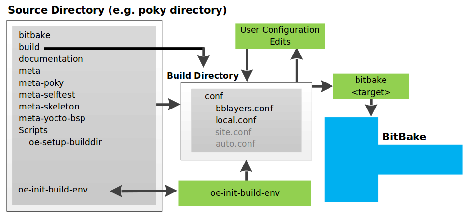

# Yocto

## 1. Tổng quan

### 1.1. Yocto Project là gì?

Trước khi có Yocto Project (hoặc Buildroot), việc tạo một bản Linux cho hệ thống nhúng hoàn toàn thủ công như sau: tự tải kernel, rootfs và toolchain rồi build từng phần. Cách này rất dễ lỗi và khó bảo trì.

Yocto Project là một framework giúp xây dựng hệ điều hành Linux tùy biến cho hệ thống nhúng - hay nói ngắn gọn: Embedded Linux Distro Builder.

:::warning Yocto không phải là một Linux distro
Nó là bộ công cụ giúp tạo ra một bộ image hoàn chỉnh gồm: U-Boot, kernel, rootfs và SDK cross-compiler cho thiết bị target.
:::

### 1.2. Các thành phần chính

| Thành phần                        | Vai trò                                                                                   |
| --------------------------------- | ----------------------------------------------------------------------------------------- |
| **BitBake**                       | Build engine: đọc metadata, sắp xếp và chạy các task                                      |
| **OpenEmbedded-Core** (`meta/`)   | Bộ recipe, class, config lõi dùng chung (gcc, glibc, busybox, systemd,...)                |
| **meta-poky**                     | Cấu hình distro mẫu tên `poky`                                                            |
| **meta-yocto-bsp**                | BSP mẫu cho một số board (`beaglebone-yocto`, `genericx86-64`,...)                        |
| **Poky**                          | Bản reference gom tất cả thứ trên + script (`oe-init-build-env`, `runqemu`, `devtool`,...) |
| **Communication Layer**           | `meta-openembedded`, `meta-raspberrypi`, `meta-ti`, `meta-qt5`,... tra tại [OpenEmbedded Layer Index](https://layers.openembedded.org) |

### 1.3. Luồng build tổng quan

```
local.conf + bblayers.conf + các layer (recipe, class, conf)
                       |
                       v
       BitBake: parse metadata -> tạo task graph
                       |
                       v
     Với từng recipe: fetch -> compile -> install -> package
                       |
                       v
     Image recipe: gom package -> do_rootfs -> do_image
                       |
                       v
     tmp/deploy/images/<machine>/  (u-boot, kernel, dtb, rootfs, .wic)
```

Toàn bộ tài liệu này đi theo đúng luồng trên.

### 1.4. Phiên bản

Mỗi release Yocto có một tên mã. Bản LTS ra 2 năm một lần (tháng 4) và được hỗ trợ 4 năm. Tài liệu này áp dụng cho cả hai bản LTS đang dùng phổ biến:

|                           | Kirkstone                  | Scarthgap                                   |
| ------------------------- | -------------------------- | ------------------------------------------- |
| Version                   | 4.0 LTS                    | 5.0 LTS                                     |
| Phát hành                 | 04/2022                    | 04/2024                                     |
| BitBake                   | 2.0                        | 2.8                                         |
| Kernel `linux-yocto`      | 5.15                       | 6.6                                         |
| GCC / glibc               | 11 / 2.35                  | 13 / 2.39                                   |
| Python tối thiểu trên host | 3.6                       | 3.8                                         |
| Ubuntu host hỗ trợ        | 18.04, 20.04, 22.04        | 20.04, 22.04, 24.04                         |
| Thư mục chứa class        | `classes/`                 | `classes-recipe/`, `classes-global/`, `classes/` |
| Tên file image            | `<image>-<machine>.ext4`   | `<image>-<machine>.rootfs.ext4`             |
| `PV` của recipe git       | `"1.0+git${SRCPV}"`        | `"1.0+git"`                                 |
| Template `local.conf`     | `meta-poky/conf/*.sample`  | `meta-poky/conf/templates/default/*.sample` |
| Script dọn sstate         | `sstate-cache-management.sh` | `sstate-cache-management.py`              |

:::warning Chú ý
Mọi layer dùng chung (meta-openembedded, meta-ti, meta-raspberrypi,...) phải checkout cùng nhánh với poky. Trộn layer nhánh `kirkstone` với poky nhánh `scarthgap` sẽ báo lỗi `layer is not compatible with the core layer`.
:::

Danh sách đầy đủ các release: https://wiki.yoctoproject.org/wiki/Releases

### 1.5. So sánh Yocto và Buildroot

|           | Yocto                                         | Buildroot                                 |
| --------- | --------------------------------------------- | ----------------------------------------- |
| Cấu hình  | Layer + recipe (BitBake)                      | `menuconfig` (Kconfig) + Makefile         |
| Output    | Image + package feed (rpm/deb/ipk) + SDK      | Image rootfs                              |
| Rebuild   | Incremental nhờ sstate-cache                  | Đổi config lớn thường phải build lại hết  |
| Độ khó    | Cao                                           | Thấp                                      |
| Phù hợp   | Sản phẩm lớn, nhiều board, làm việc nhóm      | Dự án nhỏ, image đơn giản                 |

## 2. Các khái niệm cốt lõi

### 2.1. Metadata

Metadata là tập hợp tất cả các file mà BitBake đọc để biết cần build cái gì và build như thế nào. Dưới đây là tổng hợp các loại file metadata:

| Loại file                   | Phần mở rộng                      | Vai trò                                                          |
| --------------------------- | --------------------------------- | ---------------------------------------------------------------- |
| **Recipe**                  | `.bb`                             | Định nghĩa cách build một package                                |
| **Append**                  | `.bbappend`                       | Ghi đè hoặc mở rộng recipe đã có từ layer khác                   |
| **Class**                   | `.bbclass`                        | Gom logic build chung cho nhiều recipe                           |
| **Include**                 | `.inc`                            | Đoạn metadata dùng chung, được `include`/`require` vào recipe    |
| **Configuration**           | `.conf`                           | Thiết lập biến cấu hình: version, distro, machine, layer path    |
| **Layer configuration**     | `layer.conf`                      | Khai báo phạm vi và ưu tiên của layer                            |
| **Distro & Machine config** | `distro/*.conf`, `machine/*.conf` | Định nghĩa đặc trưng của bản phân phối và phần cứng mục tiêu     |

### 2.2. Thuật ngữ

| Thuật ngữ   | Ý nghĩa                                                                               |
| ----------- | ------------------------------------------------------------------------------------- |
| **Recipe**  | Công thức build cho 1 phần mềm (file `.bb`)                                           |
| **Task**    | Một bước trong recipe: `do_fetch`, `do_compile`, `do_install`,...                      |
| **Package** | Gói output của recipe (`.rpm`/`.deb`/`.ipk`). 1 recipe có thể sinh nhiều package       |
| **Image**   | Recipe đặc biệt gom nhiều package thành rootfs hoàn chỉnh                              |
| **Layer**   | Thư mục gom nhóm metadata liên quan (`meta-xxx`)                                      |
| **Machine** | Mô tả phần cứng target: CPU, kernel, device tree, bootloader                          |
| **Distro**  | Chính sách của OS: init system, libc, feature mặc định                                |

## 3. Setup môi trường build

### 3.1. Yêu cầu về host

| Resource         | Minimum               | Recommended              |
| ---------------- | --------------------- | ------------------------ |
| Disk space       | 90 GB                 | 150 GB+                  |
| RAM              | 8 GB                  | 16 GB+                   |
| CPU cores        | 4                     | 8+                       |
| OS               | Ubuntu 22.04 LTS      | Ubuntu 22.04 LTS         |
| First build time | 2 đến 4 giờ (4 cores) | 1 đến 2 giờ (8+ cores)   |

### 3.2. Cài các package

:::code-group
```bash [kirkstone]
sudo apt update
sudo apt install gawk wget git diffstat unzip texinfo gcc build-essential \
    chrpath socat cpio python3 python3-pip python3-pexpect xz-utils \
    debianutils iputils-ping python3-git python3-jinja2 libegl1-mesa \
    libsdl1.2-dev python3-subunit mesa-common-dev zstd liblz4-tool file locales
sudo locale-gen en_US.UTF-8
```
```bash [scarthgap]
sudo apt update
sudo apt install gawk wget git diffstat unzip texinfo gcc build-essential \
    chrpath socat cpio python3 python3-pip python3-pexpect xz-utils \
    debianutils iputils-ping python3-git python3-jinja2 python3-subunit \
    zstd liblz4-tool file locales libacl1
sudo locale-gen en_US.UTF-8
```
:::

### 3.3. Clone poky

:::code-group
```bash [kirkstone]
mkdir -p ~/yocto && cd ~/yocto
git clone -b kirkstone git://git.yoctoproject.org/poky.git
cd poky
```
```bash [scarthgap]
mkdir -p ~/yocto && cd ~/yocto
git clone -b scarthgap git://git.yoctoproject.org/poky.git
cd poky
```
:::

Các layer khác clone cùng cấp với `poky/` và cùng nhánh, ví dụ:

:::code-group
```bash [kirkstone]
cd ~/yocto
git clone -b kirkstone https://github.com/openembedded/meta-openembedded.git
```
```bash [scarthgap]
cd ~/yocto
git clone -b scarthgap https://github.com/openembedded/meta-openembedded.git
```
:::

### 3.4. Khởi tạo môi trường build

Trước khi sử dụng bất kỳ lệnh BitBake nào, ta bắt buộc phải khởi tạo môi trường build:

```bash
source oe-init-build-env [build-directory]
```

Trong đó:

- `source` là lệnh nội bộ của shell, nó khởi tạo các biến môi trường ngay trong shell hiện tại, tức là mọi biến môi trường sẽ chỉ có tác dụng trong chính shell đó và không có giá trị đối với các shell khác. Mở terminal mới thì phải `source` lại.
- `[build-directory]` là tùy chọn. Nếu không truyền, script tạo thư mục `build/` trong thư mục hiện tại.

Khi chạy, script này sẽ:
1. Set `$OEROOT`: thư mục gốc của poky.
2. Set `$BUILDDIR`: thư mục output (mặc định `build`, nếu build cho nhiều board thì nên tách riêng, ví dụ `build-bbb`, `build-rpi`).
3. Thiết lập các biến môi trường: `BBPATH`, `PATH`,...
4. Tạo `$BUILDDIR/conf/local.conf` và `bblayers.conf` từ file mẫu nếu chưa tồn tại.
5. `cd` vào thư mục `$BUILDDIR`.



## 4. Cấu trúc thư mục build

Sau khi khởi tạo môi trường và chạy build, thư mục `build/` sẽ có cấu trúc như sau:

```
build/
├── cache/                          <- Cache metadata đã parse
├── conf/                           <- Cấu hình người dùng
│   ├── bblayers.conf
│   └── local.conf
├── downloads/                      <- Source code tải về
├── sstate-cache/                   <- Cache kết quả build
└── tmp/                            <- Toàn bộ output
    ├── deploy/
    │   ├── images/                 <- Image cuối cùng
    │   ├── rpm/ (deb/, ipk/)       <- Package đã build
    │   ├── sdk/                    <- SDK (nếu build)
    │   └── licenses/               <- License của package
    ├── work/                       <- Thư mục làm việc của từng recipe
    ├── sysroots-components/        <- Header/lib chia sẻ giữa các recipe
    ├── pkgdata/                    <- Metadata của package (dùng cho oe-pkgdata-util)
    ├── stamps/                     <- Đánh dấu task đã chạy xong
    └── log/
```

### 4.1. `conf/` - Cấu hình người dùng

Đây là nơi BitBake đọc đầu tiên khi bắt đầu build.

| File            | Vai trò                                                                                                              |
| --------------- | -------------------------------------------------------------------------------------------------------------------- |
| `local.conf`    | Cấu hình build cụ thể: chọn `MACHINE`, `DISTRO`, đường dẫn `DL_DIR`, `SSTATE_DIR`, số luồng build, image feature,... |
| `bblayers.conf` | Liệt kê các layer mà BitBake sẽ load (meta, meta-poky, meta-ti, meta-custom,...).                                    |

### 4.2. `cache/` - Cache metadata

BitBake cache kết quả parse của các file `.bb`, `.bbclass`, `.conf` tại đây. Ở lần build sau, BitBake không cần parse lại - giúp tăng tốc build đáng kể.

Nếu thay đổi recipe hoặc class, BitBake sẽ tự động invalidate cache và parse lại phần bị thay đổi. Không cần xóa cache thủ công.

### 4.3. `downloads/` - Source code tải về

Chứa toàn bộ source code từ git clone, tarball, patch,... mà các recipe yêu cầu. Mỗi file tải xong có kèm một file `.done` để BitBake biết không cần tải lại.

Mặc định đường dẫn được set trong `local.conf`:

```bash
DL_DIR ?= "${TOPDIR}/downloads"
```

:::tip
Có thể chia sẻ thư mục này giữa nhiều build để tiết kiệm thời gian và băng thông tải source. Chỉ cần trỏ `DL_DIR` về cùng một đường dẫn.
:::

### 4.4. `tmp/` - Toàn bộ kết quả build

Mọi thứ Yocto sinh ra đều nằm trong `tmp/`.

**`tmp/deploy/` - Sản phẩm cuối cùng:**

| Thư mục con            | Vai trò                                                                                             |
| ---------------------- | --------------------------------------------------------------------------------------------------- |
| `images/<machine>/`    | Chứa các file image đã build: kernel, rootfs, u-boot, SD card image (`.wic`, `.ext4`, `.dtb`,...)   |
| `rpm/`, `deb/`, `ipk/` | Package đã build, có thể dùng làm package feed                                                     |
| `licenses/`            | Lưu license của từng package (theo quy định GPL).                                                   |
| `sdk/`                 | Chứa SDK nếu chạy `bitbake <image> -c populate_sdk`.                                                |

**`tmp/work/` - Thư mục làm việc của từng recipe:**

Cấu trúc tổng quát:

```
tmp/work/
 └── <arch>/                            <- Ví dụ: cortexa8hf-neon-poky-linux-gnueabi
      └── <recipe>/
          └── <version>-r<revision>/    <- Đây chính là ${WORKDIR}
               ├── temp/                <- log và script của từng task
               │   └── log.do_<task>    <- log.do_fetch, log.do_compile,...
               ├── build/               <- Nơi compile (${B})
               ├── image/               <- Kết quả do_install (${D})
               └── packages-split/      <- File đã chia theo từng package
```

Từ cấu trúc trên, ta có một số thông tin như sau:
- Khi `do_compile`, BitBake thực hiện compile tại folder `build/`.
- Khi `do_install`, tất cả file mà recipe muốn cài vào rootfs sẽ nằm ở folder `image/`.
- Log chi tiết của từng task nằm trong `temp/log.do_<task>` - rất hữu ích khi debug.

### 4.5. `sstate-cache/` - Shared State Cache

Đây là thư mục quan trọng nhất giúp tăng tốc build. Mỗi recipe phải đi qua nhiều task, nếu lần nào cũng build lại từ đầu thì rất lãng phí.

**Cơ chế hoạt động:**

Khi một task build thành công, BitBake thực hiện:
1. Tính hash signature dựa trên toàn bộ input của task: source code, cấu hình biến, toolchain, dependency,... Mọi yếu tố ảnh hưởng đến kết quả build đều tham gia vào hash.
2. Đóng gói toàn bộ output của task đó vào một file nén.
3. Lưu file nén vào `sstate-cache/`.

Ở lần build tiếp theo, trước khi chạy task, BitBake sẽ thực hiện:
1. Tính lại hash signature cho task đó.
2. Tìm trong `sstate-cache/` xem có file nào có hash khớp không.
3. Nếu hash khớp $\rightarrow$ giải nén output từ cache, bỏ qua hoàn toàn bước build $\rightarrow$ tiết kiệm rất nhiều thời gian.
4. Nếu hash không khớp (source, config, dependency thay đổi) $\rightarrow$ build lại task đó từ đầu rồi tạo file sstate mới.

**Cấu trúc bên trong `sstate-cache/`:**

```
sstate-cache/
├── 1a/
│   └── sstate:busybox:cortexa8hf-neon-poky-linux-gnueabi:1.36.1:r0:...:1a2b3c..._package.tar.zst
├── 5f/
│   └── sstate:glibc:...:5f6e7d..._populate_sysroot.tar.zst
└── ...
```

Mỗi file được đặt tên theo pattern: `sstate:<recipe>:<arch>:<version>:<revision>:...:<hash>_<task>.tar.zst`. Các thư mục con (`1a/`, `5f/`,...) là 2 ký tự đầu của hash, dùng để phân tán file tránh một thư mục chứa quá nhiều file.

**Ví dụ minh họa:**

Giả sử lần đầu build `busybox`, task `do_compile` mất 2 phút. BitBake lưu kết quả vào sstate. Lần build sau, nếu không thay đổi gì liên quan đến busybox, BitBake chỉ cần giải nén file sstate trong vài giây thay vì compile lại 2 phút.

Nhưng nếu ta thay đổi `CFLAGS` trong `local.conf`, hash sẽ khác $\rightarrow$ BitBake compile lại busybox từ đầu.

:::tip Tăng tốc độ build cho cả team
Có thể chia sẻ `sstate-cache/` giữa nhiều máy build để tăng tốc build cho cả team. Chỉ cần đảm bảo các máy có cùng cấu hình build (cùng nhánh layer, toolchain version, distro features, `MACHINE`,...), nếu không hash sẽ khác và cache sẽ không được reuse.

```bash
# Trỏ sstate-cache về thư mục chung trên NFS hoặc server
SSTATE_DIR = "/shared/yocto/sstate-cache"
```
:::

:::warning Chú ý
Thư mục `sstate-cache/` sẽ phình to theo thời gian vì mỗi lần thay đổi config sẽ tạo file sstate mới (file cũ không tự xóa). Cách dọn dẹp xem ở mục 12.9.
:::

## 5. BitBake

### 5.1. BitBake là gì?

BitBake là một build engine cốt lõi của Yocto. Nếu ví Yocto như một nhà máy sản xuất Linux thì BitBake chính là người quản đốc - nó không tự viết code hay compile nhưng nó điều phối mọi thứ: đọc công thức (recipe), kiểm tra nguyên vật liệu (dependency), sắp xếp thứ tự sản xuất (task graph) và phân công công nhân (parallel build).

**So sánh với `make`:** Cả hai đều là build system nhưng `make` chỉ xử lý được một project đơn lẻ. BitBake được thiết kế để quản lý hàng nghìn package cùng lúc với dependency chằng chịt giữa chúng và mỗi package có thể lấy source từ nguồn khác nhau (git, tarball, file local,...).

### 5.2. Quy trình làm việc của BitBake

Khi ta gõ `bitbake core-image-minimal`, BitBake sẽ thực hiện theo trình tự:
1. Parse cấu hình: Đọc `local.conf` và `bblayers.conf` để biết `MACHINE`, `DISTRO`, danh sách layer.
2. Parse metadata: Quét tất cả layer, đọc toàn bộ file `.bb`, `.bbappend`, `.bbclass`, `.conf` để xây dựng bức tranh toàn cảnh về mọi recipe có sẵn.
3. Phân giải target: Từ target `core-image-minimal`, BitBake tìm recipe tương ứng rồi đệ quy tìm toàn bộ dependency (`DEPENDS`, `RDEPENDS`) để biết cần build những gì.
4. Xây dựng Task Graph: Sắp xếp tất cả task của tất cả recipe thành một DAG (đồ thị có hướng không chu trình). Task nào được phụ thuộc sẽ chạy trước.
5. Kiểm tra sstate-cache: Với mỗi task, BitBake kiểm tra xem kết quả đã có trong cache chưa. Nếu có thì bỏ qua. Nếu không thì đưa vào hàng đợi để thực thi.
6. Thực thi song song: BitBake chạy các task song song nếu chúng không phụ thuộc nhau. Ví dụ: `do_compile` của `busybox` và `do_compile` của `nano` có thể chạy cùng lúc.
7. Đóng gói image: Sau khi tất cả recipe đã build xong, BitBake chạy các task tạo rootfs, đóng gói thành file image cuối cùng.

### 5.3. Cú pháp lệnh

```
bitbake [options] <target>
bitbake <target> [options]
```

Trong đó:
- `<target>` là recipe hoặc image cần build, ví dụ: `busybox`, `core-image-minimal`, `virtual/kernel`.
- `[options]` là các tham số điều khiển hành vi của BitBake.

### 5.4. Các lệnh thường dùng

| Lệnh                                | Mô tả                                                | Khi nào dùng?                                 |
| ----------------------------------- | ---------------------------------------------------- | --------------------------------------------- |
| `bitbake <target>`                  | Build recipe hoặc image                              | Build bình thường                             |
| `bitbake -c <task> <target>`        | Chạy một task cụ thể                                 | Debug từng bước                               |
| `bitbake -c listtasks <target>`     | Liệt kê toàn bộ task của recipe                      | Xem recipe có những task nào                  |
| `bitbake -f -c <task> <target>`     | Ép chạy lại task dù đã chạy rồi                      | Khi sửa source trực tiếp trong `tmp/work`     |
| `bitbake -c clean <target>`         | Xóa output build của recipe                          | Muốn build lại recipe                         |
| `bitbake -c cleansstate <target>`   | `clean` + xóa sstate của recipe                      | Nghi cache bị hỏng, cần build lại thật sự     |
| `bitbake -c cleanall <target>`      | `cleansstate` + xóa source đã tải trong `DL_DIR`     | Source tải về bị lỗi                          |
| `bitbake -c devshell <target>`      | Mở shell trong môi trường build của recipe           | Chạy thử lệnh compile bằng tay                |
| `bitbake -e <target>`               | In toàn bộ biến sau khi parse                        | Debug giá trị biến: `WORKDIR`, `S`, `D`,...   |
| `bitbake-getvar -r <target> <VAR>`  | In giá trị 1 biến và nơi nó được gán                 | Gọn hơn `bitbake -e \| grep`                  |
| `bitbake -p`                        | Chỉ parse metadata, không build                      | Kiểm tra cú pháp recipe có lỗi không          |
| `bitbake -k <target>`               | Gặp lỗi vẫn build tiếp phần không liên quan          | Build lâu, muốn thấy hết lỗi một lần          |
| `bitbake -g <target>`               | Xuất dependency graph, không build                   | Tìm vì sao package bị kéo vào image           |

:::tip Phân biệt `clean`, `cleansstate`, `cleanall`
- `bitbake -c clean <recipe>` chỉ xóa thư mục `tmp/work/<...>/<recipe>/` - kết quả build cục bộ. Nếu sstate còn, lần build sau BitBake vẫn lấy lại từ cache chứ không compile lại.
- `bitbake -c cleansstate <recipe>` xóa thêm cả file trong `sstate-cache/` - buộc BitBake phải build lại từ đầu.
- `bitbake -c cleanall <recipe>` xóa thêm cả source đã tải trong `downloads/`.

Dùng `cleansstate` khi nghi ngờ cache bị stale hoặc corrupt, dùng `cleanall` khi file tải về bị hỏng.
:::

## 6. Cú pháp metadata

Recipe, class và file `.conf` đều dùng chung cú pháp BitBake. Hiểu phần này giúp tránh phần lớn lỗi sửa biến mà không có tác dụng.

### 6.1. Toán tử gán

| Cú pháp            | Ý nghĩa                                                           |
| ------------------ | ----------------------------------------------------------------- |
| `A = "x"`          | Gán. `${...}` bên trong được expand lúc biến được dùng (lazy)     |
| `A := "x"`         | Gán và expand ngay lập tức                                        |
| `A ?= "x"`         | Gán nếu `A` chưa có giá trị (giá trị mặc định)                    |
| `A ??= "x"`        | Mặc định yếu: chỉ áp dụng khi kết thúc parse mà không ai gán `A`  |
| `A += "x"`         | Nối vào sau, có dấu cách                                          |
| `A =+ "x"`         | Nối vào trước, có dấu cách                                        |
| `A .= "x"`         | Nối vào sau, không dấu cách                                       |
| `A =. "x"`         | Nối vào trước, không dấu cách                                     |
| `A:append = " x"`  | Nối vào sau, áp dụng sau cùng, không tự thêm dấu cách             |
| `A:prepend = "x "` | Nối vào trước, áp dụng sau cùng                                   |
| `A:remove = "x"`   | Xóa mọi từ `x` khỏi `A`, áp dụng sau cùng                         |

:::warning `+=` và `:append` khác nhau
`+=` được thực hiện ngay tại dòng đó, còn `:append` được thực hiện sau khi parse xong mọi file. Ví dụ `local.conf` được parse trước image recipe:

```bash
# local.conf
IMAGE_INSTALL += "nano"            # bị image recipe gán đè sau đó -> mất
IMAGE_INSTALL:append = " nano"     # áp dụng sau cùng -> luôn có tác dụng
```

Vì vậy khi sửa biến từ `local.conf` hoặc `.bbappend` nên dùng `:append`/`:remove`. Nhớ thêm dấu cách đầu với `:append`.
:::

:::tip Cú pháp cũ
Kirkstone và Scarthgap đều dùng dấu hai chấm: `IMAGE_INSTALL:append`, `RDEPENDS:${PN}`. Cú pháp gạch dưới (`IMAGE_INSTALL_append`, `RDEPENDS_${PN}`) chỉ dùng cho bản Honister (3.4) trở về trước, nếu gặp trong layer cũ thì phải chuyển sang dấu hai chấm. Poky có sẵn script `scripts/contrib/convert-overrides.py` để chuyển tự động.
:::

### 6.2. Override có điều kiện

Thêm `:<override>` sau tên biến để giá trị chỉ có tác dụng trong ngữ cảnh đó:

```bash
RDEPENDS:${PN} = "libcurl"                 # chỉ áp dụng cho package ${PN}
PACKAGECONFIG:pn-curl = "ssl"              # chỉ áp dụng cho recipe curl (dùng trong local.conf)
KERNEL_DEVICETREE:beaglebone-yocto = "..." # chỉ khi MACHINE = beaglebone-yocto
EXTRA_OECMAKE:append:class-native = " -DX=1" # chỉ khi build bản native (chạy trên host)
```

### 6.3. Python inline

`${@...}` cho phép chạy biểu thức Python khi expand biến. `d` là datastore chứa mọi biến:

```bash
# Nếu DISTRO_FEATURES có systemd thì dùng systemd, ngược lại sysvinit
INIT = "${@bb.utils.contains('DISTRO_FEATURES', 'systemd', 'systemd', 'sysvinit', d)}"

# Đọc giá trị biến khác
MY_DIR = "${@d.getVar('WORKDIR')}/extra"
```

### 6.4. `include`, `require`, `inherit`

| Lệnh                  | Tác dụng                                               |
| --------------------- | ------------------------------------------------------ |
| `include file.inc`    | Chèn nội dung file, không báo lỗi nếu không tìm thấy   |
| `require file.inc`    | Chèn nội dung file, báo lỗi nếu không tìm thấy         |
| `inherit cmake`       | Chèn class `classes*/cmake.bbclass` (xem mục 7.5)      |

## 7. Recipe

### 7.1. Recipe là gì?

Mỗi recipe (file `.bb`) là công thức build một phần mềm cụ thể. Nếu BitBake là quản đốc thì recipe là bản vẽ kỹ thuật cho từng sản phẩm.

Recipe nói cho BitBake biết:
- Lấy source ở đâu? git, tarball, file local.
- Compile như thế nào? gcc, cmake, autotools, hay script tùy chỉnh.
- Cài vào rootfs ra sao? file nào vào `/usr/bin`, file nào vào `/etc`.
- Phụ thuộc vào gì? cần library, tool nào build trước.
- Thông tin đi kèm? license, version, mô tả.

**Tên file recipe:**

```
<tên-package>_<version>.bb

ví dụ:
hello-world_1.0.bb      -> PN = hello-world, PV = 1.0
myapp_2.3.1.bb          -> PN = myapp, PV = 2.3.1
myapp_git.bb            -> lấy source từ git, version theo commit
busybox_%.bbappend      -> % khớp mọi version (chỉ dùng cho .bbappend)
```

### 7.2. Cấu trúc của một recipe

Cấu trúc cơ bản của một recipe sẽ gồm các thành phần sau:

| Thành phần                             | Vai trò                                                 |
| -------------------------------------- | ------------------------------------------------------- |
| **Biến (`VARIABLES`)**                 | Thông tin cấu hình: `SRC_URI`, `DEPENDS`, `LICENSE`,... |
| **Task (`do_*`)**                      | Hành động: fetch, compile, install, package,...         |
| **Inheritance (`inherit ...`)**        | Kế thừa logic từ `.bbclass`                             |
| **Dependency (`DEPENDS`, `RDEPENDS`)** | Xác định package cần build trước hoặc cài cùng.         |
| **Output Packages (`PACKAGES`)**       | Xác định các gói nhỏ sinh ra từ recipe.                 |

Ví dụ recipe đơn giản:

```bash
SUMMARY = "Simple Hello World Application"
LICENSE = "MIT"
LIC_FILES_CHKSUM = "file://${COMMON_LICENSE_DIR}/MIT;md5=0835ade698e0bcf8506ecda2f7b4f302"

SRC_URI = "file://main.c"

S = "${WORKDIR}"

do_compile() {
    ${CC} ${CFLAGS} ${LDFLAGS} main.c -o hello
}

do_install() {
    install -d ${D}${bindir}
    install -m 0755 hello ${D}${bindir}/hello
}
```

:::tip Khi nâng lên bản sau Scarthgap
Từ Styhead (5.1) trở đi, file `file://` được giải nén vào `${UNPACKDIR}` thay vì `${WORKDIR}` và không được đặt `S = "${WORKDIR}"` nữa. Recipe viết cho Kirkstone/Scarthgap như trên cần sửa thành `S = "${UNPACKDIR}"` khi nâng cấp.
:::

### 7.3. Các biến quan trọng

#### 7.3.1. Thông tin cơ bản

| Biến                 | Vai trò                                                              | Ví dụ                                         |
| -------------------- | -------------------------------------------------------------------- | --------------------------------------------- |
| `SUMMARY`            | Mô tả ngắn về recipe (1 dòng)                                        | `"MQTT broker and client"`                    |
| `DESCRIPTION`        | Mô tả chi tiết hơn                                                   | `"Mosquitto is an open source MQTT broker"`   |
| `HOMEPAGE`           | URL trang chủ                                                        | `"https://mosquitto.org/"`                    |
| `LICENSE`            | License của source                                                   | `"MIT"`, `"GPL-2.0-only"`, `"Apache-2.0"`     |
| `LIC_FILES_CHKSUM`   | File license + MD5. BitBake dùng để phát hiện license bị thay đổi    | `"file://LICENSE;md5=abc123..."`              |

#### 7.3.2. Source code

| Biến                 | Vai trò                                                  | Ví dụ                                                          |
| -------------------- | -------------------------------------------------------- | -------------------------------------------------------------- |
| `SRC_URI`            | Danh sách nơi lấy source, patch, file config,...         | `"git://github.com/user/app.git;branch=main;protocol=https"`   |
| `SRCREV`             | Commit hash khi dùng git                                 | `"abcdef1234567890abcdef1234567890abcdef12"`                   |
| `SRC_URI[sha256sum]` | Checksum tarball để xác minh file tải về                 | `"a1b2c3d4e5f6..."`                                            |

#### 7.3.3. Tên và thư mục build

BitBake tự tính các biến này dựa trên tên recipe, version và kiến trúc target:

| Biến      | Ý nghĩa                                         | Ví dụ giá trị                         |
| --------- | ----------------------------------------------- | ------------------------------------- |
| `PN`      | Package name (tên recipe)                       | `myapp`                               |
| `PV`      | Package version                                 | `1.0`                                 |
| `PR`      | Package revision                                | `r0`                                  |
| `WORKDIR` | Thư mục làm việc chính của recipe               | `tmp/work/.../myapp/1.0-r0/`          |
| `S`       | Source directory - nơi chứa source sau unpack   | `${WORKDIR}/git`                      |
| `B`       | Build directory - nơi compiler chạy             | `${WORKDIR}/build` (hoặc `${S}`)      |
| `D`       | Destination directory - staging install         | `${WORKDIR}/image`                    |
| `T`       | Temp directory - log và script của task         | `${WORKDIR}/temp`                     |

:::tip Khi nào cần set `S`?
- `SRC_URI` dùng `git://` $\rightarrow$ source nằm ở `${WORKDIR}/git` nên cần `S = "${WORKDIR}/git"`.
- `SRC_URI` dùng tarball $\rightarrow$ mặc định `S = "${WORKDIR}/${BP}"` (`${BP}` = `${BPN}-${PV}`), thường không cần set.
- `SRC_URI` chỉ có `file://...` $\rightarrow$ file nằm ngay `${WORKDIR}` nên cần `S = "${WORKDIR}"`.
:::

#### 7.3.4. Dependency

| Biến          | Vai trò                                                                                   | Ví dụ                                   |
| ------------- | ----------------------------------------------------------------------------------------- | --------------------------------------- |
| `DEPENDS`     | Build-time dependency - các package cần có khi compile. BitBake sẽ build chúng trước.     | `"qtbase qtmqtt mosquitto"`             |
| `RDEPENDS`    | Runtime dependency - các package cần có khi chạy trên target. Sẽ được cài cùng vào image. | `RDEPENDS:${PN} = "mosquitto libcurl"`  |
| `RRECOMMENDS` | Như `RDEPENDS` nhưng chỉ là nên có - image có thể loại bỏ được                          | `RRECOMMENDS:${PN} = "ca-certificates"` |

`DEPENDS` hoạt động ở cấp recipe, còn `RDEPENDS` hoạt động ở cấp package. Một recipe có thể sinh ra nhiều package nên `RDEPENDS` luôn cần chỉ rõ package nào đang được nói đến, vì vậy ta hay thấy cú pháp `RDEPENDS:${PN}` thay vì chỉ `RDEPENDS`.

Ví dụ recipe `curl` có thể sinh ra các package: `curl` (binary), `libcurl` (shared library), `curl-dev` (header). Mỗi package có thể có `RDEPENDS` riêng:

```bash
RDEPENDS:${PN} = "libcurl"                      # binary curl cần libcurl để chạy
RDEPENDS:libcurl = "ca-certificates"            # libcurl cần cert lúc runtime
```

Ngoài ra, `DEPENDS` không trực tiếp ảnh hưởng đến kích thước image vì nó chỉ tồn tại trên máy build. Nhưng `RDEPENDS` ảnh hưởng rất lớn, bởi vì mọi package trong `RDEPENDS` sẽ tự động bị kéo vào image. Và mỗi package đó lại có `RDEPENDS` của riêng nó, tạo thành một chuỗi phụ thuộc dây chuyền.

Ví dụ thực tế: ta thêm một ứng dụng nhỏ 200KB vào image, nhưng nó `RDEPENDS` lên `python3`, mà `python3` lại `RDEPENDS` lên hàng loạt module khác. Kết quả image phình thêm 30-40MB chỉ vì một ứng dụng nhỏ.

:::tip Shared library được tự thêm
Nếu binary link với `libz.so`, BitBake tự phát hiện và thêm package chứa `libz.so` vào runtime dependency. Không cần tự ghi `RDEPENDS` cho thư viện đã link.
:::

#### 7.3.5. Output và packaging

| Biến          | Vai trò                                                                                         | Ví dụ                                                     |
| ------------- | ----------------------------------------------------------------------------------------------- | --------------------------------------------------------- |
| `PACKAGES`    | Danh sách package recipe sinh ra. Mặc định: `${PN}-src ${PN}-dbg ${PN}-staticdev ${PN}-dev ${PN}-doc ${PN}-locale ${PN}` | `"${PN} ${PN}-dev ${PN}-clients"` |
| `FILES:<pkg>` | File/thư mục thuộc package đó                                                                   | `FILES:${PN} += "${datadir}/myapp"`                       |
| `PROVIDES`    | Khai báo virtual name mà recipe này cung cấp để recipe khác tham chiếu                          | `PROVIDES = "virtual/kernel"`                             |

#### 7.3.6. Nhóm Filesystem - Dùng trong `do_install()`

Đây là các biến chuẩn trỏ đến đường dẫn trong Linux filesystem. Dùng chúng thay vì hardcode path để đảm bảo recipe hoạt động đúng trên mọi kiến trúc và distro.

| Biến                     | Giá trị chuẩn             | Mục đích                     |
| ------------------------ | ------------------------- | ---------------------------- |
| `bindir`                 | `/usr/bin`                | Binary cho người dùng        |
| `sbindir`                | `/usr/sbin`               | System binary                |
| `base_bindir`            | `/bin`                    | Binary cơ bản                |
| `libdir`                 | `/usr/lib`                | Thư viện (`.so`)             |
| `includedir`             | `/usr/include`            | Header files                 |
| `sysconfdir`             | `/etc`                    | File config                  |
| `datadir`                | `/usr/share`              | Data (icons, fonts, qml,...) |
| `localstatedir`          | `/var`                    | Data runtime                 |
| `systemd_system_unitdir` | `/lib/systemd/system`     | File `.service`              |

### 7.4. Vòng đời của một recipe (task)

```
do_fetch -> do_unpack -> do_patch -> do_configure -> do_compile -> do_install
                                                                       |
                                       +-------------------------------+
                                       |                               |
                                       v                               v
                             do_populate_sysroot           do_package -> do_package_write_rpm
                        (header/lib cho recipe khác)           (tạo .rpm/.deb/.ipk)

Image recipe:  do_rootfs -> do_image -> do_image_complete
```

#### 7.4.1. do_fetch: Tải source code

Task đầu tiên trong vòng đời recipe, chịu trách nhiệm tải source code hoặc patch cần thiết từ các vị trí trong `SRC_URI` về `${DL_DIR}`.

```bash
SRC_URI = "<protocol>://<location>;<param1>=<value>;<param2>=<value>"
```

Với mỗi loại URI sẽ được xử lý theo cách thức khác nhau:
- `file://` - File cục bộ nằm cạnh recipe (cách BitBake tìm file này xem mục 8.6).
- `git://` - Git repository, ví dụ `git://github.com/user/app.git;protocol=https;branch=main`.
- `https://` - Tải tarball qua HTTPS, cần kèm `SRC_URI[sha256sum]`.

Khi `do_fetch` hoàn thành, BitBake tạo file `.done_fetch` trong `${WORKDIR}` để đánh dấu task đã xong. Nhờ đó, lần build sau sẽ bỏ qua bước fetch nếu source không thay đổi.

#### 7.4.2. do_unpack: Giải nén source

Giải nén source từ `${DL_DIR}` vào `${WORKDIR}`. Nếu là git repo thì checkout đúng commit `SRCREV`.

#### 7.4.3. do_patch: Apply patch vào source

Apply các file `.patch` trong `SRC_URI` vào source, theo đúng thứ tự liệt kê.

**Tại sao cần patch?** Source trong `tmp/work/` được unpack lại mỗi khi recipe build lại từ đầu nên sửa trực tiếp ở đó sẽ bị mất và cũng không chia sẻ được cho người khác. Cách đúng là đưa thay đổi thành file `.patch` trong layer:

```bash
SRC_URI += "file://0001-fix-crash.patch"
```

Cách tạo patch nhanh nhất là dùng `devtool`.

#### 7.4.4. do_configure: Cấu hình trước khi compile

Chạy bước cấu hình cho project, ví dụ:
- Với CMake project $\rightarrow$ chạy `cmake` để generate Makefile.
- Với Autotools project $\rightarrow$ chạy `./configure`.
- Với Meson project $\rightarrow$ chạy `meson setup`.

Task này thường được cung cấp dưới dạng class kế thừa (`inherit cmake`, `inherit autotools`,...). Tham số thêm cho bước configure truyền qua `EXTRA_OECMAKE`, `EXTRA_OECONF`, `EXTRA_OEMESON`. Nếu recipe không inherit class nào, ta có thể tự viết `do_configure()`.

#### 7.4.5. do_compile: Biên dịch source code

Mặc định chạy `oe_runmake` (tương đương `make`). Có thể override:

```bash
do_compile() {
    ${CC} ${CFLAGS} ${LDFLAGS} -o myapp src/main.c src/utils.c
}
```

Quá trình compile diễn ra trong thư mục `${B}` (Build directory).

:::warning Chú ý
Luôn dùng `${CC}`, `${CFLAGS}`, `${LDFLAGS}` thay vì gọi `gcc`. Gọi `gcc` trực tiếp sẽ compile ra binary cho máy host, không chạy được trên board. Thiếu `${LDFLAGS}` sẽ bị lỗi QA `No GNU_HASH in the ELF binary`.
:::

#### 7.4.6. do_install: Cài đặt vào staging directory

Copy các file cần thiết vào staging directory `${D}`. Đây không phải rootfs thật, chỉ là thư mục tạm để BitBake biết recipe muốn cài gì.

```bash
do_install() {
    install -d ${D}${bindir}
    install -m 0755 ${B}/myapp ${D}${bindir}/myapp

    install -d ${D}${sysconfdir}
    install -m 0644 ${WORKDIR}/myapp.conf ${D}${sysconfdir}/myapp.conf
}
```

Lệnh `install` là lệnh copy có thêm khả năng set quyền và tạo thư mục:
- `-d`: tạo thư mục (đệ quy, như `mkdir -p`).
- `-m 0644`: set permission cho file được copy.

```
WORKDIR                       D (staging)                  Board
myapp        --install-->     ${D}/usr/bin/myapp     -->   /usr/bin/myapp
myapp.conf   --install-->     ${D}/etc/myapp.conf    -->   /etc/myapp.conf
```

:::warning Chú ý
File muốn có trong rootfs phải được copy vào `${D}`. Quên copy thì file không có trong image dù compile thành công.
:::

#### 7.4.7. do_populate_sysroot: Chia sẻ header/lib cho recipe khác

Task này copy header, thư viện, file `.pc`,... từ `${D}` vào sysroot dùng chung. Khi recipe B có `DEPENDS = "A"`, BitBake đưa phần sysroot của A vào thư mục `recipe-sysroot/` riêng của B để B compile được.

```
Recipe A (zlib)                         Recipe B (myapp, DEPENDS = "zlib")
${D}/usr/include/zlib.h  --populate-->  B/recipe-sysroot/usr/include/zlib.h
${D}/usr/lib/libz.so     --sysroot--->  B/recipe-sysroot/usr/lib/libz.so
```

Vì vậy nếu thiếu `DEPENDS`, B sẽ báo lỗi `zlib.h: No such file or directory` dù zlib đã được build xong cho recipe khác.

#### 7.4.8. do_package: Chia output thành các package con

Sau `do_install`, `${D}` chứa mọi thứ của recipe:

```
${D}/
├── usr/bin/myapp
├── usr/lib/libmyapp.so.1
├── usr/lib/libmyapp.so
├── usr/lib/libmyapp.so.1
├── usr/include/myapp.h
└── usr/share/doc/myapp/README
```

Không phải lúc nào cũng cần đưa tất cả vào image:
- Board production: chỉ cần binary, không cần header hay doc
- Board development: cần thêm header để compile

Vì vậy `do_package` lấy toàn bộ file trong `${D}` và chia thành các package con. BitBake có sẵn quy tắc mặc định theo `${PN}` (giản lược):

```bash
FILES:${PN}        = "${bindir}/* ${libdir}/lib*.so.*"  # myapp       <- binary, shared lib
FILES:${PN}-dev    = "${libdir}/*.so ${includedir}"     # myapp-dev   <- header file, .so symlink
FILES:${PN}-doc    = "${docdir}"                        # myapp-doc   <- documentation
FILES:${PN}-dbg    = "${bindir}/.debug ..."             # myapp-dbg   <- debug symbols
```

Kết quả sau `do_package`:

```
myapp        -> usr/bin/myapp, usr/lib/libmyapp.so.1
myapp-dev    -> usr/lib/libmyapp.so, usr/include/myapp.h
myapp-doc    -> usr/share/doc/myapp/README
myapp-dbg    -> debug symbols tách ra từ binary
```

Trong đó:
| Package           | Nội dung                                      |
| ----------------- | --------------------------------------------- |
| `${PN}`           | Binary và file runtime                        |
| `${PN}-dev`       | Header, `.so` symlink, `.pc` (dùng khi compile) |
| `${PN}-dbg`       | Debug symbols                                 |
| `${PN}-doc`       | Man page, documentation                       |
| `${PN}-staticdev` | Static library (`.a`)                         |

Ngoài ra, ta cũng có thể tự định nghĩa thêm package thay vì dùng mặc định dựa trên biến `PACKAGES`:

```bash
# Tạo package con hoàn toàn mới
PACKAGES =+ "myapp-plugins"
FILES:myapp-plugins = "${libdir}/myapp/plugins/*"
```

Tức là ta có thể đặt tên package tùy ý, không bắt buộc phải theo pattern `${PN}-dev`, `${PN}-lib`,...

:::warning Lỗi `installed-vs-shipped`
Nếu `do_install` cài file vào thư mục không nằm trong `FILES` của package nào, build báo lỗi QA:

```
QA Issue: myapp: Files/directories were installed but not shipped in any package:
  /usr/share/myapp/data.json
```

Cách sửa: thêm đường dẫn đó vào package, ví dụ `FILES:${PN} += "${datadir}/myapp"`.
:::

#### 7.4.9. do_rootfs: Đưa package vào root filesystem

Khi ta build image với config:

```bash
# core-image-minimal.bb
IMAGE_INSTALL += "myapp"
```

BitBake dùng package manager (rpm/dnf, apt, opkg) cài `myapp` và toàn bộ `RDEPENDS` của nó vào một thư mục rootfs:

```
tmp/work/.../core-image-minimal/1.0/rootfs/
├── usr/
│   └── bin/
│       ├── myapp        <- từ package myapp
│       └── bash         <- từ package bash
├── etc/
│   ├── myapp.conf       <- từ package myapp
│   └── passwd           <- từ package base-files
└── lib/
    └── ...
```

#### 7.4.10. do_image: Đóng gói thành image file

Rootfs được đóng gói thành file image theo `IMAGE_FSTYPES` (xem mục 10.4), rồi copy vào `tmp/deploy/images/<machine>/`:

:::code-group
```bash [kirkstone]
core-image-minimal-<machine>.ext4       # ext4 filesystem
core-image-minimal-<machine>.wic.bz2    # disk image có partition table
core-image-minimal-<machine>.tar.bz2    # tarball
```
```bash [scarthgap]
core-image-minimal-<machine>.rootfs.ext4       # ext4 filesystem
core-image-minimal-<machine>.rootfs.wic.bz2    # disk image có partition table
core-image-minimal-<machine>.rootfs.tar.bz2    # tarball
```
:::

Các file trên là symlink trỏ tới file thật có kèm timestamp. Rồi flash lên board, khi board boot lên thì rootfs đó chính là `/` của hệ thống.

### 7.5. Từ khóa inherit

`inherit` dùng để import một class (`.bbclass`) vào trong recipe `.bb`.

Khi gặp `inherit cmake`, BitBake sẽ:
1. Tìm `cmake.bbclass` trong thư mục `classes-recipe/` hoặc `classes/` của các layer.
2. Gộp nội dung class vào recipe hiện tại.
3. Các task `do_configure`, `do_compile`, `do_install` dùng logic của class.

Thư mục class khác nhau giữa hai bản:

:::code-group
```bash [kirkstone]
meta-custom/
└── classes/
    └── my-build.bbclass     # dùng được cho cả inherit (recipe) và INHERIT (global)
```
```bash [scarthgap]
meta-custom/
├── classes-recipe/
│   └── my-build.bbclass     # chỉ dùng trong recipe: inherit my-build
├── classes-global/
│   └── my-global.bbclass    # chỉ dùng toàn cục: INHERIT += "my-global"
└── classes/
    └── my-any.bbclass       # dùng được cả hai (giống kirkstone)
```
:::

Ví dụ, class `cmake_qt5` cung cấp task `do_configure` sẽ tự gọi:

```bash
cmake \
   -DCMAKE_BUILD_TYPE=Release \
   -DCMAKE_TOOLCHAIN_FILE=...
```

Ngoài ra, ta có thể override task sau khi inherit:

```bash
inherit cmake

# Override do_install của cmake, viết lại theo ý mình
do_install() {
    install -d ${D}${bindir}
    install -m 0755 myapp ${D}${bindir}/
}
```

Hoặc chỉ nối thêm bước vào sau task của class, không viết lại toàn bộ:

```bash
inherit cmake

do_install:append() {
    install -d ${D}${sysconfdir}
    install -m 0644 ${WORKDIR}/myapp.conf ${D}${sysconfdir}/
}
```

**Các class hay dùng:**

| Class               | Tác dụng                                                     |
| ------------------- | ------------------------------------------------------------ |
| `cmake`             | Build project CMake                                          |
| `autotools`         | Build project `./configure && make`                          |
| `meson`             | Build project Meson                                          |
| `pkgconfig`         | Thêm `pkgconfig-native` để tìm thư viện qua `pkg-config`     |
| `systemd`           | Cài và enable service systemd (xem mục 7.7)                  |
| `update-rc.d`       | Cài init script SysVinit                                     |
| `useradd`           | Tạo user/group khi cài package                               |
| `packagegroup`      | Recipe chỉ gom package, không có source (xem mục 10.2)       |
| `core-image`        | Recipe image                                                 |
| `kernel`            | Recipe kernel                                                |
| `native`            | Build bản chạy trên host (tool dùng khi build)               |

:::warning Chú ý
Nếu 2 layer cùng có một file `.bbclass` trùng tên thì sẽ lấy file `.bbclass` của layer có priority cao hơn.
:::

### 7.6. Recipe lấy source từ git và build bằng CMake

Trường hợp hay gặp nhất khi đưa app của mình vào Yocto:

:::code-group
```bash [kirkstone]
# hello_git.bb
SUMMARY = "Hello app"
LICENSE = "MIT"
LIC_FILES_CHKSUM = "file://LICENSE;md5=<md5-của-file-LICENSE>"

SRC_URI = "git://github.com/user/hello.git;protocol=https;branch=main"
SRCREV = "<commit-hash>"
PV = "1.0+git${SRCPV}"

S = "${WORKDIR}/git"

inherit cmake

EXTRA_OECMAKE = "-DBUILD_TESTS=OFF"
```
```bash [scarthgap]
# hello_git.bb
SUMMARY = "Hello app"
LICENSE = "MIT"
LIC_FILES_CHKSUM = "file://LICENSE;md5=<md5-của-file-LICENSE>"

SRC_URI = "git://github.com/user/hello.git;protocol=https;branch=main"
SRCREV = "<commit-hash>"
PV = "1.0+git"          # SRCPV không còn cần, BitBake tự thêm commit vào version

S = "${WORKDIR}/git"

inherit cmake

EXTRA_OECMAKE = "-DBUILD_TESTS=OFF"
```
:::

Ở đây ta không cần viết `do_compile` hay `do_install` vì class `cmake` đã chạy `cmake --build` và `cmake --install` với `DESTDIR=${D}`. File `CMakeLists.txt` chỉ cần có lệnh `install(TARGETS hello DESTINATION bin)`.

:::tip
Lấy md5 của file license bằng `md5sum LICENSE`. Nếu ghi sai, BitBake báo lỗi kèm giá trị đúng, có thể copy từ đó.
:::

### 7.7. Cài service systemd

```bash
SRC_URI += "file://hello.service"

inherit systemd

SYSTEMD_SERVICE:${PN} = "hello.service"
SYSTEMD_AUTO_ENABLE = "enable"      # tự enable khi boot

do_install:append() {
    install -d ${D}${systemd_system_unitdir}
    install -m 0644 ${WORKDIR}/hello.service ${D}${systemd_system_unitdir}/
}
```

Distro phải có `systemd` trong `DISTRO_FEATURES` (xem mục 9.2), nếu không class `systemd` sẽ bỏ qua service.

### 7.8. Placeholder trong file template

Đầu tiên, ta cần hiểu rằng placeholder là ký hiệu giữ chỗ được thay thế bằng giá trị thực tế tại thời điểm build. Trong Yocto có nhiều loại placeholder khác nhau tùy ngữ cảnh. Tuy nhiên, trong phần này ta chỉ nói về placeholder trong file template/script.

**Tại sao cần file template?**

Giả sử ta có file config `/etc/netlogger.conf` cần được cài lên board, nhưng nội dung của nó phụ thuộc vào môi trường build:

```ini
# Vấn đề: các giá trị này khác nhau tùy MACHINE, DISTRO, version,...
[netlogger]
binary  = /usr/bin/netlogger     # bindir có thể là /bin trên poky-tiny
version = 1.0                    # thay đổi theo PV
logdir  = /var/log/netlogger     # localstatedir có thể khác
```

Ta không thể hardcode vì:
- `bindir` có thể là `/usr/bin` hoặc `/bin` tùy distro
- `PV` thay đổi mỗi khi nâng version
- `sysconfdir` có thể khác nhau tùy cấu hình

Giải pháp ở đây là dùng file template với placeholder, để build system điền. Một file template sẽ có đuôi là `.in`.

Để có thể thay thế placeholder trong file template thì cách đơn giản nhất là sử dụng `sed` trong task `do_install`.

```bash
sed 's|pattern|replacement|flags'
# hoặc
sed 's#pattern#replacement#flags'
```

Trong đó:
- `s` là lệnh thay thế (substitute).
- `|` hoặc `#` là ký tự phân cách. Không dùng `/` như thông thường vì giá trị thay vào là đường dẫn (`/usr/bin`) chứa sẵn dấu `/`.
- `g` (flag) nghĩa là thay tất cả vị trí trên một dòng, không chỉ vị trí đầu tiên.
- `-e` cho phép ghép nhiều lệnh thay thế trong một lần gọi `sed`.

**Ví dụ**

File template `netlogger.conf.in`:

```ini
[netlogger]
binary      = @BINDIR@/netlogger
version     = @VERSION@
logdir      = @LOCALSTATEDIR@/log/netlogger
sysconfdir  = @SYSCONFDIR@/netlogger
num_threads = @NUM_THREADS@
```

Trong recipe:

```bash
SRC_URI = " \
    file://netlogger.c \
    file://netlogger.conf.in \
"

do_install() {
    # Bước 1 - thay thế placeholder
    sed -e 's|@BINDIR@|${bindir}|g' \
        -e 's|@VERSION@|${PV}|g' \
        -e 's|@LOCALSTATEDIR@|${localstatedir}|g' \
        -e 's|@SYSCONFDIR@|${sysconfdir}|g' \
        -e 's|@NUM_THREADS@|4|g' \
        ${WORKDIR}/netlogger.conf.in > ${WORKDIR}/netlogger.conf

    # Bước 2 - install file đã được điền vào
    install -d ${D}${sysconfdir}/netlogger
    install -m 0644 ${WORKDIR}/netlogger.conf ${D}${sysconfdir}/netlogger/netlogger.conf
}
```

Lưu ý `${bindir}`, `${PV}`,... là biến BitBake, được BitBake thay bằng giá trị thật **trước khi** shell chạy lệnh `sed`. Vì vậy với shell, lệnh thực sự được chạy là `sed -e 's|@BINDIR@|/usr/bin|g' ...`.

Kết quả file trên board:

```ini
[netlogger]
binary      = /usr/bin/netlogger
version     = 1.0
logdir      = /var/log/netlogger
sysconfdir  = /etc/netlogger
num_threads = 4
```

Tuy nhiên, không phải lúc nào việc thay thế placeholder cũng đơn giản như vậy, một số trường hợp cần logic phức tạp hơn thì ta sẽ sử dụng Python inline.

Ví dụ file template `netlogger.conf.in`:

```ini
[netlogger]
binary   = @BINDIR@/netlogger
loglevel = @LOGLEVEL@
features = @FEATURES@
```

Trong recipe - dùng Python để build chuỗi features:

```bash
# Hàm Python tính toán giá trị trước khi thay thế
def get_features(d):
    features = []
    packageconfig = d.getVar('PACKAGECONFIG') or ''

    if 'json' in packageconfig:
        features.append('json')
    if 'syslog' in packageconfig:
        features.append('syslog')
    if 'compress' in packageconfig:
        features.append('compress')

    # Trả về dạng "json,syslog" hoặc "none"
    return ','.join(features) if features else 'none'

do_install() {
    FEATURES="${@get_features(d)}"
    LOGLEVEL="${@'debug' if d.getVar('DEBUG_BUILD') == '1' else 'info'}"

    sed -e "s|@BINDIR@|${bindir}|g" \
        -e "s|@LOGLEVEL@|${LOGLEVEL}|g" \
        -e "s|@FEATURES@|${FEATURES}|g" \
        ${WORKDIR}/netlogger.conf.in \
        > ${WORKDIR}/netlogger.conf

    install -d ${D}${sysconfdir}/netlogger
    install -m 0644 ${WORKDIR}/netlogger.conf ${D}${sysconfdir}/netlogger/
}
```

Trong đó:
- `def get_features(d)` là hàm Python khai báo ngay trong recipe. `d` là datastore, dùng `d.getVar()` để đọc giá trị biến BitBake.
- `${@get_features(d)}` gọi hàm đó khi BitBake expand dòng lệnh, kết quả (ví dụ `json,syslog`) được gán vào biến shell `FEATURES`.
- `${@'debug' if ... else 'info'}` là biểu thức Python một dòng, chọn log level theo biến `DEBUG_BUILD`.

Kết quả nếu bật `json` và `syslog`:

```ini
[netlogger]
binary   = /usr/bin/netlogger
loglevel = info
features = json,syslog
```

:::tip Bổ sung
Ta cũng có thể sử dụng CMake (`configure_file()`) hoặc autotools (`AC_CONFIG_FILES`) để thực hiện thay placeholder trong file template.
:::

## 8. Layer

### 8.1. Layer là gì?

Layer là thư mục gom nhóm metadata (recipe, class, config, patch, device tree) nhằm mở rộng hoặc tùy biến Linux distro. Tên layer thường bắt đầu bằng `meta-`.

**Tại sao cần layer?** Nếu không có layer, mọi recipe và config nằm chung một chỗ. Muốn custom phải sửa trực tiếp vào file gốc:
- Không maintain được: update Yocto $\rightarrow$ thay đổi của ta bị ghi đè.
- Không tái sử dụng: dùng cho board khác $\rightarrow$ copy-paste rồi sửa lại.
- Không làm việc nhóm được: nhiều người sửa cùng file $\rightarrow$ conflict liên tục.

Nhờ layer, Yocto giải quyết hết bằng cách tách metadata thành các module độc lập:
- Mỗi layer có thể thêm recipe mới hoặc mở rộng recipe của layer khác bằng `.bbappend`.
- Các layer chồng lên nhau theo priority.
- Update Yocto core chỉ cần update layer `meta`, layer custom không bị ảnh hưởng.

### 8.2. Cấu trúc bên trong một layer

```
meta-custom/
├── conf/
│   ├── layer.conf              <- Bắt buộc: khai báo layer cho BitBake
│   ├── machine/
│   │   └── my-board.conf       <- (Tùy chọn) Machine mới
│   └── distro/
│       └── my-distro.conf      <- (Tùy chọn) Distro mới
├── recipes-core/
│   ├── images/
│   │   └── my-image.bb         <- (Tùy chọn) Image recipe
│   └── busybox/
│       └── busybox_%.bbappend  <- (Tùy chọn) Mở rộng recipe busybox
├── recipes-myapp/
│   └── myapp/
│       ├── myapp_1.0.bb        <- Recipe cho ứng dụng riêng
│       └── files/
│           └── main.c          <- Source/file đi kèm
├── classes/
│   └── my-build.bbclass        <- (Tùy chọn) Class tùy chỉnh
└── README
```

**File `conf/layer.conf`** khai báo layer với BitBake:

:::code-group
```bash [kirkstone]
# Thêm đường dẫn layer vào danh sách tìm kiếm
BBPATH .= ":${LAYERDIR}"

# Nói cho BitBake biết tìm recipe ở đâu
BBFILES += "${LAYERDIR}/recipes-*/*/*.bb ${LAYERDIR}/recipes-*/*/*.bbappend"

# Tên layer
BBFILE_COLLECTIONS += "meta-custom"

# Pattern file thuộc layer này
BBFILE_PATTERN_meta-custom = "^${LAYERDIR}/"

# Độ ưu tiên - số càng cao, override power càng lớn
BBFILE_PRIORITY_meta-custom = "7"

# Layer này phụ thuộc layer nào
LAYERDEPENDS_meta-custom = "core"

# Phiên bản Yocto tương thích
LAYERSERIES_COMPAT_meta-custom = "kirkstone"
```
```bash [scarthgap]
# Thêm đường dẫn layer vào danh sách tìm kiếm
BBPATH .= ":${LAYERDIR}"

# Nói cho BitBake biết tìm recipe ở đâu
BBFILES += "${LAYERDIR}/recipes-*/*/*.bb ${LAYERDIR}/recipes-*/*/*.bbappend"

# Tên layer
BBFILE_COLLECTIONS += "meta-custom"

# Pattern file thuộc layer này
BBFILE_PATTERN_meta-custom = "^${LAYERDIR}/"

# Độ ưu tiên - số càng cao, override power càng lớn
BBFILE_PRIORITY_meta-custom = "7"

# Layer này phụ thuộc layer nào
LAYERDEPENDS_meta-custom = "core"

# Phiên bản Yocto tương thích
LAYERSERIES_COMPAT_meta-custom = "scarthgap"
```
:::

:::tip
Nếu layer viết đúng cho cả hai bản, có thể khai báo cả hai: `LAYERSERIES_COMPAT_meta-custom = "kirkstone scarthgap"`.
:::

### 8.3. Các loại layer

| Loại Layer                         | Vai trò                                                       | Ví dụ                         |
| ---------------------------------- | ------------------------------------------------------------- | ----------------------------- |
| **BSP Layer**                      | Bootloader, kernel, device tree, machine config               | `meta-ti`, `meta-raspberrypi` |
| **Distro Layer**                   | Định nghĩa chính sách hệ điều hành                            | `meta-poky`                   |
| **Middleware Layer**               | Thư viện, framework                                           | `meta-qt5`, `meta-python`     |
| **Application / Custom Layer**     | Ứng dụng, image, `.bbappend` của sản phẩm                     | `meta-custom`                 |

### 8.4. Layer Priority

Khi hai layer có cùng recipe (cùng tên): **layer có priority cao hơn được dùng**. Với `.bbappend`, mọi file khớp đều được áp dụng, theo thứ tự priority từ thấp đến cao.

| Layer          | Priority | Ghi đè              |
| -------------- | -------- | ------------------- |
| meta           | 5        | Mặc định, bị ghi đè |
| meta-poky      | 5        |                     |
| meta-yourboard | 9        | Ghi đè tất cả       |

:::tip
Nếu cùng priority thì version cao hơn được chọn. Muốn chọn version cụ thể: `PREFERRED_VERSION_busybox = "1.36.%"`.
:::

### 8.5. Mở rộng recipe bằng `.bbappend`

Một layer có thể mở rộng recipe của layer khác mà không sửa file gốc. Quy tắc: tên `.bbappend` phải khớp tên recipe `.bb`:

```bash
busybox_1.36.1.bbappend     -> khớp busybox_1.36.1.bb
busybox_%.bbappend          -> khớp mọi version busybox
myapp_git.bbappend          -> khớp myapp_git.bb
```

**Ví dụ: Thêm patch vào Busybox mà không sửa file gốc**

Tạo file `meta-custom/recipes-core/busybox/busybox_%.bbappend`:

```bash
FILESEXTRAPATHS:prepend := "${THISDIR}/${PN}:"
SRC_URI += "file://fix_bug.patch"
```

Và đặt patch tại `meta-custom/recipes-core/busybox/busybox/fix_bug.patch`.

Giải thích:
- `FILESEXTRAPATHS`: Thêm đường dẫn chứa file patch vào danh sách tìm kiếm (giải thích chi tiết ở mục 8.6).
- `SRC_URI +=`: Thêm patch vào recipe gốc.

### 8.6. Cấu hình `FILESEXTRAPATHS`

Khi BitBake xử lý một file `file://...` trong `SRC_URI`, nó cần phải biết tìm file đó ở đâu. Nó sẽ tìm theo một danh sách thư mục được định nghĩa sẵn gọi là `FILESPATH`.

Mặc định `FILESPATH` gồm các thư mục nằm cạnh file `.bb` gốc, tìm theo thứ tự từ trên xuống:

```
<recipe-dir>/${BP}/       <- ví dụ netlogger-1.0/
<recipe-dir>/${BPN}/      <- ví dụ netlogger/
<recipe-dir>/files/
```

Trong mỗi thư mục trên, BitBake còn tìm thêm thư mục con theo override (ví dụ tên `MACHINE`) trước. Nhờ đó có thể để file riêng cho từng board: `files/beaglebone-yocto/netlogger.conf` sẽ được ưu tiên hơn `files/netlogger.conf` khi build cho BeagleBone.

$\rightarrow$ `FILESEXTRAPATHS` cho phép ta thêm thư mục tìm kiếm vào **trước** danh sách này.

**Tại sao cần `FILESEXTRAPATHS`**

Một tình huống thực tế, ta có recipe gốc:

```
meta-example/
└── recipes-example/
    └── netlogger/
        ├── netlogger_1.0.bb
        └── files/
            ├── netlogger.c
            └── netlogger.conf
```

Khi ta muốn thay file config bằng file của layer mình qua `.bbappend` mà không đụng vào layer gốc:

```
meta-myproduct/
└── recipes-example/
    └── netlogger/
        ├── netlogger_%.bbappend
        └── myfiles/              <- thư mục riêng của ta
            └── netlogger.conf
```

Vấn đề ở đây là `FILESPATH` chỉ chứa thư mục cạnh file `.bb` gốc (trong `meta-example`), nên BitBake mặc định sẽ không biết cách tìm trong `myfiles/` của ta. Do đó ta cần phải khai báo qua `FILESEXTRAPATHS`.

**Cú pháp**

```bash
# Thêm thư mục vào đầu danh sách tìm kiếm
FILESEXTRAPATHS:prepend := "${THISDIR}/myfiles:"
```

Sau dòng này, danh sách tìm kiếm trở thành:

```
meta-myproduct/.../netlogger/myfiles/     <- tìm đầu tiên
meta-example/.../netlogger/netlogger-1.0/
meta-example/.../netlogger/netlogger/
meta-example/.../netlogger/files/
```

$\rightarrow$ `netlogger.conf` được tìm thấy trong `myfiles/` trước, nên file của ta được dùng thay cho file gốc. Còn `netlogger.c` không có trong `myfiles/` nên BitBake tìm tiếp và lấy từ `files/` của layer gốc.

Ba điểm quan trọng:

1. Dùng `:=` thay vì `=`

    ```bash
    FILESEXTRAPATHS:prepend := "${THISDIR}/myfiles:"   # đúng
    FILESEXTRAPATHS:prepend  = "${THISDIR}/myfiles:"   # sai
    ```

    `${THISDIR}` là thư mục chứa file **đang được parse**. Khi BitBake đọc file `.bbappend`, `THISDIR` đang trỏ tới `meta-myproduct/.../netlogger/`. Với `:=`, giá trị được expand ngay lúc đó nên giữ đúng đường dẫn này. Với `=`, biến chỉ được expand khi được dùng, lúc đó `THISDIR` đã trỏ sang thư mục khác (thư mục của file `.bb` gốc), nên đường dẫn sai.

2. Phải có dấu `:` ở cuối

    ```bash
    FILESEXTRAPATHS:prepend := "${THISDIR}/myfiles:"   # đúng - có dấu :
    FILESEXTRAPATHS:prepend := "${THISDIR}/myfiles"    # sai - thiếu dấu :
    ```

    Dấu `:` là ký tự phân cách giữa các path trong danh sách. Thiếu dấu `:` thì đường dẫn của ta bị dính liền với đường dẫn phía sau thành một path không tồn tại.

3. Dùng `:prepend` thay vì `:append` (giải thích ngay bên dưới).

**prepend và append**

Toàn bộ `FILESEXTRAPATHS` luôn được đặt **trước** các thư mục mặc định của `FILESPATH`. Vì vậy nếu chỉ có một `.bbappend` thì dùng `:prepend` hay `:append` đều cho kết quả giống nhau: thư mục của ta vẫn được tìm trước `files/` gốc.

Khác biệt xuất hiện khi **nhiều layer** cùng có `.bbappend` cho một recipe và cùng có file trùng tên. Ví dụ:

```
meta-board    (priority 6)  -> netlogger_%.bbappend + myfiles/netlogger.conf
meta-product  (priority 9)  -> netlogger_%.bbappend + myfiles/netlogger.conf
```

Các `.bbappend` được áp dụng theo thứ tự priority từ thấp đến cao: `meta-board` trước, `meta-product` sau.

```bash
# Cả hai layer dùng :prepend
# meta-board thêm vào đầu:    [board]
# meta-product thêm vào đầu:  [product] [board]
# -> FILESPATH: [product] [board] [files/ gốc]
# -> Lấy file của meta-product (priority cao nhất) - đúng như mong muốn

# Cả hai layer dùng :append
# meta-board thêm vào cuối:   [board]
# meta-product thêm vào cuối: [board] [product]
# -> FILESPATH: [board] [product] [files/ gốc]
# -> Lấy file của meta-board dù priority thấp hơn - sai
```

:::warning Kết luận
Trong `.bbappend` luôn dùng `FILESEXTRAPATHS:prepend := "${THISDIR}/<thư-mục>:"`. Đây là quy ước chung của mọi layer, đảm bảo layer có priority cao hơn luôn override được file của layer thấp hơn.
:::

### 8.7. Các bước tạo layer mới

**Bước 1: Khởi tạo môi trường build**

```bash
cd ~/yocto/poky
source oe-init-build-env
```

**Bước 2: Tạo layer**

```bash
bitbake-layers create-layer ../meta-custom
```

Kết quả:

```
meta-custom/
    ├── conf/
    │    └── layer.conf
    ├── recipes-example/
    │    └── example/
    │         └── example_0.1.bb
    ├── COPYING.MIT
    └── README
```

**Bước 3: Kiểm tra `conf/layer.conf`**

Mở `meta-custom/conf/layer.conf`, xác nhận hoặc điều chỉnh các thông số như:
- `BBFILE_PRIORITY_meta-custom` $\rightarrow$ độ ưu tiên layer
- `LAYERSERIES_COMPAT_meta-custom` $\rightarrow$ phiên bản tương thích của Yocto (`kirkstone` hoặc `scarthgap`, script tự điền theo nhánh poky đang dùng)

**Bước 4: Thêm layer vào cấu hình build**

Thêm layer vào `conf/bblayers.conf` hoặc dùng `bitbake-layers` để thêm tự động.

```bash
bitbake-layers add-layer ../meta-custom
```

Sau đó, ta có thể kiểm tra với:

```bash
bitbake-layers show-layers
```

**Bước 5: Tạo recipe trong layer**

Ví dụ tạo ứng dụng "HelloWorld":

```bash
mkdir -p ../meta-custom/recipes-myapp/helloworld/files
# Đặt helloworld.c vào thư mục files/
```

Tạo file `helloworld_1.0.bb` với nội dung:

```bash
SUMMARY = "Hello World"
LICENSE = "MIT"
LIC_FILES_CHKSUM = "file://${COMMON_LICENSE_DIR}/MIT;md5=0835ade698e0bcf8506ecda2f7b4f302"

SRC_URI = "file://helloworld.c"
S = "${WORKDIR}"

do_compile() {
    ${CC} ${CFLAGS} ${LDFLAGS} helloworld.c -o helloworld
}

do_install() {
    install -d ${D}${bindir}                 # Tạo directory nếu thư mục chưa tồn tại
    install -m 0755 helloworld ${D}${bindir} # Copy file
}
```

Build thử:

```bash
bitbake helloworld
```

**Bước 6 (Tùy chọn): Thêm recipe vào image**

Ví dụ trong `conf/local.conf` hoặc image recipe (xem mục 10.5):

```bash
IMAGE_INSTALL:append = " helloworld"
```

Build image:

```bash
bitbake <image-name>
```

### 8.8. Lệnh `bitbake-layers`

| Lệnh                                         | Tác dụng                                               |
| -------------------------------------------- | ------------------------------------------------------ |
| `bitbake-layers show-layers`                 | Liệt kê layer đang dùng và priority                    |
| `bitbake-layers add-layer <path>`            | Thêm layer vào `bblayers.conf`                         |
| `bitbake-layers remove-layer <path>`         | Gỡ layer                                               |
| `bitbake-layers create-layer <path>`         | Tạo layer mới                                          |
| `bitbake-layers show-recipes <name>`         | Recipe nằm ở layer nào, version gì                     |
| `bitbake-layers show-appends`                | `.bbappend` nào đang áp lên recipe nào                 |
| `bitbake-layers show-overlayed`              | Recipe bị layer khác ghi đè                            |
| `bitbake-layers layerindex-fetch <layer>`    | Tải layer từ Layer Index (kèm layer phụ thuộc) và add  |

:::tip Quản lý nhiều layer trong dự án
Mỗi layer là một repo git riêng. Để cả team checkout đúng nhánh và đúng commit của mọi layer, thường dùng `git submodule`, `repo` (manifest) hoặc công cụ [kas](https://kas.readthedocs.io) (một file YAML mô tả layer + `local.conf`).
:::

## 9. Cấu hình build

Phần này là các biến hay đặt trong `local.conf`, distro config hoặc machine config.

### 9.1. Machine

Machine xác định phần cứng target ta đang build. Giá trị này quyết định:
- Kiến trúc CPU (ARM, x86, RISC-V,...)
- Kernel và bootloader sẽ sử dụng là gì?
- Device tree nào được compile

Một số giá trị phổ biến:

```bash
MACHINE ?= "qemux86-64"        # QEMU giả lập x86
MACHINE ?= "qemuarm64"         # QEMU giả lập ARM64
MACHINE ?= "beaglebone-yocto"  # BeagleBone Black (có sẵn trong meta-yocto-bsp)
MACHINE ?= "raspberrypi4-64"   # Raspberry Pi 4 (cần meta-raspberrypi)
```

Liệt kê machine có sẵn trong các layer:

```bash
ls ../poky/meta*/conf/machine/ ../meta-*/conf/machine/
```

:::tip Khi nào cần sửa machine?
Khi custom board mới: đổi kernel/device tree, thêm hoặc tắt feature liên quan đến phần cứng. Xem mục 9.7.4.
:::

### 9.2. Distro và `DISTRO_FEATURES`

Distro là các policy quy định cách OS hoạt động:
- Init system: systemd, SysVinit,...
- C library: glibc, musl.
- Các feature mặc định của hệ thống.

```bash
DISTRO = "poky"           # distro mặc định, dùng SysVinit
DISTRO = "poky-tiny"      # tối giản, dùng musl
DISTRO = "nodistro"       # không dùng chính sách của poky, chỉ có mặc định của OE-Core
```

Để xem distro đang hỗ trợ những feature nào, ta dùng lệnh:

```bash
bitbake-getvar DISTRO_FEATURES
# hoặc
bitbake -e | grep "^DISTRO_FEATURES="
```

`DISTRO_FEATURES` định nghĩa các feature mà cả distro hỗ trợ. Nó là một khai báo mang tính chính sách - nói cho toàn bộ các recipe biết rằng distro này có hỗ trợ feature X hay không.

Trong `local.conf` hoặc distro config:

```bash
# Bỏ những feature không cần cho hệ thống embedded
DISTRO_FEATURES:remove = "x11 wayland bluetooth wifi pulseaudio"
```

Chỉ một dòng này có thể khiến hàng chục package liên quan không được build hoặc được build mà không có phần hỗ trợ tương ứng, giảm đáng kể kích thước image.

**Cách thêm/bớt feature đúng cách:**

```bash
# Thêm vào cuối (chú ý dấu cách đầu)
DISTRO_FEATURES:append = " pam seccomp"

# Bỏ feature không cần
DISTRO_FEATURES:remove = "x11 wayland bluetooth pcmcia"

# Override hoàn toàn (không khuyến khích trong local.conf)
DISTRO_FEATURES = "ipv4 ipv6 wifi alsa systemd"
```

:::warning Chú ý
`DISTRO_FEATURES` ảnh hưởng đến compile-time - tức là feature bị remove sẽ không được compile vào binary, không chỉ đơn giản là ẩn đi. Đổi biến này làm hash của rất nhiều task thay đổi, nên gần như phải build lại toàn bộ.
:::

**Chuyển init system sang systemd:**

```bash
INIT_MANAGER = "systemd"
```

Biến này tự thêm `systemd` vào `DISTRO_FEATURES`, bỏ `sysvinit` và set các `VIRTUAL-RUNTIME_*` liên quan. Các bản cũ phải set từng biến bằng tay (xem mục 9.7.2).

### 9.3. Định dạng package

Xác định format package được tạo ra khi build:

```bash
# Chọn 1 trong 3 loại
PACKAGE_CLASSES = "package_rpm"    # RPM - mặc định của Poky
PACKAGE_CLASSES = "package_deb"    # Debian package
PACKAGE_CLASSES = "package_ipk"    # nhẹ hơn, dùng cho embedded
```

Ảnh hưởng đến package manager nào được dùng trên image nếu bật `package-management` trong `IMAGE_FEATURES`.

### 9.4. Tối ưu tốc độ build

```bash
BB_NUMBER_THREADS ?= "8"    # Số task BitBake chạy song song
PARALLEL_MAKE ?= "-j 8"     # Số job của make (truyền vào make -j)
```

Mặc định cả hai được set bằng số CPU core:

```bash
BB_NUMBER_THREADS ?= "${@oe.utils.cpu_count()}"
PARALLEL_MAKE ?= "-j ${@oe.utils.cpu_count()}"
```

Nếu máy build bị lag hoặc thiếu RAM thì giảm hai giá trị này (xem mục 12.2).

### 9.5. Cache để tăng tốc

```bash
# Nơi lưu source đã download
DL_DIR = "/opt/yocto/downloads"

# Shared State Cache - cache kết quả build
SSTATE_DIR = "${TOPDIR}/../sstate-cache"
```

Nếu ta có `sstate-cache` từ build trước, build lần sau nhanh hơn rất nhiều vì BitBake chỉ build những gì thay đổi.

Nên đặt `DL_DIR` và `SSTATE_DIR` ra ngoài thư mục build để dùng chung giữa nhiều build:

```bash
DL_DIR ?= "/opt/yocto/downloads"
SSTATE_DIR ?= "/opt/yocto/sstate-cache"
```

### 9.6. Bật/tắt feature của một recipe cụ thể (`PACKAGECONFIG`)

`PACKAGECONFIG` là một cơ chế trong Yocto cho phép ta bật/tắt các feature tùy chọn của một recipe mà không cần sửa trực tiếp recipe đó. Nó hoạt động bằng cách ánh xạ mỗi feature thành các tham số build tương ứng (configure flags, dependency, ...).

Nguyên tắc cốt lõi về `PACKAGECONFIG`:
- Định nghĩa feature $\rightarrow$ khai báo arg bật/tắt
- Bật feature bằng cách đưa tên vào `PACKAGECONFIG`
- BitBake tự gom arg vào biến `PACKAGECONFIG_CONFARGS`, rồi class tương ứng truyền vào lệnh configure: `cmake` (qua `EXTRA_OECMAKE`), `autotools` (qua `EXTRA_OECONF`), `meson` (qua `EXTRA_OEMESON`)

Ngoài việc truyền arg vào build system, `PACKAGECONFIG` còn tự động điều chỉnh `DEPENDS` và `RDEPENDS`:

```bash
PACKAGECONFIG[compress] = "-DENABLE_COMPRESS=ON,-DENABLE_COMPRESS=OFF,zlib,zlib"
```

Nghĩa là khi ta bật feature `compress`:

```
Bật compress
    +-- cmake nhận -DENABLE_COMPRESS=ON      <- ảnh hưởng compile
    +-- DEPENDS += "zlib"                    <- zlib phải có trước khi build
    +-- RDEPENDS:${PN} += "zlib"             <- zlib được kéo vào image
```

**Mỗi feature được định nghĩa theo dạng (các trường cách nhau bởi dấu phẩy):**

```bash
PACKAGECONFIG[feature] = "<arg nếu bật>,<arg nếu tắt>,<build deps>,<runtime deps>,<runtime recommends>,<feature xung đột>"
```

| Vị trí | Trường               | Ý nghĩa                                                       |
| ------ | -------------------- | ------------------------------------------------------------- |
| 1      | arg nếu bật          | Truyền vào configure khi feature **bật**                      |
| 2      | arg nếu tắt          | Truyền vào configure khi feature **tắt**                      |
| 3      | build deps           | Thêm vào `DEPENDS` khi feature bật                            |
| 4      | runtime deps         | Thêm vào `RDEPENDS:${PN}` khi feature bật                     |
| 5      | runtime recommends   | Thêm vào `RRECOMMENDS:${PN}` khi feature bật (hiếm dùng)      |
| 6      | feature xung đột     | Feature không được bật cùng lúc (hiếm dùng)                   |

Thường chỉ dùng 3-4 trường đầu. Trường nào không dùng có thể để trống hoặc bỏ đi.

**Ví dụ thực tế:**

Giả sử recipe `curl` có định nghĩa:

```bash
PACKAGECONFIG[ssl] = "--with-ssl,--without-ssl,openssl"
PACKAGECONFIG[zlib] = "--with-zlib,--without-zlib,zlib"
PACKAGECONFIG[ipv6] = "--enable-ipv6,--disable-ipv6"
```

Mặc định recipe có thể bật sẵn:

```bash
PACKAGECONFIG ?= "ssl zlib"
```

Nghĩa là `ssl` và `zlib` được bật, `ipv6` bị tắt. Khi build, Yocto sẽ tự động thêm `--with-ssl`, `--with-zlib`, `--disable-ipv6` vào lệnh configure, đồng thời build `openssl` và `zlib` trước.

Trong file `.bbappend` hoặc `local.conf`, ta có thể thực hiện tùy chỉnh:

```bash
# Ghi đè hoàn toàn - chỉ bật ssl, tắt hết còn lại
PACKAGECONFIG:pn-curl = "ssl"

# Thêm feature vào danh sách hiện có
PACKAGECONFIG:append:pn-curl = " ipv6"

# Bỏ feature khỏi danh sách hiện có
PACKAGECONFIG:remove:pn-curl = "zlib"
```

Trong `local.conf` bắt buộc phải có `:pn-curl` để chỉ áp dụng cho recipe curl. Còn trong file `curl_%.bbappend` thì không cần, vì `.bbappend` vốn chỉ áp dụng cho recipe curl: `PACKAGECONFIG:append = " ipv6"`.

**Hiểu về `PACKAGECONFIG` có thể giúp ta tối ưu dung lượng**

Khi ta tắt một feature qua `PACKAGECONFIG`, hai điều xảy ra:
- Phần code liên quan không được biên dịch vào binary $\rightarrow$ binary nhỏ hơn
- Dependency của feature đó không bị kéo vào image. Ví dụ tắt `ssl` thì `openssl` không cần cài nữa $\rightarrow$ tiết kiệm vài MB

Nói ngắn gọn, `PACKAGECONFIG` là cách Yocto cho phép ta chỉ bật đúng những gì cần, bỏ phần thừa, từ đó giảm kích thước binary lẫn số lượng dependency trong image.

**Cách xem recipe hỗ trợ những feature nào**

```bash
# Xem giá trị PACKAGECONFIG hiện tại (feature đang bật) của một recipe
bitbake -e <recipe> | grep ^PACKAGECONFIG=

# Xem đường dẫn file .bb, mở ra tìm các dòng PACKAGECONFIG[...] để biết mọi feature có thể bật
bitbake-getvar -r <recipe> FILE
```

**Điểm khác biệt với `DISTRO_FEATURES`**

`DISTRO_FEATURES` mang tính toàn cục, ảnh hưởng đến nhiều recipe cùng lúc. Khi ta thêm hay bỏ một giá trị trong `DISTRO_FEATURES`, hàng chục recipe có thể thay đổi hành vi theo. Ngược lại, `PACKAGECONFIG` chỉ tác động lên đúng một recipe.

Ví dụ cụ thể: khi ta bỏ bluetooth khỏi `DISTRO_FEATURES`, tất cả recipe kiểm tra feature này (như systemd, bluez5...) đều tự động tắt phần hỗ trợ bluetooth của chúng. Ta không cần sửa từng recipe một.

**Cơ chế liên kết giữa `DISTRO_FEATURES` và `PACKAGECONFIG`**

Các recipe thường dùng `DISTRO_FEATURES` để tự điều chỉnh `PACKAGECONFIG`. Trong recipe, ta sẽ thấy dạng như:

```bash
PACKAGECONFIG ??= "${@bb.utils.filter('DISTRO_FEATURES', 'bluetooth wifi', d)}"
```

Dòng này nghĩa là: Nếu `DISTRO_FEATURES` chứa bluetooth thì bật `PACKAGECONFIG[bluetooth]`, nếu chứa wifi thì bật `PACKAGECONFIG[wifi]`. Vậy `DISTRO_FEATURES` đóng vai trò đầu vào, còn `PACKAGECONFIG` là nơi thực thi cụ thể ở từng recipe.

### 9.7. Chuyển cấu hình từ local.conf sang Layer để tự động hóa build

Khi bắt đầu dùng Yocto, mọi thứ thường được cấu hình trong `local.conf` vì đơn giản và nhanh. Nhưng khi dự án phát triển, `local.conf` sẽ phình to với đủ loại cấu hình lẫn lộn: machine, distro policy, image package, biến môi trường,... Điều này gây ra nhiều vấn đề:
- Không tái sử dụng: File `local.conf` gắn với máy build cụ thể. Developer A có `local.conf` khác developer B. Khi clone repo, mỗi người phải tự tạo lại.
- Không version control: `local.conf` thường nằm trong `.gitignore` vì chứa path đặc thù của từng máy. Vậy các cấu hình quan trọng như "dùng systemd" hay "cài nano vào image" sẽ không được track trong git.
- Khó maintain: Khi team có 5 developer, mỗi người phải tự nhớ thêm đúng dòng cấu hình vào `local.conf`. Ai quên thì build ra image khác.
- Không tự động hóa CI/CD: Server CI cần biết chính xác cấu hình để build. Nếu cấu hình nằm trong `local.conf` thì phải copy file thủ công.

**Giải pháp:** Phân loại cấu hình theo bản chất của chúng, rồi chuyển vào đúng nơi trong layer. Chỉ giữ lại trong `local.conf` những gì đặc thù theo máy build.

| Loại cấu hình                  | Đặt ở đâu                              |
| ------------------------------ | -------------------------------------- |
| Đặc thù máy build              | `local.conf` (không commit)            |
| Chính sách OS                  | `conf/distro/my-distro.conf`           |
| Image chứa gì                  | `recipes-core/images/my-image.bb`      |
| Phần cứng                      | `conf/machine/my-board.conf`           |

Dưới đây là hướng dẫn phân loại và chuyển cấu hình vào đúng nơi:

#### 9.7.1. Cấu hình môi trường build

Đây là các cấu hình đặc thù theo máy build - mỗi developer hoặc mỗi server CI sẽ có giá trị khác nhau:

```bash
# Đường dẫn lưu source tải về - phụ thuộc cấu trúc thư mục trên máy
DL_DIR = "/opt/yocto/downloads"

# Đường dẫn shared state cache
SSTATE_DIR = "/opt/yocto/sstate-cache"

# Thư mục build tạm
TMPDIR = "${TOPDIR}/tmp"

# Số luồng build - phụ thuộc CPU máy build
BB_NUMBER_THREADS = "8"
PARALLEL_MAKE = "-j8"

# Proxy nội bộ (nếu có)
# HTTP_PROXY = "http://proxy.company.com:3128"
```

**Tại sao giữ trong `local.conf`?** Vì đây là thông tin cá nhân/máy: developer A có ổ cứng mount ở `/opt/yocto`, developer B mount ở `/home/b/yocto`. Server CI có 32 core nên dùng `-j32`, laptop developer chỉ có 4 core nên dùng `-j4`. Không nên commit những giá trị này vào git.

#### 9.7.2. Cấu hình distro/policy

Đây là các cấu hình quy định cách OS hoạt động - không phụ thuộc vào board hay máy build nào:

**Trước (trong `local.conf`):**

```bash
DISTRO_FEATURES:append = " systemd"
VIRTUAL-RUNTIME_init_manager = "systemd"
DISTRO_FEATURES_BACKFILL_CONSIDERED += "sysvinit"
VIRTUAL-RUNTIME_initscripts = "systemd-compat-units"
```

**Sau (tạo file `meta-custom/conf/distro/my-distro.conf`):**

```bash
# Kế thừa từ Poky (distro mặc định)
require conf/distro/poky.conf

# Tên distro
DISTRO = "my-distro"
DISTRO_NAME = "My Custom Distro"
DISTRO_VERSION = "1.0"

# Policy: dùng systemd thay sysvinit (một dòng thay cho 4 dòng ở trên)
INIT_MANAGER = "systemd"
```

Rồi trong `local.conf` chỉ cần một dòng:

```bash
DISTRO = "my-distro"
```

**Tại sao chuyển?** Vì quyết định dùng systemd là chính sách chung cho cả dự án, không phụ thuộc ai build hay build trên máy nào. Mọi developer và CI đều phải dùng cùng chính sách. Đặt vào layer $\rightarrow$ commit vào git $\rightarrow$ ai clone repo cũng có.

#### 9.7.3. Cấu hình image

Đây là các cấu hình quy định image chứa gì - package nào được cài vào rootfs. Cách chuyển `IMAGE_INSTALL` từ `local.conf` sang image recipe riêng được trình bày ở mục 10.5.

**Tại sao chuyển?** Vì danh sách package trong image là đặc tả sản phẩm - nó định nghĩa image chứa gì. Đây là thông tin cần track trong git. Nếu để trong `local.conf`, developer A có thể quên thêm `mosquitto`, build ra image thiếu component.

#### 9.7.4. Cấu hình machine

Đây là các cấu hình liên quan đến hardware cụ thể:

**Trước (trong `local.conf`):**

```bash
MACHINE = "beaglebone-yocto"
APPEND:append = " fbcon=map:off"
```

**Sau (tạo file `meta-custom/conf/machine/my-board.conf`):**

```bash
# Kế thừa cấu hình từ BeagleBone
require conf/machine/beaglebone-yocto.conf

# Tùy chỉnh cho board của mình
APPEND:append = " fbcon=map:off"

# Có thể thêm device tree, kernel config,...
# KERNEL_DEVICETREE = "am335x-myboard.dtb"
```

Rồi trong `local.conf` chỉ cần:

```bash
MACHINE = "my-board"
```

**Tại sao chuyển?** Vì cấu hình hardware là **đặc tả board** - nó không thay đổi giữa các developer hay các lần build. Board nào thì device tree đó, kernel param đó.

Machine mới thường cần khai báo thêm với recipe kernel, nếu không sẽ gặp lỗi `Nothing PROVIDES 'virtual/kernel'` - xem mục 11.4.

#### 9.7.5. Tổng kết

Sau khi chuyển hết cấu hình vào đúng nơi, `local.conf` sẽ rất gọn - chỉ còn lại những gì đặc thù theo máy build:

```bash
# ===== Chỉ định machine, distro =====
MACHINE = "my-board"
DISTRO  = "my-distro"

# ===== Cấu hình đặc thù máy build =====
DL_DIR     = "/opt/yocto/downloads"
SSTATE_DIR = "/opt/yocto/sstate-cache"

BB_NUMBER_THREADS = "8"
PARALLEL_MAKE     = "-j8"

# ===== Tuỳ chọn debug (bật/tắt tùy lúc) =====
# EXTRA_IMAGE_FEATURES += "debug-tweaks"
```

Mỗi developer clone repo $\rightarrow$ chỉ cần tạo `local.conf` với 6-7 dòng trên (sửa path và số thread cho phù hợp máy mình) $\rightarrow$ build $\rightarrow$ ra image giống nhau. Mọi cấu hình quan trọng đều nằm trong layer, được track trong git.

#### 9.7.6. Tạo sẵn `local.conf` bằng template

Có thể tiến thêm một bước: để sẵn file `local.conf` và `bblayers.conf` mẫu trong layer. Khi developer chạy `oe-init-build-env` lần đầu, thư mục build được tạo luôn với cấu hình của dự án. Vị trí file mẫu khác nhau giữa hai bản:

:::code-group
```bash [kirkstone]
# Cấu trúc
meta-custom/conf/
├── local.conf.sample
├── bblayers.conf.sample
└── conf-notes.txt              # (tùy chọn) nội dung in ra sau khi source

# Sử dụng
TEMPLATECONF=$(pwd)/../meta-custom/conf source oe-init-build-env
```
```bash [scarthgap]
# Cấu trúc
meta-custom/conf/templates/default/
├── local.conf.sample
├── bblayers.conf.sample
└── conf-summary.txt            # (tùy chọn) nội dung in ra sau khi source

# Sử dụng
TEMPLATECONF=$(pwd)/../meta-custom/conf/templates/default source oe-init-build-env
```
:::

Trong `bblayers.conf.sample`, dùng `##OEROOT##` để chỉ thư mục poky, script sẽ tự thay bằng đường dẫn thật:

```bash
BBLAYERS ?= " \
  ##OEROOT##/meta \
  ##OEROOT##/meta-poky \
  ##OEROOT##/../meta-openembedded/meta-oe \
  ##OEROOT##/../meta-custom \
"
```

:::warning Chú ý
`TEMPLATECONF` chỉ có tác dụng khi thư mục build **chưa có** `conf/local.conf`. Nếu đã có thì phải xóa `conf/` (hoặc dùng thư mục build mới) rồi source lại.
:::

## 10. Image

### 10.1. Các image có sẵn

| Image                     | Nội dung                                                    |
| ------------------------- | ----------------------------------------------------------- |
| `core-image-minimal`      | Nhỏ nhất, chỉ đủ boot vào shell (busybox)                   |
| `core-image-base`         | `minimal` + hỗ trợ đầy đủ phần cứng của `MACHINE`           |
| `core-image-full-cmdline` | Console với nhiều tool Linux đầy đủ (không dùng busybox)    |
| `core-image-weston`       | Giao diện đồ họa Wayland/Weston                             |
| `core-image-sato`         | Giao diện đồ họa Sato (X11)                                 |

Liệt kê image có trong các layer đang dùng:

```bash
bitbake-layers show-recipes "*-image-*"
```

### 10.2. Thêm package vào image

Ta có thể thêm package vào image mà không cần sửa recipe image như sau:

```bash
IMAGE_INSTALL:append = " vim curl python3 myapp"
```

Tuy nhiên, thay vì liệt kê từng package, ta có thể tạo một packagegroup như sau:

```bash
# packagegroup-myapp.bb
SUMMARY = "Packages for my product"
inherit packagegroup

RDEPENDS:${PN} = " \
    vim \
    curl \
    python3 \
    myapp \
"
```

Rồi ta chỉ cần:

```bash
IMAGE_INSTALL:append = " packagegroup-myapp"
```

Đây là cách các image lớn như `core-image-full-cmdline` tổ chức packages.

:::warning Chú ý
Ta phải thêm dấu cách trước tên package vì `IMAGE_INSTALL` đã được định nghĩa sẵn trong image recipe (ví dụ `core-image-minimal`), cho nên `IMAGE_INSTALL` trong file `local.conf` chỉ là mở rộng của nó, và `:append` không tự thêm dấu cách.

```bash
IMAGE_INSTALL:append = " openssh"   # đúng
IMAGE_INSTALL:append = "openssh"    # sai - dính vào tên package phía trước
```
:::

### 10.3. `IMAGE_FEATURES`

Bật nhóm tính năng có sẵn cho image, thay vì tự liệt kê từng package:

| Feature                | Tác dụng                                                        |
| ---------------------- | --------------------------------------------------------------- |
| `ssh-server-openssh`   | Cài OpenSSH server                                              |
| `ssh-server-dropbear`  | Cài Dropbear (SSH server nhẹ)                                   |
| `debug-tweaks`         | Cho root đăng nhập không mật khẩu - **chỉ dùng khi phát triển** |
| `tools-debug`          | Cài gdb, strace                                                 |
| `tools-profile`        | Cài perf, valgrind,...                                          |
| `dev-pkgs`             | Cài thêm mọi package `-dev` (header) vào image                  |
| `package-management`   | Giữ package manager (rpm/dpkg/opkg) trên target                 |
| `read-only-rootfs`     | Rootfs chỉ đọc                                                  |

```bash
# Trong image recipe
IMAGE_FEATURES += "ssh-server-openssh"

# Trong local.conf
EXTRA_IMAGE_FEATURES += "tools-debug"
```

:::tip
`debug-tweaks` dùng được ở cả Kirkstone và Scarthgap. Từ bản 5.2 (Walnascar) nó bị bỏ và tách thành các feature nhỏ hơn: `allow-empty-password`, `allow-root-login`, `empty-root-password`, `post-install-logging`.
:::

### 10.4. `IMAGE_FSTYPES` - Định dạng file image

```bash
IMAGE_FSTYPES = "ext4 wic.bz2 wic.bmap tar.bz2"
```

| Định dạng   | Dùng khi                                                                  |
| ----------- | ------------------------------------------------------------------------- |
| `ext4`      | Chỉ partition rootfs, dùng cho QEMU hoặc ghi vào partition có sẵn         |
| `wic`       | Disk image đầy đủ (bootloader + kernel + rootfs), flash thẳng vào SD/eMMC |
| `tar.bz2`   | Giải nén rootfs ra thư mục (NFS root, container)                          |
| `wic.bmap`  | File map đi kèm `.wic`, giúp `bmaptool` flash nhanh hơn `dd`              |

Layout partition của `.wic` được mô tả trong file `.wks` (biến `WKS_FILE`).

Flash image `.wic` vào thẻ SD:

:::code-group
```bash [kirkstone]
# Cách 1: bmaptool (nhanh, chỉ ghi phần có dữ liệu)
sudo bmaptool copy core-image-minimal-<machine>.wic.bz2 /dev/sdX

# Cách 2: dd
bzcat core-image-minimal-<machine>.wic.bz2 | sudo dd of=/dev/sdX bs=4M status=progress
```
```bash [scarthgap]
# Cách 1: bmaptool (nhanh, chỉ ghi phần có dữ liệu)
sudo bmaptool copy core-image-minimal-<machine>.rootfs.wic.bz2 /dev/sdX

# Cách 2: dd
bzcat core-image-minimal-<machine>.rootfs.wic.bz2 | sudo dd of=/dev/sdX bs=4M status=progress
```
:::

### 10.5. Tạo image recipe riêng

**Trước (trong `local.conf`):**

```bash
IMAGE_INSTALL:append = " nano htop i2c-tools mosquitto myapp"
IMAGE_FEATURES:append = " ssh-server-openssh"
```

**Sau (tạo file `meta-custom/recipes-core/images/my-image.bb`):**

```bash
SUMMARY = "My custom Linux image"
LICENSE = "MIT"

# Kế thừa class core-image để có base system
inherit core-image

# Các package cần cài vào image
IMAGE_INSTALL:append = " \
    nano \
    htop \
    i2c-tools \
    mosquitto \
    myapp \
"

# Feature: bật SSH server
IMAGE_FEATURES:append = " ssh-server-openssh"
```

Rồi build bằng:

```bash
bitbake my-image
```

`local.conf` không cần dòng `IMAGE_INSTALL` nào nữa.

Cũng có thể kế thừa một image có sẵn bằng `require recipes-core/images/core-image-minimal.bb` rồi thêm package.

### 10.6. Thêm package vào target sysroot của SDK

SDK giúp developer compile app cho board mà không cần cài Yocto (chi tiết ở bài [SDK / Toolchain](../4.%20SDK/README.md)). `TOOLCHAIN_TARGET_TASK` là biến quyết định những package được cài vào phần target sysroot của SDK.

Khi ta chạy:

```bash
bitbake <image> -c populate_sdk
```

SDK được tạo ra gồm 2 phần:

```
SDK/
└── sysroots/
    ├── x86_64-pokysdk-linux/        <- HOST sysroot   (cross-compiler, tools)
    └── aarch64-poky-linux/          <- TARGET sysroot (libraries, headers của board)
```

File installer nằm trong `tmp/deploy/sdk/`, tên có kèm version Yocto, ví dụ `poky-glibc-x86_64-core-image-minimal-cortexa8hf-neon-beaglebone-yocto-toolchain-4.0.sh` (Kirkstone) hoặc `...-toolchain-5.0.sh` (Scarthgap).

**Tình huống thực tế:**

Ta build image cho board BBB, image có `mosquitto`. Nhưng khi developer dùng SDK để compile app cần link với `mosquitto`, họ bị lỗi:

```
error: mosquitto.h: No such file or directory
```

Nguyên nhân: `mosquitto-dev` (chứa headers) chưa có trong target sysroot của SDK.

Giải pháp lúc này là:

```bash
# Thêm vào local.conf, image recipe hoặc distro config
TOOLCHAIN_TARGET_TASK:append = " mosquitto-dev"
```

Rồi build lại SDK.

## 11. Kernel

### 11.1. Virtual Provider

Trong Yocto, `virtual/kernel` là một **virtual recipe** - alias trỏ tới recipe kernel cụ thể. Cơ chế này cho phép nhiều layer cung cấp kernel khác nhau, và Yocto sẽ tự chọn đúng recipe phù hợp cho `MACHINE` qua biến `PREFERRED_PROVIDER_virtual/kernel` $\rightarrow$ Đây là cơ chế Virtual Provider.

| Recipe                | Layer               | Vai trò                                                   |
| --------------------- | ------------------- | --------------------------------------------------------- |
| `linux-yocto`         | meta                | Kernel mặc định của Poky (5.15 ở Kirkstone, 6.6 ở Scarthgap) |
| `linux-ti-staging`    | meta-ti             | Kernel cho SoC TI (BBB, AM335x)                           |
| `linux-raspberrypi`   | meta-raspberrypi    | Kernel cho Raspberry Pi                                   |
| `linux-intel`         | meta-intel          | Kernel cho Intel SoC                                      |
| `linux-custom`        | layer riêng của bạn | Kernel tự sửa                                             |

Cơ chế này cũng áp dụng cho bootloader (`virtual/bootloader`) và nhiều thành phần khác.

**Xác định kernel provider hiện tại:**

```bash
bitbake -e virtual/kernel | grep ^PREFERRED_PROVIDER_virtual/kernel
# hoặc
bitbake-getvar PREFERRED_PROVIDER_virtual/kernel
```

Kết quả:

```bash
PREFERRED_PROVIDER_virtual/kernel="linux-ti-staging"
```

hoặc:

```bash
PREFERRED_PROVIDER_virtual/kernel="linux-yocto"
```

hoặc một provider khác (vd: linux-stable, linux-bb.org, linux-custom,... tuỳ distro/BSP).

### 11.2. Các thao tác phổ biến với kernel

**Mở kernel menuconfig:**

```bash
bitbake -c menuconfig virtual/kernel
```

Hoặc thông qua devshell:

```bash
bitbake -c devshell virtual/kernel
make menuconfig
exit  # Thoát devshell
```

**Rebuild kernel:**

```bash
bitbake -f -c compile virtual/kernel
bitbake -c deploy virtual/kernel
bitbake core-image-full-cmdline
```

**Đọc đường dẫn kernel source:**

```bash
bitbake -e virtual/kernel | grep ^S=
```

**Đọc tên kernel recipe:**

```bash
bitbake -e virtual/kernel | grep ^PN=
```

**Tạo config fragment từ những gì đã đổi trong menuconfig:**

```bash
bitbake -c diffconfig virtual/kernel
```

**Kiểm tra config có được áp dụng đúng không:**

```bash
bitbake -c kernel_configcheck -f virtual/kernel
```

:::warning Chú ý
Thay đổi bằng `menuconfig` hoặc sửa trực tiếp source trong `tmp/work` chỉ là tạm thời, sẽ mất khi recipe bị `clean` hoặc unpack lại. Muốn giữ lâu dài phải đưa vào layer bằng config fragment và patch (mục 11.3).
:::

### 11.3. Thêm config fragment và patch cho kernel

**Config fragment** là file `.cfg` chỉ chứa những dòng config cần thay đổi, thay vì cả file `defconfig` hàng nghìn dòng. Nhờ vậy khi nâng version kernel, ta không phải merge lại cả file config.

**Bước 1: Tạo fragment**

Cách 1 - sinh từ `menuconfig`:

```bash
bitbake -c menuconfig virtual/kernel      # bật/tắt option mong muốn rồi lưu
bitbake -c diffconfig virtual/kernel      # sinh file fragment.cfg
# -> đường dẫn file được in ra, nằm trong ${WORKDIR}
```

Cách 2 - tự viết, ví dụ `enable-i2c.cfg`:

```
CONFIG_I2C=y
CONFIG_I2C_CHARDEV=y
```

**Bước 2: Đưa fragment và patch vào layer**

```
meta-custom/recipes-kernel/linux/
├── linux-yocto_%.bbappend
└── files/
    ├── enable-i2c.cfg
    └── 0001-add-my-driver.patch
```

```bash
# linux-yocto_%.bbappend
FILESEXTRAPATHS:prepend := "${THISDIR}/files:"

SRC_URI += " \
    file://enable-i2c.cfg \
    file://0001-add-my-driver.patch \
"
```

**Bước 3: Build lại kernel và kiểm tra**

```bash
bitbake -c kernel_configcheck -f virtual/kernel
bitbake virtual/kernel
```

:::tip
File `.cfg` được merge tự động với các recipe kernel kế thừa class `kernel-yocto` (như `linux-yocto` và nhiều kernel BSP). Với recipe kernel không hỗ trợ, phải thay cả file `defconfig` qua `SRC_URI += "file://defconfig"`.
:::

### 11.4. Custom machine sử dụng kernel mới

Khi tạo machine mới (ví dụ `my-board` ở mục 9.7.4), cần nói cho Yocto biết kernel sẽ dùng BSP nào. Nếu không, sẽ gặp lỗi:

```
ERROR: Nothing PROVIDES 'virtual/kernel'
linux-yocto was skipped: incompatible with machine my-board (not in COMPATIBLE_MACHINE)
```

Để fix, thêm các config sau vào `recipes-kernel/linux/linux-yocto_%.bbappend`:

```bash
# Cho phép linux-yocto build cho machine mới
COMPATIBLE_MACHINE:my-board = "my-board"

# Map KMACHINE của machine mới về BSP beaglebone
KMACHINE:my-board = "beaglebone"
```

Và trong `my-board.conf` đảm bảo chọn đúng provider:

```bash
PREFERRED_PROVIDER_virtual/kernel = "linux-yocto"
```

## 12. Troubleshoot & Debug

### 12.1. Vấn đề về tài nguyên

Điều kiện bộ nhớ tối thiểu mà một máy build có thể dùng Yocto xem ở mục 3.1. Nếu không đủ sẽ dẫn đến lỗi thiếu bộ nhớ, ví dụ như sau:

```bash
WARNING: The free space of /home/user/yocto/build/tmp (/dev/sda5) is running low (0.998GB left)
ERROR: No new tasks can be executed since the disk space monitor action is "STOPTASKS"!
```

Lúc gặp lỗi này thì ta có hai hướng:
- Dọn bớt dung lượng (xem mục 12.9).
- Nếu build trong máy ảo: tăng kích thước disk của máy ảo, rồi dùng tool `GParted` để mở rộng phân vùng.

```bash
sudo apt install gparted
sudo gparted
```

`GParted` là một ứng dụng GUI nên ta không thể sử dụng qua ssh mà cần màn hình đồ họa.

### 12.2. Vấn đề về luồng thực thi

Khi build, Yocto có xu hướng dùng hết các luồng mà CPU hỗ trợ $\rightarrow$ Điều này sẽ làm máy build bị lag, thậm chí bị kill process do thiếu RAM (lỗi kiểu `Killed signal terminated program cc1plus`) $\rightarrow$ Do đó ta cần giảm số luồng mà Yocto có thể sử dụng. Để làm được điều này, ta sẽ cần thêm hai cấu hình vào file `build/conf/local.conf`. Ví dụ như sau:

```bash
BB_NUMBER_THREADS = "8"
PARALLEL_MAKE = "-j8"
```

$\rightarrow$ Yocto chỉ sử dụng tối đa 8 luồng để build.

### 12.3. Vấn đề về recipe

Khi build Yocto mà gặp lỗi kiểu như sau:

```bash
Parsing of 883 .bb files complete (0 cached, 883 parsed). 1644 targets, 45 skipped, 0 masked, 0 errors.
ERROR: Nothing PROVIDES 'binutils-cross'. Close matches:
binutils
binutils-cross-testsuite
binutils-cross-arm
```

Thì là do `binutils-cross` không phải là recipe để gọi trực tiếp. Trong Yocto, recipe cross binutils sẽ đổi tên theo kiến trúc target: `binutils-cross-${TARGET_ARCH}`. Ví dụ: `binutils-cross-arm`, `binutils-cross-aarch64`,...

Lúc này ta sẽ build riêng recipe `binutils-cross` tùy thuộc vào kiến trúc target. Ví dụ như kiến trúc arm thì ta làm như sau:

```bash
bitbake binutils-cross-arm
```

Nói chung, khi gặp `Nothing PROVIDES 'xxx'` thì kiểm tra:
- Tên recipe có đúng không (xem danh sách "Close matches" BitBake gợi ý).
- Layer chứa recipe đó đã được thêm vào `bblayers.conf` chưa. Có thể tìm recipe thuộc layer nào trên [OpenEmbedded Layer Index](https://layers.openembedded.org).

### 12.4. Các lỗi thường gặp khác

| Lỗi                                                          | Nguyên nhân / Cách sửa                                                                                   |
| ------------------------------------------------------------ | -------------------------------------------------------------------------------------------------------- |
| `... skipped: incompatible with machine`                     | Recipe giới hạn `COMPATIBLE_MACHINE` (xem mục 11.4)                                                      |
| `LIC_FILES_CHKSUM ... md5 mismatch`                          | File license bị thay đổi. Kiểm tra license mới, rồi cập nhật md5 theo giá trị BitBake in ra              |
| `Fetcher failure`                                            | Sai URL, `SRCREV`, `branch=`, hoặc lỗi mạng/proxy. Xem `log.do_fetch`                                    |
| `Files/directories were installed but not shipped`           | File trong `${D}` không thuộc package nào. Thêm vào `FILES:${PN}` (xem mục 7.4.8)                        |
| `No GNU_HASH in the ELF binary`                              | Compile thiếu `${LDFLAGS}` (xem mục 7.4.5)                                                               |
| `xxx.h: No such file or directory` khi compile recipe        | Thiếu `DEPENDS` (xem mục 7.4.7)                                                                          |
| `layer is not compatible with the core layer`                | Layer khác nhánh với poky, hoặc `LAYERSERIES_COMPAT` chưa có tên nhánh đang dùng (xem mục 1.4, 8.2)      |
| `Variable xxx_append contains an operation using the old override syntax` | Layer viết cho bản cũ, đổi `_append` thành `:append` (xem mục 6.1)                          |

### 12.5. Cách lấy log task của một recipe bất kỳ

Khi task lỗi, BitBake thường in sẵn đường dẫn file log ngay trong thông báo:

```
ERROR: myapp-1.0-r0 do_compile: Execution of '.../temp/run.do_compile.12345' failed with exit code 1
ERROR: Logfile of failure stored in: .../tmp/work/.../myapp/1.0-r0/temp/log.do_compile.12345
```

Nếu muốn xem log của một task bất kỳ, ví dụ task `do_configure` của recipe `qtbase`, thì trước tiên ta cần xác định `WORKDIR` của recipe:

```bash
bitbake -e qtbase | grep ^WORKDIR=
# hoặc
bitbake-getvar -r qtbase WORKDIR
```

Output sẽ là đường dẫn tới thư mục `WORKDIR`.

```bash
WORKDIR="/home/user/yocto/build/tmp/work/cortexa8hf-neon-poky-linux-gnueabi/qtbase/5.15.7+git-r0"
```

Sau đó, ta sẽ vào thư mục `${WORKDIR}/temp/` và xem log mong muốn:
- `log.do_<task>`: output của task.
- `run.do_<task>`: script mà BitBake thực sự chạy - đọc file này để biết lệnh và giá trị biến đầy đủ.

### 12.6. Thêm print debug vào recipe

```bash
# In giá trị biến khi parse
python () {
    bb.warn("SRC_URI = %s" % d.getVar('SRC_URI'))
    bb.warn("WORKDIR = %s" % d.getVar('WORKDIR'))
}

# Hoặc trong task shell
do_compile() {
    bbwarn "Compiling with CC=${CC}"
    bbdebug 1 "CFLAGS = ${CFLAGS}"
    ${CC} ${CFLAGS} ${LDFLAGS} hello.c -o hello
}
```

Các hàm log theo mức độ (Python / shell):

```
bb.fatal() / bbfatal   -> dừng build, in lỗi
bb.error() / bberror   -> in lỗi, tiếp tục
bb.warn()  / bbwarn    -> in warning
bb.note()  / bbnote    -> in thông tin (chỉ có trong file log)
bb.debug() / bbdebug   -> chỉ hiện khi dùng cờ -D
```

Ngoài ra, khi một biến bị gán đè mà không rõ ở đâu, dùng `bitbake -e <recipe>` hoặc `bitbake-getvar -r <recipe> <VAR>`: kết quả có kèm lịch sử gán của biến (file nào, dòng nào, toán tử gì).

### 12.7. Xem package thực sự có trong image

Đọc file manifest sau khi build, file này liệt kê tất cả package trong image. Đây là danh sách package đã được package manager đưa vào root filesystem.

:::code-group
```bash [kirkstone]
cat tmp/deploy/images/${MACHINE}/core-image-minimal-${MACHINE}.manifest
```
```bash [scarthgap]
cat tmp/deploy/images/${MACHINE}/core-image-minimal-${MACHINE}.rootfs.manifest
```
:::

Mỗi dòng thường gồm:

```
<package-name> <architecture> <version>
```

Lúc này, ta có thể sử dụng công cụ `oe-pkgdata-util` để xem package thuộc recipe nào, package chứa những file gì,...

:::tip Theo dõi image thay đổi qua các lần build
Bật `buildhistory` để Yocto ghi lại nội dung image (package, kích thước, danh sách file) sau mỗi lần build:

```bash
# local.conf
INHERIT += "buildhistory"
BUILDHISTORY_COMMIT = "1"
```

Kết quả nằm trong `build/buildhistory/` (là một repo git). Dùng lệnh `buildhistory-diff` để xem image thay đổi gì so với lần build trước.
:::

### 12.8. Công cụ oe-pkgdata-util

Đây là tool của Yocto dùng để tra cứu metadata của các package sau khi đã được build.

Khi ta build một recipe, Yocto tạo ra nhiều package con. Thông tin của từng package (chứa file nào, phụ thuộc gì, thuộc recipe nào,...) được ghi vào thư mục `tmp/pkgdata/<machine>/`.

$\rightarrow$ `oe-pkgdata-util` cho phép truy vấn lại dữ liệu đó, thay vì phải mò vào trong thư mục.

| Lệnh | Ý nghĩa |
| --- | --- |
| `oe-pkgdata-util list-pkgs`                          | Liệt kê toàn bộ package đã build ra |
| `oe-pkgdata-util find-path /usr/include/mosquitto.h` | Tìm xem file này thuộc package nào |
| `oe-pkgdata-util list-pkg-files mosquitto-dev`       | Liệt kê toàn bộ file có trong package `mosquitto-dev` |
| `oe-pkgdata-util lookup-recipe mosquitto-dev`        | Xác định package được tạo bởi recipe nào |
| `oe-pkgdata-util package-info mosquitto`             | Xem version, recipe, kích thước của package |
| `oe-pkgdata-util read-value RDEPENDS mosquitto`      | Xem package này `RDEPENDS` vào đâu |

**Ví dụ thực tế:**

- Tìm tất cả package liên quan đến mosquitto:

```bash
oe-pkgdata-util list-pkgs | grep mosquitto
```

```
libmosquitto1
libmosquittopp1
mosquitto
mosquitto-dev
mosquitto-clients
mosquitto-staticdev
```

- Tìm header thuộc package nào:

```bash
oe-pkgdata-util find-path /usr/include/mosquitto.h
# -> mosquitto-dev: /usr/include/mosquitto.h
# -> nghĩa là header nằm trong gói này.
```

- Xem nội dung package `mosquitto-dev`:

```bash
oe-pkgdata-util list-pkg-files mosquitto-dev
```

```
/usr/include/mosquitto.h
/usr/lib/libmosquitto.so
/usr/lib/pkgconfig/libmosquitto.pc
```

### 12.9. Giảm dung lượng bộ nhớ sau build

**Tự động xóa `tmp/work` sau khi build xong mỗi recipe:**

```bash
# local.conf
INHERIT += "rm_work"
RM_WORK_EXCLUDE += "myapp"     # giữ lại work dir của recipe đang debug
```

**Xóa thủ công:**

Khi build Yocto xong, ta có thể xóa một số thư mục lớn mà vẫn giữ được cache giúp rebuild nhanh:
- Thư mục `tmp/work/` chiếm phần lớn dung lượng. Ta có thể xóa nó vì khi rebuild, Yocto sẽ dùng sstate-cache để khôi phục nhanh mà không cần compile lại từ đầu. Folder này thường chiếm dung lượng hàng chục đến hàng trăm GB.
- Thư mục `tmp/deploy/` (trừ `tmp/deploy/images/` nếu ta cần giữ image cuối cùng) cũng có thể xóa - đặc biệt `tmp/deploy/rpm/`, `tmp/deploy/deb/`, hoặc `tmp/deploy/ipk/` chứa các package đã build.
- Thư mục `tmp/buildstats/` chứa thống kê build, xóa không ảnh hưởng gì.
- Thư mục `tmp/log/` chứa log cũ, cũng xóa được.

```bash
# Xóa work directory (tiết kiệm nhiều nhất)
rm -rf tmp/work/*

# Xóa package output
rm -rf tmp/deploy/rpm tmp/deploy/deb tmp/deploy/ipk

# Xóa log và buildstats
rm -rf tmp/log tmp/buildstats

# Không xóa:
# sstate-cache/
# downloads/
```

**Dọn `sstate-cache/`:**

Khi ta sửa một recipe rồi build lại, Yocto tính hash mới cho các task bị ảnh hưởng (do input thay đổi). Các file sstate cũ (với hash cũ) vẫn nằm đó, và file sstate mới (với hash mới) được tạo thêm. Yocto không tự động xóa bản cũ, nên thư mục sstate-cache cứ phình ra dần.

Nếu ta chỉ sửa nhỏ trong một recipe (ví dụ thêm config), thì chỉ vài task của recipe đó và các recipe phụ thuộc tạo hash mới - tăng không nhiều. Nhưng nếu ta sửa recipe ở tầng thấp như glibc, gcc, hoặc base-files, gần như toàn bộ task phía trên bị tính hash lại, khiến sstate-cache gần như nhân đôi.

Cách 1 - xóa các file sstate lâu không được dùng:

```bash
# Xóa sstate không được truy cập hơn 30 ngày
find sstate-cache/ -name "sstate:*" -atime +30 -delete
```

Cách 2 - dùng script có sẵn trong `poky/scripts/`, chỉ giữ lại bản mới nhất của mỗi task và xóa các bản cũ trùng lặp:

:::code-group
```bash [kirkstone]
../poky/scripts/sstate-cache-management.sh \
    --cache-dir=sstate-cache \
    --remove-duplicated
```
```bash [scarthgap]
../poky/scripts/sstate-cache-management.py \
    --cache-dir=sstate-cache \
    --remove-duplicated
```
:::

Script hiển thị số file sẽ xóa và hỏi xác nhận trước khi xóa.

### 12.10. Phân tích dependency graph

Chạy:

```bash
bitbake -g core-image-minimal
```

Lệnh này không build lại toàn bộ image mà phân tích dependency graph và tạo các file trong thư mục build, thường gồm:

```bash
pn-buildlist
task-depends.dot
```

Trong đó:
- `pn-buildlist` chứa danh sách `PN`, tức tên recipe mà bitbake cần build để tạo image.
- `task-depends.dot` mô tả dependency giữa các task như `do_compile`, `do_install`, `do_package` và `do_rootfs`.

Ví dụ khi đọc file `pn-buildlist` ta sẽ thấy:

```
busybox
base-files
base-passwd
linux-licheepi
u-boot-licheepi
musl
core-image-minimal
```

:::warning Chú ý
Đây là recipe build-time, không phải danh sách package trong rootfs. Nó có thể gồm:
- Native recipe như cmake-native, pkgconfig-native
- Cross compiler và toolchain
- Kernel và uboot
- Recipe tạo package nhưng package không được cài vào image

Muốn biết rootfs thực sự có gì, xem manifest (mục 12.7).
:::

Ngoài ra, ta có thể sử dụng `oe-depends-dot` với file `task-depends.dot`. Đây là một script có sẵn trong poky giúp ta tìm lý do một recipe bị kéo vào image. Ví dụ:

```bash
oe-depends-dot -k libpython3 -w task-depends.dot
```

Output:

```
Because: bluez5 btrfs-tools core-image-smartfarm coreutils glib-2 gobject-introspection libxml2 nfs-utils opkg-utils python3-dbus python3-packaging python3-pycairo python3-pygobject python3-pyparsing
core-image-smartfarm -> bluez5 -> python3-dbus -> glib-2 -> python3
core-image-smartfarm -> bluez5 -> python3-dbus -> glib-2 -> coreutils -> opkg-utils -> python3
core-image-smartfarm -> bluez5 -> python3-pygobject -> gobject-introspection -> glib-2 -> coreutils -> opkg-utils -> python3
core-image-smartfarm -> btrfs-tools -> python3
core-image-smartfarm -> libxml2 -> python3
core-image-smartfarm -> nfs-utils -> python3
core-image-smartfarm -> python3-packaging -> python3-pyparsing -> python3
core-image-smartfarm -> python3-pygobject -> python3-pycairo -> python3
```

$\rightarrow$ Muốn bỏ `python3` khỏi image thì phải bỏ các package ở đầu chuỗi, ví dụ bỏ `bluetooth` khỏi `DISTRO_FEATURES` (loại `bluez5`), bỏ `btrfs-tools`, `nfs-utils` nếu không cần,...

## Tham khảo

- Yocto Project Reference Manual: https://docs.yoctoproject.org/ref-manual/
- Tài liệu theo từng bản: https://docs.yoctoproject.org/4.0/ (Kirkstone), https://docs.yoctoproject.org/5.0/ (Scarthgap)
- Migration Guide (các thay đổi giữa các bản): https://docs.yoctoproject.org/migration-guides/
- BitBake User Manual: https://docs.yoctoproject.org/bitbake/
- OpenEmbedded Layer Index: https://layers.openembedded.org
