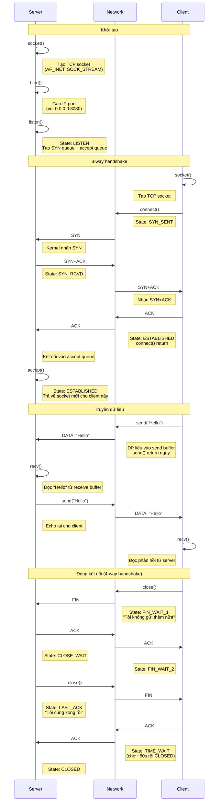

## 1. Port

Ta có một cái máy tính, tất cả các dữ liệu của máy tính đấy gửi ra ngoài mạng thì đều có chung một địa chỉ IP và địa chỉ IP này sẽ là định danh cho cái máy tính đấy. Tuy nhiên, máy tính lại chạy rất nhiều ứng dụng cùng lúc, ví dụ như: facebook, youtube,...Mỗi một cái ứng dụng này đều có nhu cầu gửi một gói tin ra ngoài mạng, vậy khi một gói tin đến với máy tính thì làm thế nào mà kernel có thể phân biệt được bản tin đấy thuộc về ứng dụng nào? Câu trả lời là port.

Mỗi một ứng dụng khi muốn kết nối với mạng thì cần phải xin kernel mở một port - một số nguyên không âm từ 0 đến 65535 dùng để định danh. Kernel sẽ dựa vào port để biết được gói tin thuộc về ứng dụng nào và trả về ứng dụng đấy.

Ta có thể hiểu đơn giản như sau: Nếu IP là địa chỉ toà nhà, thì port là số phòng bên trong. Gói tin gửi đến 192.168.1.10:8080 nghĩa là "đến máy 192.168.1.10, tìm ứng dụng đang ở phòng 8080".

Ba dải port quan trọng:
- 0-1023 (well-known ports): dành cho các dịch vụ chuẩn, cần quyền root để bind. Ví dụ: HTTP dùng port 80, HTTPS dùng 443, SSH dùng 22, DNS dùng 53.
- 1024-49151 (registered ports): các ứng dụng phổ biến đăng ký dùng. Ví dụ: MySQL dùng 3306, PostgreSQL dùng 5432, Redis dùng 6379.
- 49152-65535 (ephemeral ports): kernel tự động gán cho client khi gọi `connect()`. Mỗi lần client mở kết nối mới, kernel chọn một port trống trong dải này. Trên Linux thực tế dải mặc định là 32768-60999, xem bằng `cat /proc/sys/net/ipv4/ip_local_port_range`.

:::tip Lưu ý
Port là khái niệm của họ giao thức IP (TCP/UDP). Các loại socket khác dùng cách định danh khác: Unix Domain Socket dùng đường dẫn file, CAN socket dùng tên interface (`can0`), Netlink dùng port id của process,...
:::

## 2. Socket là gì?

Ta sẽ nhìn socket từ nhiều góc độ:
- Ở góc nhìn đơn giản nhất: socket là một đầu nối mà ứng dụng dùng để gửi/nhận dữ liệu. Giống như ổ cắm điện là điểm tiếp xúc giữa thiết bị và mạng lưới điện thì socket là điểm tiếp xúc giữa ứng dụng và một kênh truyền thông - có thể là mạng internet, một process khác trên cùng máy, bus CAN, hay chính kernel.
- Ở góc nhìn developer: socket là một file descriptor - một con số nguyên mà kernel cấp cho ứng dụng. Trong Linux mọi thứ đều được đại diện bởi file và socket cũng vậy. Ta có thể dùng `read()`/`write()` trên socket giống hệt như đọc/ghi file. Sự khác biệt là dữ liệu không đi vào ổ cứng mà đi đến đầu bên kia của socket.
- Ở góc nhìn kernel: socket là một cấu trúc dữ liệu trong kernel (`struct socket` chứa `struct sock`), bao gồm toàn bộ thông tin cần thiết để quản lý một kênh truyền: địa chỉ hai đầu, trạng thái kết nối, send buffer, receive buffer,... và một bảng hàm (`proto_ops`) trỏ đến phần xử lý của từng họ giao thức.

**Các loại socket (domain và type)**

Khi tạo socket, ta phải chọn hai thứ: domain (họ địa chỉ hay socket nói chuyện với ai) và type (ngữ nghĩa truyền dữ liệu hay dữ liệu được truyền như thế nào).

| Domain | Dùng cho  | Địa chỉ |
| --- | --- | --- |
| `AF_INET` / `AF_INET6` | Mạng IP thông thường | IP + port |
| `AF_UNIX` | Unix Domain Socket (UDS): Giao tiếp giữa các tiến trình trên cùng thiết bị | Đường dẫn file |
| `AF_CAN`  | Bus CAN trong ô tô và công nghiệp | Tên interface CAN |
| `AF_NETLINK` | Giao tiếp với kernel, ví dụ theo dõi trạng thái mạng, hotplug | Port id + nhóm multicast |
| `AF_PACKET` | Gửi và nhận gói tin ở tầng thấp (frame Ethernet), tự làm giao thức | Interface + địa chỉ MAC |
| `AF_BLUETOOTH` | Bluetooth qua BlueZ (RFCOMM, L2CAP, BLE) | Địa chỉ Bluetooth + channel/PSM |

Về type, cần phân biệt các loại sau:

- `SOCK_STREAM`: cung cấp luồng byte, không có ranh giới gói tin. một lần `recv()` có thể nhận thiếu hoặc nhận dồn nhiều gói. Đây là loại dùng cho hầu hết ứng dụng: web, database, SSH,...
- `SOCK_DGRAM`: mỗi lần `send()` là một datagram, mỗi lần `recv()` nhận đúng một datagram. Với UDP thì gói có thể mất hoặc đến sai thứ tự, dùng cho DNS, video streaming, game realtime...
- `SOCK_SEQPACKET`: kết hợp ưu điểm của hai loại trên, rất hữu ích khi dùng với UDS.
- `SOCK_RAW`: dùng cho các công cụ như ping hoặc các ứng dụng tự xử lý header giao thức.

Ngữ nghĩa của type là chung nhưng cách hiện thực phụ thuộc domain. Ví dụ `SOCK_DGRAM` trên `AF_INET` là UDP có thể mất gói còn trên `AF_UNIX` thì không bao giờ mất gói vì dữ liệu chỉ được copy trong RAM.

**Định danh một socket**

Mỗi domain có cách định danh riêng. Với TCP/UDP, một kết nối được xác định duy nhất bởi bộ 5 thông tin hay 5-tuple: protocol (TCP/UDP), source IP, source port, destination IP, destination port. Đây là lý do một server chạy trên port 80 có thể phục vụ hàng nghìn client cùng lúc - mỗi kết nối có bộ 5 thông tin khác nhau vì client IP hoặc client port khác nhau, nên kernel phân biệt được chúng.

Với UDS, server được định danh bằng đường dẫn file (ví dụ `/run/myapp.sock`). Mỗi kết nối được `accept()` là một cặp socket riêng trong kernel, vì vậy kernel không cần 5-tuple để phân biệt.

## 3. Luồng hoạt động cơ bản của Socket

Dù là domain nào thì các syscall đều giống nhau. Điểm khác nhau chỉ nằm ở hai chỗ:
- Cấu trúc địa chỉ truyền vào `bind()`, `connect()`, `sendto()`.
- Type của socket: có kết nối (`SOCK_STREAM`, `SOCK_SEQPACKET`) hay không có kết nối (`SOCK_DGRAM`).

### 3.1. Cấu trúc địa chỉ

Các API như `bind()`, `connect()`, `accept()` đều nhận tham số kiểu `struct sockaddr *`. Đây là một kiểu generic, mỗi domain có một struct cụ thể và trường đầu tiên luôn là `family` để kernel biết cách hiểu phần còn lại:

```c
struct sockaddr {            // kiểu generic
    sa_family_t sa_family;   // AF_INET, AF_UNIX, ...
    char        sa_data[14];
};

struct sockaddr_in {         // AF_INET
    sa_family_t    sin_family;
    in_port_t      sin_port;   // port (network byte order)
    struct in_addr sin_addr;   // địa chỉ IPv4
};

struct sockaddr_in6 {        // AF_INET6
    sa_family_t     sin6_family;
    in_port_t       sin6_port;
    struct in6_addr sin6_addr; // địa chỉ IPv6
    ...
};

struct sockaddr_un {         // AF_UNIX
    sa_family_t sun_family;
    char        sun_path[108]; // đường dẫn file
};

struct sockaddr_can {        // AF_CAN
    sa_family_t can_family;
    int         can_ifindex;   // index của can0, can1...
    ...
};
```

Ta luôn khai báo struct cụ thể, điền thông tin rồi ép kiểu sang `struct sockaddr *` khi gọi API.

```c
struct sockaddr_in addr = { .sin_family = AF_INET, .sin_port = htons(8080) };
bind(fd, (struct sockaddr *)&addr, sizeof(addr));

struct sockaddr_un uaddr = { .sun_family = AF_UNIX };
strcpy(uaddr.sun_path, "/run/myapp.sock");
bind(fd, (struct sockaddr *)&uaddr, sizeof(uaddr));
```

:::warning Network byte order
Chỉ áp dụng cho các domain mạng như `AF_INET`/`AF_INET6`. Các máy tính dùng kiến trúc CPU khác nhau có thể lưu trữ dữ liệu theo thứ tự byte khác nhau (little endian hoặc big endian). Để đảm bảo mọi máy đều hiểu đúng giá trị, network quy ước một chuẩn chung là big endian (network byte order). Khi lập trình socket, ta dùng các hàm chuyển đổi:
- `htons()` / `htonl()`: host to network (short/long) - dùng khi gửi.
- `ntohs()` / `ntohl()`: network to host - dùng khi nhận.

Ví dụ: `addr.sin_port = htons(8080)` chuyển port 8080 từ host byte order sang network byte order trước khi gán vào socket address. Với `AF_UNIX` thì không cần vì dữ liệu không rời khỏi máy.
:::

### 3.2. Socket có kết nối (SOCK_STREAM, SOCK_SEQPACKET)

Đây là mô hình client-server phổ biến nhất.

**Phía server**

- `socket()`: tạo socket, chọn domain và type. Tương tự như mua một chiếc điện thoại nhưng chưa gắn SIM.
- `bind()`: gán địa chỉ cho socket (IP:port với `AF_INET`, đường dẫn file với `AF_UNIX`). Giống như gắn SIM với số điện thoại cụ thể để người khác gọi đến được.
- `listen()`: chuyển socket sang trạng thái listen, kernel tạo hàng đợi chứa các kết nối đang chờ ứng dụng lấy ra (accept queue).
- `accept()`: lấy một kết nối từ accept queue. Hàm này trả về một socket mới dành riêng cho kết nối đó. Socket gốc vẫn tiếp tục listen. Đây là điểm quan trọng: server có một socket để listen và nhiều socket con - mỗi cái cho một client.
- `recv()` / `send()`: đọc và ghi dữ liệu trên socket con.
- `close()`: đóng kết nối.

**Phía client**

- `socket()`: tạo socket cùng domain và type với server.
- `connect()`: kết nối đến địa chỉ của server. Khi hàm này return thành công, kết nối đã được thiết lập.
- `send()` / `recv()`: trao đổi dữ liệu.
- `close()`: đóng kết nối.

```
        Server                              Client
     +----------+                        +----------+
     | socket() |                        | socket() |
     +----------+                        +----------+
          |                                   |
     +----------+                             |
     |  bind()  |                             |
     +----------+                             |
          |                                   |
     +----------+                             |
     | listen() |                             |
     +----------+                             |
          |                                   |
     +----------+    thiết lập kết nối   +-----------+
     | accept() | <--------------------- | connect() |
     +----------+                        +-----------+
          |                                   |
     +----------+        dữ liệu         +----------+
     |  recv()  | <--------------------- |  send()  |
     +----------+                        +----------+
          |                                   |
     +----------+        dữ liệu         +----------+
     |  send()  | ---------------------> |  recv()  |
     +----------+                        +----------+
          |                                   |
     +----------+       đóng kết nối     +----------+
     | close()  | <--------------------> | close()  |
     +----------+                        +----------+
```

Bước thiết lập kết nối và đóng kết nối là nơi các domain khác nhau nhiều nhất:
- TCP: thiết lập bằng 3-way handshake qua mạng, đóng bằng 4-way handshake, rồi socket nằm ở `TIME_WAIT`.
- UDS: không có gói tin nào trên mạng. `connect()` chỉ cần kernel tìm socket đang listen theo đường dẫn, tạo cặp socket nối với nhau rồi đưa vào accept queue. Khi đóng, kernel giải phóng ngay.

### 3.3. Socket không kết nối (SOCK_DGRAM)

Không có `listen()`/`accept()`. Mỗi datagram tự mang địa chỉ đích:

- Phía nhận: `socket()` $\rightarrow$ `bind()` $\rightarrow$ `recvfrom()` để nhận datagram kèm địa chỉ người gửi $\rightarrow$ `sendto()` để trả lời.
- Phía gửi: `socket()` $\rightarrow$ `sendto()` với địa chỉ đích $\rightarrow$ `recvfrom()` nhận phản hồi.

```
      Receiver                              Sender
     +------------+                      +------------+
     |  socket()  |                      |  socket()  |
     +------------+                      +------------+
           |                                   |
     +------------+                            |
     |   bind()   |                            |
     +------------+                            |
           |                                   |
     +------------+       datagram       +------------+
     | recvfrom() | <------------------- |  sendto()  |
     +------------+                      +------------+
           |                                   |
     +------------+       datagram       +------------+
     |  sendto()  | -------------------> | recvfrom() |
     +------------+                      +------------+
```

Socket datagram vẫn có thể gọi `connect()`. Lúc này không có kết nối nào được thiết lập, kernel chỉ ghi nhớ địa chỉ đích mặc định để ta dùng `send()`/`recv()` thay cho `sendto()`/`recvfrom()`, đồng thời lọc bỏ datagram từ địa chỉ khác.

### 3.4. Ví dụ: luồng TCP

Đây là diagram chi tiết cho trường hợp phổ biến nhất `AF_INET` + `SOCK_STREAM` (TCP), thể hiện rõ các trạng thái TCP trong quá trình bắt tay. Kiến thức về TCP xem lại ở bài [Network basic](/linux-kernel/network/basic).



:::warning Một số điểm quan trọng cần lưu ý
- `accept()` trả về socket mới, trong khi socket ban đầu (listening socket) vẫn tiếp tục nhận kết nối mới $\rightarrow$ Đó là lý do server có thể phục vụ nhiều client cùng lúc.
- `send()` chỉ copy dữ liệu vào kernel send buffer rồi return. Kernel sẽ tự lo phần còn lại. Điều này nghĩa là `send()` return thành công không đảm bảo bên kia đã nhận.
- `recv()` là một blocking API. Nó sẽ chờ cho đến khi có dữ liệu trong receive buffer. Với socket có kết nối, khi `recv()` trả về 0 nghĩa là bên kia đã đóng kết nối.
- `SOCK_STREAM` là **byte stream**, không phải message stream (đúng với cả TCP và UDS stream). Nếu client gọi `send()` hai lần gửi "Hello" rồi "World", bên server gọi `recv()` một lần có thể nhận được "HelloWorld" gộp lại, hoặc chỉ "Hel" rồi lần sau nhận "loWorld". Nếu ứng dụng cần biết đâu là một "message" hoàn chỉnh, ta phải tự thiết kế protocol ở tầng application (ví dụ thêm length header hoặc dùng delimiter như `\n`), hoặc dùng `SOCK_SEQPACKET`/`SOCK_DGRAM`.
- File descriptor là tài nguyên hữu hạn - mỗi process có giới hạn số fd mở cùng lúc (mặc định 1024, xem bằng `ulimit -n`). Server phục vụ nhiều client cần tăng giới hạn này.
:::

## 4. Giải thích chi tiết các API

Bên dưới sẽ giải thích kernel làm gì khi gọi từng API. Phần chung cho mọi domain được trình bày trước, sau đó là phần riêng của TCP và UDS - hai loại hay gặp nhất.

::::content-group
  ::: tab [socket]
  ```c
  int socket(int domain, int type, int protocol);
  ```

  - `domain`: `AF_INET`, `AF_INET6`, `AF_UNIX`, `AF_CAN`,...
  - `type`: `SOCK_STREAM`, `SOCK_DGRAM`, `SOCK_SEQPACKET`, `SOCK_RAW`. Có thể OR thêm `SOCK_NONBLOCK` (chế độ non-blocking) và `SOCK_CLOEXEC` (tự đóng fd khi `exec()`).
  - `protocol`: thường để `0` để kernel tự chọn giao thức mặc định cho cặp (domain, type). Ví dụ (`AF_INET`, `SOCK_STREAM`) $\rightarrow$ TCP. Với `AF_CAN` thì phải chỉ rõ `CAN_RAW` hoặc `CAN_BCM`.

  Khi gọi `socket()`, kernel thực hiện:

  1. Tìm họ giao thức tương ứng với `domain` (mỗi domain đăng ký một `struct net_proto_family` với kernel). Nếu domain không được hỗ trợ, trả về `EAFNOSUPPORT`.
  2. Cấp phát `struct socket`, gắn bảng hàm `proto_ops` của domain/type đó. Từ đây mọi lời gọi `bind()`, `connect()`, `send()`... đều được chuyển đến hàm của đúng giao thức.
  3. Cấp phát `struct sock` (gọi là sk) - phần lõi chứa trạng thái và buffer của giao thức.
  4. Khởi tạo send buffer và receive buffer (kích thước mặc định lấy từ `/proc/sys/net/core/wmem_default` và `rmem_default`, TCP thì dùng `net.ipv4.tcp_wmem`/`tcp_rmem`).
  5. Gán một file descriptor (`fd`) và trả về cho ứng dụng.

  Lúc này socket chưa có địa chỉ, chưa kết nối đến đâu cả. Nó chỉ là một cái vỏ trống.

  **Ví dụ minh họa:**
  ```c
  int tcp_fd  = socket(AF_INET, SOCK_STREAM, 0);       // TCP
  int udp_fd  = socket(AF_INET, SOCK_DGRAM, 0);        // UDP
  int uds_fd  = socket(AF_UNIX, SOCK_STREAM, 0);       // UDS stream
  int can_fd  = socket(AF_CAN, SOCK_RAW, CAN_RAW);     // CAN
  int nb_fd   = socket(AF_INET, SOCK_STREAM | SOCK_NONBLOCK, 0);
  ```
  :::

  ::: tab [bind]
  ```c
  int bind(int fd, const struct sockaddr *addr, socklen_t addrlen);
  ```

  `bind()` nói cho kernel: "Socket này sẽ có địa chỉ này". Kernel thực hiện:
  1. Kiểm tra `addr->sa_family` có khớp với domain của socket không.
  2. Kiểm tra địa chỉ có đang bị socket khác dùng không. Nếu có, trả về `EADDRINUSE`.
  3. Kiểm tra quyền.
  4. Gán địa chỉ vào `struct sock` và đăng ký socket vào bảng tra cứu của domain để các gói tin/kết nối đến có thể tìm thấy nó.

  Phần riêng của từng domain:
  - **TCP/UDP:** địa chỉ là IP:port. Port < 1024 cần quyền root (hoặc capability `CAP_NET_BIND_SERVICE`). IP `INADDR_ANY` (0.0.0.0) nghĩa là nhận trên mọi interface. Port 0 nghĩa là để kernel tự chọn.
  - **UDS:** địa chỉ là đường dẫn. Kernel tạo một file kiểu socket (`ls -l` thấy ký tự `s` đầu tiên) trong filesystem, cần quyền ghi vào thư mục chứa. Nếu file đã tồn tại thì `bind()` lỗi `EADDRINUSE`, kể cả khi process cũ đã chết - vì vậy server thường `unlink()` file trước khi `bind()`.

  **Ví dụ minh họa:**
  ```c
  // TCP/UDP
  struct sockaddr_in addr = {0};
  addr.sin_family = AF_INET;
  addr.sin_port = htons(8080);        // port 8080
  addr.sin_addr.s_addr = INADDR_ANY;  // mọi interface
  bind(sockfd, (struct sockaddr*)&addr, sizeof(addr));

  // UDS
  struct sockaddr_un uaddr = {0};
  uaddr.sun_family = AF_UNIX;
  strncpy(uaddr.sun_path, "/tmp/app.sock", sizeof(uaddr.sun_path) - 1);
  unlink(uaddr.sun_path);             // xoá file socket cũ nếu còn
  bind(uds_fd, (struct sockaddr*)&uaddr, sizeof(uaddr));
  ```
  :::

  ::: tab [listen]
  ```c
  int listen(int fd, int backlog);
  ```

  `listen()` chỉ dùng cho socket có kết nối (`SOCK_STREAM`, `SOCK_SEQPACKET`). Gọi trên `SOCK_DGRAM` sẽ lỗi `EOPNOTSUPP`. Hàm này đánh dấu socket là listening socket - từ nay nó không dùng để truyền dữ liệu nữa mà chỉ để nhận kết nối mới.

  Kernel tạo **accept queue** chứa các kết nối đã được thiết lập xong, chờ ứng dụng gọi `accept()`. Kích thước tối đa của hàng đợi này là `backlog`, bị giới hạn bởi `/proc/sys/net/core/somaxconn` (mặc định 4096 trên kernel mới).

  **Với TCP**, socket chuyển từ `CLOSED` sang `LISTEN` và kernel dùng thêm một hàng đợi nữa:
  - **SYN queue:** chứa các kết nối đang bắt tay - đã nhận `SYN`, đã gửi `SYN+ACK`, đang chờ `ACK` cuối cùng. Kích thước theo `net.ipv4.tcp_max_syn_backlog`.
  - **Accept queue:** chứa kết nối đã hoàn tất 3-way handshake.

  Khi accept queue đầy, TCP sẽ bỏ qua gói `ACK` cuối của client (client sẽ gửi lại), dẫn tới kết nối chậm hoặc timeout.

  **Với UDS**, không có handshake nên chỉ có accept queue. Khi hàng đợi đầy, `connect()` của client sẽ bị block (hoặc trả về `EAGAIN` nếu non-blocking).

  **Ví dụ minh họa:**
  ```c
  listen(sockfd, 128);
  // backlog = 128: Accept queue chứa tối đa 128 kết nối đang chờ accept()
  ```
  :::

  ::: tab [connect]
  ```c
  int connect(int fd, const struct sockaddr *addr, socklen_t addrlen);
  ```

  Đây là syscall quan trọng nhất phía client. Ý nghĩa của nó phụ thuộc vào type:

  **Socket có kết nối:** thiết lập kết nối đến listening socket có địa chỉ `addr`. Khi return `0`, kết nối đã sẵn sàng để truyền dữ liệu.

  - **TCP:**
    1. Kernel tự động gán ephemeral port nếu client chưa bind.
    2. Gửi gói `SYN` đến server, socket chuyển sang `SYN_SENT`.
    3. Chờ server gửi lại `SYN+ACK`.
    4. Gửi gói `ACK` cuối cùng, socket chuyển sang `ESTABLISHED`.
    5. `connect()` trả về `0`.
  - **UDS:**
    1. Kernel tra đường dẫn trong filesystem, cần quyền ghi trên file socket.
    2. Tạo một socket mới phía server, nối với socket client thành một cặp, đưa vào accept queue.
    3. `connect()` trả về `0` gần như ngay lập tức.

  **Socket không kết nối (`SOCK_DGRAM`):** không gửi gói tin nào. Kernel chỉ ghi nhớ `addr` làm địa chỉ đích mặc định.

  Các lỗi thường gặp:
  - `ECONNREFUSED`: không có ai listen ở địa chỉ đó. Với TCP là khi nhận được gói `RST`, với UDS là khi file socket tồn tại nhưng không có process nào listen (ví dụ server đã chết nhưng chưa xoá file).
  - `ENOENT`: UDS - file socket không tồn tại.
  - `ETIMEDOUT`: TCP - server không phản hồi. Kernel retry gói `SYN` theo `net.ipv4.tcp_syn_retries` (mặc định 6 lần, tổng khoảng 127 giây) rồi bỏ cuộc.
  - `EINPROGRESS`: socket non-blocking, kết nối đang được thiết lập (xem mục I/O multiplexing để biết cách chờ).

  **Ví dụ minh hoạ:**

  ```c
  // TCP
  struct sockaddr_in srv = {0};
  srv.sin_family = AF_INET;
  srv.sin_port = htons(8080);
  inet_pton(AF_INET, "192.168.1.10", &srv.sin_addr);
  connect(sockfd, (struct sockaddr*)&srv, sizeof(srv));

  // UDS
  struct sockaddr_un usrv = {0};
  usrv.sun_family = AF_UNIX;
  strncpy(usrv.sun_path, "/tmp/app.sock", sizeof(usrv.sun_path) - 1);
  connect(uds_fd, (struct sockaddr*)&usrv, sizeof(usrv));
  ```
  :::

  ::: tab [accept]
  ```c
  int accept(int fd, struct sockaddr *addr, socklen_t *addrlen);
  int accept4(int fd, struct sockaddr *addr, socklen_t *addrlen, int flags);
  ```

  Hàm `accept()` là bước tiếp khách phía server:

  1. Kiểm tra accept queue - xem có kết nối nào đã được thiết lập xong không?
  2. Nếu có: lấy kết nối đó ra, gán một file descriptor mới và trả về. Nếu `addr` khác `NULL`, kernel điền địa chỉ của client vào đó.
  3. Nếu trống: block tiến trình cho đến khi có kết nối mới (hoặc trả về lỗi `EAGAIN` nếu đang ở chế độ non-blocking).

  `accept4()` cho phép truyền thêm `SOCK_NONBLOCK | SOCK_CLOEXEC` để socket con được tạo sẵn ở chế độ non-blocking, tiết kiệm một lần gọi `fcntl()`.

  **Điểm then chốt:** Hàm `accept()` trả về một socket mới (ví dụ `fd = 4`), hoàn toàn khác với listening socket ban đầu (`fd = 3`). Socket gốc vẫn tiếp tục thực hiện nhiệm vụ listen. Mỗi client khi kết nối đến sẽ được cấp một socket riêng biệt.

  Ví dụ với TCP:
  - Listening socket (fd=3): 0.0.0.0:8080
  - Client A socket (fd=4): 192.168.1.10:8080 <-> 10.0.0.5:54321
  - Client B socket (fd=5): 192.168.1.10:8080 <-> 10.0.0.6:49876

  Với UDS, client thường không bind nên địa chỉ trả về rỗng. Muốn biết client là ai, dùng `SO_PEERCRED` (xem mục Unix Domain Socket).

  **Ví dụ minh hoạ:**

  ```c
  struct sockaddr_storage client_addr;   // đủ lớn cho mọi domain
  socklen_t len = sizeof(client_addr);

  int client_fd = accept(sockfd, (struct sockaddr*)&client_addr, &len);
  ```
  :::

  ::: tab [send]
  ```c
  ssize_t send(int fd, const void *buf, size_t len, int flags);
  ssize_t sendto(int fd, const void *buf, size_t len, int flags,
                 const struct sockaddr *dest, socklen_t addrlen);
  ```

  - `send()`: dùng cho socket đã kết nối (hoặc datagram đã `connect()`). `write()` tương đương `send()` với `flags = 0`.
  - `sendto()`: dùng cho socket datagram, chỉ định địa chỉ đích trong mỗi lần gửi.

  Hàm `send()` không gửi dữ liệu trực tiếp đến đầu bên kia ngay lập tức. Vai trò của nó chỉ bao gồm:
  1. Sao chép dữ liệu từ bộ nhớ ứng dụng vào kernel.
  2. Trả về số lượng byte đã được sao chép thành công.
  3. Phần còn lại do giao thức xử lý:
     - TCP: dữ liệu nằm trong send buffer, TCP stack tự chia thành segment, gửi đi, chờ ACK và gửi lại nếu mất.
     - UDP: đóng gói thành một datagram và gửi đi ngay, không chờ ACK.
     - UDS: copy thẳng vào receive buffer của socket bên kia và đánh thức process đang chờ.

  **Khi không còn chỗ để chứa dữ liệu:**
  Trường hợp này thường xảy ra khi bên nhận xử lý chậm (TCP flow control, hoặc receive buffer của UDS bên kia đầy).
  - **Chế độ blocking mode:** Hàm `send()` sẽ bị chặn (block) cho đến khi có đủ chỗ trống.
  - **Chế độ non-blocking mode:** Hàm `send()` sẽ trả về `-1` với mã lỗi `errno = EAGAIN` hoặc `EWOULDBLOCK`.

  **Khi bên kia đã đóng kết nối:** `send()` trả về `-1` với `errno = EPIPE` và process nhận signal `SIGPIPE` - mặc định signal này sẽ giết process. Server nên dùng cờ `MSG_NOSIGNAL` hoặc bỏ qua `SIGPIPE` bằng `signal(SIGPIPE, SIG_IGN)`.

  **Những lưu ý cực kỳ quan trọng:**
  - `send()` trả về giá trị 100 không có nghĩa là bên kia đã nhận được 100 byte. Nó chỉ có nghĩa là 100 byte đó đã được copy vào kernel.
  - Với `SOCK_STREAM`, `send()` có thể chỉ gửi một phần dữ liệu, ta cần gửi phần còn lại trong vòng lặp.
  - Với `SOCK_DGRAM`, một lần `send()` là một datagram nguyên vẹn: hoặc gửi hết, hoặc lỗi (ví dụ `EMSGSIZE` nếu quá lớn).

  **Ví dụ minh hoạ:**

  ```c
  // SOCK_STREAM: gửi cho đến hết
  ssize_t send_all(int fd, const char *buf, size_t len) {
      size_t sent = 0;
      while (sent < len) {
          ssize_t n = send(fd, buf + sent, len - sent, MSG_NOSIGNAL);
          if (n == -1) {
              if (errno == EINTR) continue;
              return -1;   // EAGAIN (non-blocking), EPIPE,...
          }
          sent += n;
      }
      return sent;
  }

  // SOCK_DGRAM: gửi một datagram đến địa chỉ cụ thể
  sendto(udp_fd, msg, strlen(msg), 0, (struct sockaddr*)&dest, sizeof(dest));
  ```
  :::

  ::: tab [recv]
  ```c
  ssize_t recv(int fd, void *buf, size_t len, int flags);
  ssize_t recvfrom(int fd, void *buf, size_t len, int flags,
                   struct sockaddr *src, socklen_t *addrlen);
  ```

  Hàm `recv()` đọc dữ liệu mà kernel đã nhận được và đặt vào bộ đệm receive buffer:

  1. Kiểm tra xem receive buffer có dữ liệu hay không.
  2. Nếu có: Sao chép dữ liệu sang bộ nhớ của ứng dụng và trả về số byte đã nhận.
  3. Nếu trống: Chặn (block) tiến trình cho đến khi có dữ liệu mới (hoặc trả về `EAGAIN` nếu đang ở chế độ non-blocking).

  `recvfrom()` giống `recv()` nhưng điền thêm địa chỉ người gửi vào `src` - dùng cho socket datagram để biết trả lời cho ai.

  **Các giá trị trả về đặc biệt:**
  - **> 0:** Số byte thực tế đã đọc được.
  - **= 0:** Với socket có kết nối: bên kia đã đóng kết nối (hoặc gọi `shutdown(SHUT_WR)`) - không còn dữ liệu nào nữa. Với socket datagram: nhận được một datagram rỗng, không phải dấu hiệu đóng kết nối.
  - **= -1:** Đã xảy ra lỗi (cần kiểm tra biến `errno`). Ví dụ `ECONNRESET` khi TCP nhận gói `RST`.

  **Khác nhau giữa stream và datagram:**
  - `SOCK_STREAM`: `recv(fd, buf, 1024)` có thể trả về bất kỳ số byte nào từ 1 đến 1024, không nhất thiết bằng số byte bên kia gửi trong một lần `send()`.
  - `SOCK_DGRAM`/`SOCK_SEQPACKET`: mỗi lần `recv()` trả về đúng một message. Nếu buffer nhỏ hơn message, phần dư bị **cắt bỏ** (có cờ `MSG_TRUNC`) chứ không để lại cho lần sau.

  **Ví dụ minh hoạ:**

  ```c
  char buf[1024];
  ssize_t n = recv(client_fd, buf, sizeof(buf) - 1, 0);

  if (n > 0) {
      buf[n] = '\0'; // Thêm ký tự kết thúc chuỗi
      printf("Received: %s\n", buf);
  } else if (n == 0) {
      printf("Peer disconnected\n");
      close(client_fd);
  } else {
      perror("recv error");
  }
  ```
  :::

  ::: tab [close]
  ```c
  int close(int fd);
  int shutdown(int fd, int how);   // SHUT_RD, SHUT_WR, SHUT_RDWR
  ```

  Hàm `close()` báo cho kernel biết: "Tôi đã xong việc với fd này". Kernel giải phóng fd ngay - `fd` có thể được tái sử dụng cho file hoặc socket khác. Nếu đây là fd cuối cùng trỏ tới socket (không còn bản `dup()` hay `fork()` nào), kernel mới thực sự đóng socket.

  `shutdown()` khác `close()` ở chỗ nó đóng một chiều của kết nối nhưng vẫn giữ fd. Ví dụ client gửi xong request thì gọi `shutdown(fd, SHUT_WR)` để báo "tôi gửi xong rồi", bên kia `recv()` sẽ nhận 0, nhưng client vẫn đọc được phản hồi.

  **Với TCP**, các bước đóng bao gồm:
  1. Nếu send buffer còn dữ liệu, kernel cố gắng gửi nốt trước khi đóng.
  2. Gửi gói tin `FIN` cho phía đối phương.
  3. Chờ gói `ACK` (và gói `FIN` từ phía bên kia nếu chưa nhận được) để hoàn tất quy trình ngắt kết nối 4 bước.
  4. Cấu trúc `socket/sock` bên dưới không bị giải phóng ngay lập tức - phía chủ động đóng sẽ nằm ở trạng thái `TIME_WAIT` (khoảng 60 giây).

  Tại sao cần trạng thái `TIME_WAIT`?
  - **Đảm bảo độ tin cậy:** Đảm bảo gói `ACK` cuối cùng đến được phía bên kia. Nếu gói này bị thất lạc, bên kia sẽ gửi lại `FIN` và kernel vẫn còn socket ở `TIME_WAIT` để gửi lại `ACK`.
  - **Tránh nhiễu dữ liệu:** Đảm bảo các gói tin cũ còn sót lại trên mạng sẽ không bị nhầm lẫn với một kết nối mới dùng đúng 5-tuple đó.

  Trên server có hàng nghìn kết nối, số lượng socket `TIME_WAIT` quá lớn có thể chiếm dụng tài nguyên. Khi restart server cũng hay gặp lỗi `bind(): Address already in use` vì port cũ còn socket `TIME_WAIT` - khắc phục bằng `setsockopt(fd, SOL_SOCKET, SO_REUSEADDR, ...)` trước `bind()`.

  **Với UDS**, không có `FIN` hay `TIME_WAIT`. Kernel giải phóng socket ngay, bên kia `recv()` nhận 0. Tuy nhiên file socket trong filesystem **không tự bị xoá** khi đóng - server nên `unlink()` khi thoát.

  **Ví dụ minh hoạ:**
  ```c
  close(client_fd);
  // TCP: Gửi hết dữ liệu trong send buffer -> Gửi FIN -> Chờ ACK -> TIME_WAIT ~60s
  // UDS: Giải phóng ngay, peer nhận EOF

  close(uds_listen_fd);
  unlink("/tmp/app.sock");   // UDS: xoá file socket
  ```
  :::
::::

## 5. Unix Domain Socket

### 5.1. UDS là gì?

Unix Domain Socket (`AF_UNIX`, hay `AF_LOCAL`) là socket dùng để giao tiếp giữa các process **trên cùng một máy**. Nó dùng đúng bộ API socket đã học ở trên, chỉ khác địa chỉ là một đường dẫn file thay vì IP:port.

Ta có thể dùng TCP qua `127.0.0.1` để giao tiếp local, nhưng UDS tốt hơn vì dữ liệu không đi qua TCP/IP stack:

```
 TCP qua loopback:
 App A -> socket -> TCP -> IP -> loopback -> IP -> TCP -> socket -> App B
                    (checksum, segment, ACK, routing, netfilter,...)

 UDS:
 App A -> socket ---------- copy trong kernel ----------> socket -> App B
```

| Tiêu chí | TCP loopback | UDS |
| --- | --- | --- |
| Địa chỉ | 127.0.0.1:port | Đường dẫn file, ví dụ `/run/app.sock` |
| Hiệu năng | Qua toàn bộ TCP/IP stack | Nhanh hơn, độ trễ thấp hơn |
| Phân quyền | Ai cũng kết nối được tới port | Dùng quyền file (owner, group, mode) |
| Biết client là ai | Chỉ biết IP:port | Biết PID, UID, GID của client (`SO_PEERCRED`) |
| Truyền fd giữa process | Không | Có (`SCM_RIGHTS`) |
| Giữ ranh giới message, tin cậy | Không (byte stream) | Có với `SOCK_SEQPACKET`, `SOCK_DGRAM` |
| Mở rộng ra mạng | Có, chỉ cần đổi IP | Không, chỉ trong máy |

Rất nhiều thành phần trên Linux dùng UDS: `systemd` (`/run/systemd/private`), `journald` (`/run/systemd/journal/socket`), D-Bus (`/run/dbus/system_bus_socket`), Docker (`/var/run/docker.sock`), X11, Wayland, MySQL/PostgreSQL khi kết nối local,...

### 5.2. Ba loại địa chỉ UDS

- **Pathname:** `sun_path` là một đường dẫn bình thường như `/run/app.sock`. Kernel tạo một file kiểu socket (`ls -l` thấy chữ `s` đầu dòng) trong filesystem khi `bind()`. Quyền truy cập được kiểm soát bằng `chmod`/`chown` trên file. File không tự xoá khi đóng socket.
- **Abstract (riêng Linux):** byte đầu tiên của `sun_path` là `'\0'`, ví dụ `"\0myapp"`. Không tạo file trong filesystem, tự biến mất khi socket đóng, không cần `unlink()`. Nhược điểm là không phân quyền bằng file được, mọi process trong cùng network namespace đều thấy. Trong `ss`, abstract socket hiển thị với ký tự `@` ở đầu, ví dụ `@myapp`.
- **Unnamed:** socket không có địa chỉ, tạo bằng `socketpair()`. Trả về một cặp socket đã nối sẵn với nhau, thường dùng giữa process cha và con sau `fork()` - giống pipe nhưng hai chiều.

```c
// Abstract: độ dài địa chỉ phải tính chính xác, không tính phần thừa của sun_path
struct sockaddr_un addr = { .sun_family = AF_UNIX };
const char name[] = "\0myapp";
memcpy(addr.sun_path, name, sizeof(name) - 1);
socklen_t len = offsetof(struct sockaddr_un, sun_path) + sizeof(name) - 1;
bind(fd, (struct sockaddr *)&addr, len);

// Unnamed: socketpair
int sv[2];
socketpair(AF_UNIX, SOCK_STREAM, 0, sv);
if (fork() == 0) {
    close(sv[0]);
    write(sv[1], "hi", 2);   // process con dùng sv[1]
    _exit(0);
}
close(sv[1]);
read(sv[0], buf, sizeof(buf)); // process cha dùng sv[0]
```

### 5.3. Ví dụ: server và client

Server nhận message và echo lại. Dùng `SOCK_SEQPACKET` để mỗi lần `recv()` nhận đúng một message mà không cần tự thiết kế framing:

```c
// uds_server.c
#include <stdio.h>
#include <string.h>
#include <unistd.h>
#include <sys/socket.h>
#include <sys/un.h>

#define SOCK_PATH "/tmp/echo.sock"

int main(void) {
    int lfd = socket(AF_UNIX, SOCK_SEQPACKET, 0);

    struct sockaddr_un addr = {0};
    addr.sun_family = AF_UNIX;
    strncpy(addr.sun_path, SOCK_PATH, sizeof(addr.sun_path) - 1);

    unlink(SOCK_PATH);   // xoá file cũ nếu lần trước không dọn
    if (bind(lfd, (struct sockaddr *)&addr, sizeof(addr)) == -1) {
        perror("bind");
        return 1;
    }
    listen(lfd, 8);
    printf("Listening on %s\n", SOCK_PATH);

    while (1) {
        int cfd = accept(lfd, NULL, NULL);

        // Lấy thông tin process client
        struct ucred cred;
        socklen_t len = sizeof(cred);
        getsockopt(cfd, SOL_SOCKET, SO_PEERCRED, &cred, &len);
        printf("Client connected: pid=%d uid=%d gid=%d\n", cred.pid, cred.uid, cred.gid);

        char buf[256];
        ssize_t n;
        while ((n = recv(cfd, buf, sizeof(buf), 0)) > 0) {
            printf("Received %zd bytes\n", n);
            send(cfd, buf, n, 0);
        }
        printf("Client disconnected\n");
        close(cfd);
    }

    close(lfd);
    unlink(SOCK_PATH);
    return 0;
}
```

```c
// uds_client.c
#include <stdio.h>
#include <string.h>
#include <unistd.h>
#include <sys/socket.h>
#include <sys/un.h>

#define SOCK_PATH "/tmp/echo.sock"

int main(void) {
    int fd = socket(AF_UNIX, SOCK_SEQPACKET, 0);

    struct sockaddr_un addr = {0};
    addr.sun_family = AF_UNIX;
    strncpy(addr.sun_path, SOCK_PATH, sizeof(addr.sun_path) - 1);

    if (connect(fd, (struct sockaddr *)&addr, sizeof(addr)) == -1) {
        perror("connect");
        return 1;
    }

    // Hai message riêng biệt - server nhận đúng hai lần recv()
    send(fd, "Hello", 5, 0);
    send(fd, "World", 5, 0);

    char buf[256];
    for (int i = 0; i < 2; i++) {
        ssize_t n = recv(fd, buf, sizeof(buf) - 1, 0);
        buf[n] = '\0';
        printf("Echo: %s\n", buf);
    }

    close(fd);
    return 0;
}
```

Kết quả:

```
$ ./uds_server
Listening on /tmp/echo.sock
Client connected: pid=4821 uid=1000 gid=1000
Received 5 bytes
Received 5 bytes
Client disconnected

$ ./uds_client
Echo: Hello
Echo: World

$ ls -l /tmp/echo.sock
srwxrwxr-x 1 pei pei 0 Oct 25 10:00 /tmp/echo.sock
```

Nếu đổi sang `SOCK_STREAM`, server có thể nhận "HelloWorld" trong một lần `recv()`.

### 5.4. Tính năng đặc biệt của UDS

**Xác thực client bằng `SO_PEERCRED`**

Như ví dụ trên, server lấy được PID, UID, GID của process ở đầu kia. Thông tin này do kernel cung cấp nên client không thể giả mạo. Đây là cách D-Bus, systemd, Docker quyết định client có quyền thực hiện lệnh hay không.

**Truyền file descriptor bằng `SCM_RIGHTS`**

UDS cho phép gửi một fd đang mở từ process này sang process khác thông qua `sendmsg()` với ancillary data. Kernel sẽ tạo một fd mới ở process nhận, trỏ tới cùng file/socket. Ví dụ: một process có quyền root mở `/dev/video0` rồi gửi fd cho process không có quyền; hoặc `systemd` mở sẵn listening socket rồi truyền cho service (socket activation).

```c
// Gửi fd_to_send qua UDS socket 'sock'
void send_fd(int sock, int fd_to_send) {
    char dummy = 'x';
    struct iovec iov = { .iov_base = &dummy, .iov_len = 1 };

    char ctrl[CMSG_SPACE(sizeof(int))] = {0};
    struct msghdr msg = {
        .msg_iov = &iov, .msg_iovlen = 1,
        .msg_control = ctrl, .msg_controllen = sizeof(ctrl),
    };

    struct cmsghdr *cmsg = CMSG_FIRSTHDR(&msg);
    cmsg->cmsg_level = SOL_SOCKET;
    cmsg->cmsg_type  = SCM_RIGHTS;
    cmsg->cmsg_len   = CMSG_LEN(sizeof(int));
    memcpy(CMSG_DATA(cmsg), &fd_to_send, sizeof(int));

    sendmsg(sock, &msg, 0);
}
```

Bên nhận dùng `recvmsg()` và đọc fd từ `CMSG_DATA()` theo cách tương tự.

:::warning Lỗi thường gặp với UDS
- `bind(): Address already in use`: file socket cũ còn trong filesystem. Gọi `unlink()` trước `bind()`.
- `connect(): Connection refused`: file tồn tại nhưng không có process nào listen (server đã crash).
- `connect(): Permission denied`: client không có quyền ghi trên file socket hoặc quyền truy cập thư mục chứa nó.
- `sun_path` chỉ dài 108 byte, đường dẫn dài hơn sẽ bị cắt. Nên đặt socket trong `/run` hoặc `/tmp` với tên ngắn.
:::

Ngoài UDS, các cơ chế IPC khác trên Linux được trình bày ở bài [IPC](/linux-kernel/os/ipc).

## 6. Blocking vs non-blocking socket

### 6.1. Blocking mode

Khi tạo socket bằng `socket()`, nó mặc định ở chế độ blocking. Nghĩa là các syscall sẽ chờ cho đến khi hoàn thành mới return:
- `recv()`: nếu receive buffer trống, process bị đưa vào trạng thái sleep. Kernel đánh thức nó khi có dữ liệu đến. Trong lúc chờ, process không làm được gì khác.
- `send()`: nếu send buffer đầy, process cũng bị sleep cho đến khi buffer có chỗ trống.
- `accept()`: nếu accept queue trống (không có client nào kết nối), process sleep cho đến khi có kết nối mới.
- `connect()`: chờ cho đến khi kết nối được thiết lập hoặc timeout.

Ở chế độ này sẽ gặp một vấn đề như sau: Nếu server dùng blocking socket và phục vụ một client, nó có thể bị kẹt tại `recv()` để nhận dữ liệu từ client đó. Client thứ hai kết nối vào phải chờ cho đến khi client thứ nhất xong. Server chỉ phục vụ được một client tại một thời điểm.

Để xử lý vấn đề này thì ta có một giải pháp truyền thống là tạo thread hoặc process mới cho mỗi client. Mỗi thread block độc lập, không ảnh hưởng nhau:

```
main thread: accept() -> tạo thread mới -> quay lại accept()
thread 1:    recv/send với client A
thread 2:    recv/send với client B
thread 3:    recv/send với client C
```

Cách này tuy hoạt động ổn nhưng mỗi thread tốn bộ nhớ (stack mặc định 8MB trên Linux) và context switch giữa hàng nghìn thread rất tốn CPU. Với 10000 client đồng thời, ta cần 10000 thread tương ứng. Điều này tiêu tốn khoảng 80GB stack memory $\rightarrow$ Không khả thi.

### 6.2. Non-blocking mode

Chuyển socket sang non-blocking bằng `fcntl()` như sau (hoặc tạo socket với cờ `SOCK_NONBLOCK`):

```c
int flags = fcntl(sockfd, F_GETFL, 0);
fcntl(sockfd, F_SETFL, flags | O_NONBLOCK);
```

Bây giờ hành vi của các syscall thay đổi hoàn toàn:
- `recv()`: nếu buffer trống, return ngay lập tức với giá trị -1 và `errno = EAGAIN`. Nghĩa là "không có dữ liệu, thử lại sau".
- `send()`: nếu buffer đầy, cũng return -1 với `EAGAIN` thay vì chờ.
- `accept()`: nếu không có kết nối đang chờ, return -1 với `EAGAIN`.
- `connect()`: return -1 với `errno = EINPROGRESS`, không đợi kết nối xong. Ta phải kiểm tra sau bằng `select()`/`poll()`/`epoll` xem kết nối đã thành công chưa.

Điều này giải quyết được vấn đề blocking, nhưng tạo ra vấn đề mới là ta phải liên tục kiểm tra mỗi socket xem có dữ liệu chưa - gọi là busy polling:

```c
while (1) {
    for (mỗi client socket) {
        n = recv(fd, buf, ...);
        if (n > 0) { xử lý dữ liệu }
        // nếu EAGAIN: bỏ qua, kiểm tra fd tiếp theo
    }
}
```

Vòng lặp này cần chạy liên tục, sẽ tiêu tốn 100% CPU ngay cả khi không có dữ liệu nào $\rightarrow$ Rất lãng phí.

## 7. I/O Multiplexing

### 7.1. Vấn đề cần giải quyết

Giả sử ta viết một server cho gateway IoT và có 20 cảm biến cùng kết nối tới. Mặc định socket ở chế độ blocking:

```c
int cfd = accept(lfd, ...);   // đứng chờ ở đây đến khi có client
recv(cfd, buf, ...);          // đứng chờ ở đây đến khi client gửi dữ liệu
```

Khi chương trình đang chờ `recv()` của client A thì nó không thể `accept()` client mới, cũng không nhận được dữ liệu từ client B. Ở đây, ta có ba phương án xử lý:

| Phương án | Ý tưởng | Nhược điểm |
| --- | --- | --- |
| Mỗi client một thread hoặc process | Mỗi luồng tự block riêng | Tốn RAM (mỗi thread cần stack, thường 8 MB ảo), phải đồng bộ bằng mutex, khó debug. |
| Non-blocking rồi polling | Gọi `recv()` lần lượt trên từng fd, không có dữ liệu thì chuyển sang fd kế | CPU luôn 100%, tốn pin và làm nóng chip |
| **I/O multiplexing** | Nhờ kernel theo dõi nhiều fd cùng lúc và chỉ được đánh thức khi có fd sẵn sàng | Phải viết theo kiểu event-driven |

Ý tưởng chính của I/O multiplexing là thay vì hỏi từng fd xem có dữ liệu chưa, chương trình đưa cả danh sách fd cho kernel rồi đi ngủ. Khi có fd sẵn sàng, kernel đánh thức chương trình và cho biết đó là những fd nào.

```
           +------------------------------+
 fd 3 ---> |                              |
 fd 4 ---> |   select / poll / epoll      | ---> fd 4 và fd 7 đã sẵn sàng
 fd 7 ---> |                              |
           +------------------------------+
```

Để làm được điều này, linux cung cấp 3 cơ chế: `select()`, `poll()`, và `epoll`.

:::tip Thông tin bổ sung
Multiplexing không chỉ dùng cho socket mà dùng được cho mọi fd: UART (/dev/ttyS0), GPIO (libgpiod), pipe, timerfd, eventfd, signalfd...
:::

### 7.2. Các sự kiện: khi nào fd sẵn sàng?

Trước khi đi vào từng API, cần hiểu rõ sẵn sàng nghĩa là gì, vì cả `select()`, `poll()` và `epoll` đều dùng chung định nghĩa này:

> fd sẵn sàng đọc (readable) nghĩa là gọi `recv()`/`read()`/`accept()` lúc này **sẽ không bị block**.
> fd sẵn sàng ghi (writable) nghĩa là gọi `send()`/`write()` lúc này **sẽ không bị block**.

Lưu ý rằng không bị block không có nghĩa là có dữ liệu. Lời gọi có thể trả về dữ liệu, trả về 0 (EOF) hoặc trả về lỗi - tất cả đều là không block. Đây là lý do một fd readable nhưng `recv()` lại trả về 0 hoặc -1.

Bên trong kernel, mỗi socket có một wait queue. Mỗi khi trạng thái socket thay đổi (dữ liệu đến, buffer được giải phóng, kết nối đóng, lỗi xảy ra), giao thức gọi hàm wake up trên wait queue này. `select`/`poll`/`epoll` đăng ký vào đó và hỏi lại hàm `poll` của socket để lấy danh sách sự kiện hiện tại.

**Bảng tên sự kiện ở các API**

| Ý nghĩa | `select()` | `poll()` | `epoll` |
| --- | --- | --- | --- |
| Readable | `readfds` | `POLLIN` | `EPOLLIN` |
| Writable | `writefds` | `POLLOUT` | `EPOLLOUT` |
| Dữ liệu except | `exceptfds` | `POLLPRI` | `EPOLLPRI` |
| Peer đã đóng chiều ghi | (báo qua readable) | `POLLRDHUP` | `EPOLLRDHUP` |
| Lỗi | (báo qua readable/writable) | `POLLERR` | `EPOLLERR` |
| Hang up | (báo qua readable) | `POLLHUP` | `EPOLLHUP` |
| fd không hợp lệ | trả về `EBADF` | `POLLNVAL` | không thể thêm vào |

`POLLERR`/`EPOLLERR` và `POLLHUP`/`EPOLLHUP` **luôn được báo**, kể cả khi ta không đăng ký.

**Readable (`EPOLLIN`)**

Socket readable khi xảy ra một trong các điều kiện sau:

| Điều kiện | Khi đó gọi | Kết quả |
| --- | --- | --- |
| Receive buffer có ít nhất `SO_RCVLOWAT` byte (mặc định 1) | `recv()` | Trả về > 0 |
| Socket datagram có ít nhất một datagram trong hàng đợi | `recvfrom()` | Trả về một datagram |
| Listening socket có kết nối trong accept queue | `accept()` | Trả về fd mới |
| Peer đã đóng kết nối hoặc `shutdown(SHUT_WR)` (TCP nhận `FIN`) | `recv()` | Trả về 0 (EOF) |
| Socket có lỗi đang chờ (ví dụ nhận `RST`) | `recv()` | Trả về -1, `errno` là lỗi đó |

**Writable (`EPOLLOUT`)**

Socket writable khi xảy ra một trong các điều kiện sau:

| Điều kiện | Ý nghĩa |
| --- | --- |
| Send buffer còn trống ít nhất `SO_SNDLOWAT` | `send()` sẽ copy được ít nhất một phần dữ liệu |
| `connect()` non-blocking đã xong (thành công hoặc thất bại) | Đọc `SO_ERROR` để biết kết quả |
| Chiều ghi đã đóng (`shutdown(SHUT_WR)` hoặc peer reset) | `send()` trả về -1 với `EPIPE` |
| Socket có lỗi đang chờ | `send()` trả về -1 với lỗi đó |

Vì send buffer gần như lúc nào cũng còn chỗ, socket hầu như luôn writable. Nếu luôn đăng ký `EPOLLOUT`, `epoll_wait()` sẽ return liên tục và CPU lên 100%. Cách đúng là:
1. Gọi `send()` trực tiếp khi có dữ liệu cần gửi.
2. Nếu `send()` không gửi hết (trả về `EAGAIN` hoặc gửi một phần), lưu phần còn lại và **bật** `EPOLLOUT`.
3. Khi nhận `EPOLLOUT`, gửi tiếp phần còn lại. Gửi xong thì **tắt** `EPOLLOUT`.

**Các sự kiện khác**

- `EPOLLRDHUP`: peer đã đóng hoặc `shutdown(SHUT_WR)`. Sự kiện này luôn đi kèm `EPOLLIN`, giúp ta biết peer đã đóng mà không cần gọi `recv()` để thấy 0. Rất hữu ích với edge-triggered.
- `EPOLLHUP`: cả hai chiều đều đã đóng - ví dụ kết nối bị reset, hoặc ta đã `shutdown(SHUT_WR)` và peer cũng đã đóng. Không thể truyền thêm dữ liệu, nên `close()` fd.
- `EPOLLERR`: socket có lỗi (ví dụ `ECONNREFUSED`, `ECONNRESET`, `ETIMEDOUT`). Đọc lỗi bằng `getsockopt(fd, SOL_SOCKET, SO_ERROR, ...)` hoặc gọi `recv()` để nhận `errno`.
- `EPOLLPRI`: có dữ liệu khẩn (TCP out-of-band). Với socket ít dùng, nhưng với fd khác thì quan trọng, ví dụ file `value` của GPIO sysfs báo `POLLPRI` khi có ngắt.

**Ví dụ: vòng đời một kết nối TCP và các sự kiện tương ứng**

```
 Sự kiện trên mạng/trong kernel         Sự kiện epoll báo          Ứng dụng nên làm
 ------------------------------------   ------------------------   ---------------------------
 Client connect() xong 3-way handshake  listen_fd: EPOLLIN         accept()
 connect() non-blocking thành công      client_fd: EPOLLOUT        đọc SO_ERROR == 0 -> bắt đầu gửi
 connect() non-blocking bị từ chối      EPOLLOUT|EPOLLERR|EPOLLHUP SO_ERROR == ECONNREFUSED -> close()
 Dữ liệu đến                            EPOLLIN                    recv() -> > 0
 send buffer đầy rồi được giải phóng    EPOLLOUT (nếu đã bật)      gửi tiếp phần còn lại
 Peer gọi close() (nhận FIN)            EPOLLIN|EPOLLRDHUP         recv() -> 0 -> close()
 Peer bị reset (nhận RST)               EPOLLIN|EPOLLERR|EPOLLHUP  recv() -> ECONNRESET -> close()
```

**Readiness của một số fd khác**

| fd | Readable khi | Writable khi |
| --- | --- | --- |
| UDS socket | Giống TCP, peer đóng thì báo EOF | Receive buffer của peer còn chỗ |
| Pipe/FIFO | Có dữ liệu, hoặc mọi đầu ghi đã đóng (EOF) | Pipe còn chỗ, đầu đọc đóng thì báo `POLLERR` |
| UART (`/dev/ttyS0`) | Có byte trong buffer nhận | Buffer truyền còn chỗ |
| `timerfd` | Timer đã hết hạn ít nhất một lần | - |
| `eventfd` | Bộ đếm khác 0 | Bộ đếm chưa đạt giá trị tối đa |
| `signalfd` | Có signal đang chờ | - |

### 7.3. select() và poll()

`select()` và `poll()` hoạt động theo cùng nguyên lý: mỗi lần gọi, ta truyền toàn bộ danh sách fd cần theo dõi cùng sự kiện quan tâm cho kernel. Kernel duyệt qua từng fd một để kiểm tra, rồi trả về fd nào có sự kiện gì.

```c
// poll(): theo dõi listening socket và một client
struct pollfd fds[2] = {
    { .fd = listen_fd, .events = POLLIN },
    { .fd = client_fd, .events = POLLIN | POLLRDHUP },
};

int n = poll(fds, 2, 1000);   // timeout 1000 ms, -1 là chờ mãi
if (n > 0) {
    if (fds[0].revents & POLLIN)
        accept(listen_fd, NULL, NULL);
    if (fds[1].revents & (POLLERR | POLLHUP | POLLRDHUP))
        close(client_fd);
    else if (fds[1].revents & POLLIN)
        recv(client_fd, buf, sizeof(buf), 0);
}
```

`events` là sự kiện ta muốn theo dõi, `revents` là sự kiện kernel trả về. Tuy nhiên, cách này có nhược điểm sau:
- Nếu có 10000 socket mà chỉ 5 cái có dữ liệu, kernel vẫn phải kiểm tra cả 10000 socket, ứng dụng cũng phải duyệt cả 10000 phần tử để tìm 5 cái đó. Độ phức tạp O(n) mỗi lần gọi.
- `select()` còn bị giới hạn 1024 fd (do dùng bitmask cố định `FD_SETSIZE`) và phải khởi tạo lại các `fd_set` sau mỗi lần gọi vì kernel ghi đè lên chúng.
- Mỗi lần gọi phải copy toàn bộ danh sách fd từ user space sang kernel space.

### 7.4. epoll

`epoll` thay đổi kiến trúc hoàn toàn: thay vì ứng dụng đưa danh sách cho kernel mỗi lần, kernel sẽ tự giữ danh sách và chỉ trả về những fd thực sự có sự kiện.

Ví dụ:

```c
// 1. Tạo epoll instance
int epfd = epoll_create1(0);

// 2. Thêm listening socket vào epoll
struct epoll_event ev;
ev.events = EPOLLIN;
ev.data.fd = listen_fd;
epoll_ctl(epfd, EPOLL_CTL_ADD, listen_fd, &ev);

// 3. Event loop
struct epoll_event events[MAX_EVENTS];
while (1) {
    // Chờ sự kiện
    int nfds = epoll_wait(epfd, events, MAX_EVENTS, -1);

    // Chỉ xử lý fd có sự kiện
    for (int i = 0; i < nfds; i++) {
        int fd = events[i].data.fd;
        uint32_t e = events[i].events;

        if (fd == listen_fd) {
            // Listening socket readable = có kết nối trong accept queue
            int client_fd = accept4(listen_fd, NULL, NULL, SOCK_NONBLOCK);

            // Thêm client mới vào epoll
            ev.events = EPOLLIN | EPOLLRDHUP;
            ev.data.fd = client_fd;
            epoll_ctl(epfd, EPOLL_CTL_ADD, client_fd, &ev);
            continue;
        }

        // Lỗi hoặc kết nối bị ngắt: không cần đọc nữa
        if (e & (EPOLLERR | EPOLLHUP)) {
            close(fd);   // epoll tự xoá fd khi close()
            continue;
        }

        if (e & EPOLLIN) {
            int n = recv(fd, buf, sizeof(buf), 0);
            if (n > 0) {
                send(fd, buf, n, 0);   // echo
            } else if (n == 0) {
                close(fd);             // peer đóng kết nối
                continue;
            }
            // n == -1 && errno == EAGAIN: chưa có thêm dữ liệu
        }

        if (e & EPOLLOUT) {
            // gửi tiếp dữ liệu còn tồn, gửi xong thì tắt EPOLLOUT bằng EPOLL_CTL_MOD
        }
    }
}
```

Giải thích chi tiết các API:

- `epoll_create1()`: tạo một epoll instance. Kernel cấp phát cấu trúc dữ liệu nội bộ gồm: một red-black tree để lưu danh sách fd đang theo dõi, và một ready list để chứa các fd có sự kiện. Hàm trả về một fd đại diện cho epoll instance này.
- `epoll_ctl()`: thêm (`EPOLL_CTL_ADD`), sửa (`EPOLL_CTL_MOD`), hoặc xoá (`EPOLL_CTL_DEL`) fd khỏi danh sách theo dõi. Trường `data` là dữ liệu tuỳ ý của ứng dụng, kernel trả lại nguyên vẹn - thường dùng để lưu `fd` hoặc con trỏ tới struct của kết nối. Khi thêm một fd, kernel đăng ký một callback vào wait queue của fd đó. Khi trạng thái fd thay đổi, callback tự động đưa fd vào ready list. Đây là điểm mấu chốt - kernel không cần duyệt toàn bộ danh sách, mà fd "tự báo" khi có sự kiện.
- `epoll_wait()`: chờ cho đến khi có sự kiện. Nếu ready list trống, process sleep. Khi có ít nhất 1 fd sẵn sàng, kernel đánh thức process và trả về chỉ những fd có sự kiện. Nếu 10000 socket đang theo dõi mà chỉ 3 cái có dữ liệu, `epoll_wait()` chỉ trả về 3 cái đó. Độ phức tạp O(log n) cho việc thêm/sửa/xoá fd, O(k) khi trả về sự kiện - với k là số sự kiện thực tế, không phụ thuộc tổng số fd.

:::tip Tại sao epoll nhanh?
Điểm khác biệt cốt lõi so với `select()`/`poll()`: khi ta thêm socket vào epoll qua `epoll_ctl()`, kernel gắn một callback function vào socket đó. Khi network card nhận gói tin và đưa dữ liệu vào receive buffer, callback này tự động chạy và đẩy socket vào ready list. Quá trình này xảy ra trong ngữ cảnh xử lý gói tin của kernel (softirq), không cần ứng dụng hỏi. Vì vậy `epoll_wait()` chỉ việc kiểm tra ready list. Nếu có thì trả về, nếu không thì sleep. Không cần duyệt qua hàng nghìn socket.
:::

**Ví dụ: connect() non-blocking**

Đây là trường hợp hay gặp nhất cần dùng `EPOLLOUT`, ví dụ client cần kết nối nhiều server cùng lúc hoặc không muốn bị treo 127 giây khi server không phản hồi:

```c
int fd = socket(AF_INET, SOCK_STREAM | SOCK_NONBLOCK, 0);
int ret = connect(fd, (struct sockaddr *)&srv, sizeof(srv));
if (ret == -1 && errno == EINPROGRESS) {
    // Kết nối đang được thiết lập, chờ writable
    ev.events = EPOLLOUT;
    ev.data.fd = fd;
    epoll_ctl(epfd, EPOLL_CTL_ADD, fd, &ev);
}

// Trong event loop, khi fd có EPOLLOUT:
int err = 0;
socklen_t len = sizeof(err);
getsockopt(fd, SOL_SOCKET, SO_ERROR, &err, &len);
if (err == 0) {
    // Kết nối thành công -> chuyển sang theo dõi EPOLLIN
    ev.events = EPOLLIN | EPOLLRDHUP;
    epoll_ctl(epfd, EPOLL_CTL_MOD, fd, &ev);
} else {
    printf("connect failed: %s\n", strerror(err));
    close(fd);
}
```

**Level-triggered và Edge-triggered**

epoll có 2 chế độ thông báo sự kiện:
- **Level-triggered (LT)**: mặc định. Chừng nào điều kiện còn đúng thì còn báo - còn dữ liệu trong buffer thì còn báo `EPOLLIN`, còn chỗ trong send buffer thì còn báo `EPOLLOUT`. Nếu ta chỉ đọc một nửa buffer, lần `epoll_wait` tiếp theo vẫn báo fd đó. Kiểu này an toàn, không bao giờ bỏ sót dữ liệu. Tuy nhiên có thể gây ra nhiều lần thông báo không cần thiết.
- **Edge-triggered (ET)**: bật bằng cờ `EPOLLET`. Chỉ thông báo khi trạng thái thay đổi, tức là khi có dữ liệu mới đến hoặc khi send buffer từ đầy chuyển sang có chỗ. Nếu ta không đọc hết dữ liệu trong lần đó, `epoll_wait()` sẽ không báo lại cho đến khi có dữ liệu mới đến. Vì vậy khi dùng ET bắt buộc:
  - Đặt fd ở chế độ non-blocking.
  - Đọc hết dữ liệu bằng vòng lặp cho tới khi `recv()` trả về `-1` với `errno == EAGAIN`.

```
 Dữ liệu trong receive buffer:

 byte  |        +---------+
       |        |         |              +-----
       |        |         +----+         |
     0 +--------+              +---------+------> thời gian
                ^         ^    ^         ^
                |         |    |         |
 LT:            báo       báo  báo       báo     (mỗi lần epoll_wait còn dữ liệu)
 ET:            báo                      báo     (chỉ khi có dữ liệu mới đến)
```

```c
// Edge-triggered: Phải đọc hết dữ liệu mỗi lần
ev.events = EPOLLIN | EPOLLET;  // bật ET

// Trong event loop, khi socket có sự kiện:
while (1) {
    int n = recv(fd, buf, sizeof(buf), 0);
    if (n == -1) {
        if (errno == EAGAIN) break;  // đã đọc hết -> thoát vòng lặp
        close(fd);                   // lỗi thật
        break;
    } else if (n == 0) {
        close(fd);  // client đóng
        break;
    }
    // xử lý n byte dữ liệu
}
```

Nếu dùng ET mà không đọc hết, dữ liệu sẽ bị kẹt trong buffer - `epoll_wait()` sẽ không báo lại, gây ra bug rất khó tìm.

**Khi nào dùng LT, khi nào dùng ET?**
- **LT**: an toàn, dễ code. Phù hợp cho hầu hết ứng dụng. Nếu chưa chắc chắn, dùng LT.
- **ET**: hiệu quả hơn khi throughput cao vì giảm số lần `epoll_wait()` return. Nginx dùng ET vì cần xử lý hàng chục nghìn kết nối với hiệu suất tối đa.

## 8. Công cụ debug socket

Khi làm việc với socket, các câu hỏi hay gặp là: server đã listen chưa? ai đang giữ port này? dữ liệu có đi ra mạng không? ứng dụng bị treo ở syscall nào? Bảng dưới đây tóm tắt công cụ cho từng câu hỏi:

| Câu hỏi | Công cụ |
| --- | --- |
| Có những socket nào, ở trạng thái gì, của process nào? | `ss`, `netstat`, `lsof` |
| Socket của một process cụ thể? | `ls -l /proc/<pid>/fd`, `lsof -p <pid>` |
| Thử kết nối hoặc giả làm server/client? | `nc`, `socat` |
| Dữ liệu thực sự đi trên mạng là gì? | `tcpdump`, Wireshark |
| Ứng dụng đang gọi syscall nào, lỗi gì? | `strace` |
| Thông số kernel (buffer, backlog,...)? | `sysctl`, `/proc/sys/net/` |

### 8.1. ss

`ss` (socket statistics, thuộc gói `iproute2`) là công cụ chính để xem socket trên Linux, thay thế cho `netstat`. Nó đọc thông tin trực tiếp từ kernel qua Netlink nên nhanh, kể cả khi có hàng chục nghìn socket.

Các option hay dùng:

| Option | Ý nghĩa |
| --- | --- |
| `-t` / `-u` / `-x` | Chỉ TCP / UDP / Unix Domain Socket |
| `-l` | Chỉ socket đang listen |
| `-a` | Tất cả, gồm cả listen và đã kết nối |
| `-n` | Hiện số (IP, port) thay vì tên dịch vụ |
| `-p` | Hiện process sở hữu socket (cần root để thấy process của user khác) |
| `-m` | Hiện bộ nhớ buffer của socket |
| `-i` | Hiện thông tin nội bộ TCP (RTT, cwnd, retransmit) |
| `-s` | Thống kê tổng |

```bash
# Server nào đang listen TCP, của process nào?
$ ss -tlnp
State   Recv-Q  Send-Q  Local Address:Port  Peer Address:Port  Process
LISTEN  0       128     0.0.0.0:8080        0.0.0.0:*          users:(("server",pid=1234,fd=3))
LISTEN  0       4096    127.0.0.53:53       0.0.0.0:*          users:(("systemd-resolve",pid=612,fd=14))

# Các kết nối TCP đã thiết lập tới port 8080
$ ss -tnp state established '( sport = :8080 )'

# Đếm socket TIME_WAIT
$ ss -tan state time-wait | wc -l

# Unix Domain Socket đang listen
$ ss -xlp
Netid  State   Recv-Q Send-Q  Local Address:Port              Peer Address:Port  Process
u_seq  LISTEN  0      8       /tmp/echo.sock 41235            * 0                users:(("uds_server",pid=4820,fd=3))
u_str  LISTEN  0      4096    /run/systemd/private 18234      * 0                users:(("systemd",pid=1,fd=17))
u_str  LISTEN  0      4096    @/tmp/.X11-unix/X0 25611        * 0                users:(("Xorg",pid=980,fd=5))
```

:::tip Đọc Recv-Q và Send-Q
Ý nghĩa của hai cột này phụ thuộc trạng thái socket:
- Socket `LISTEN`: `Recv-Q` là số kết nối đang nằm trong accept queue, `Send-Q` là backlog tối đa. Nếu `Recv-Q` thường xuyên gần bằng `Send-Q` thì ứng dụng `accept()` không kịp.
- Socket đã kết nối: `Recv-Q` là số byte trong receive buffer chưa được ứng dụng đọc, `Send-Q` là số byte đã gửi nhưng chưa được bên kia ACK. `Recv-Q` lớn và tăng dần nghĩa là ứng dụng đọc chậm hoặc bị treo; `Send-Q` lớn nghĩa là mạng chậm hoặc bên kia không đọc.
:::

### 8.2. netstat và lsof

`netstat` (gói `net-tools`) là công cụ cũ, vẫn còn trên nhiều hệ thống embedded hoặc BusyBox. Các option tương tự `ss`:

```bash
$ netstat -tlnp      # TCP đang listen
$ netstat -anp       # tất cả socket
$ netstat -s         # thống kê theo giao thức (số gói retransmit, lỗi,...)
```

`lsof` liệt kê file đang mở, và socket cũng là file:

```bash
$ lsof -i :8080            # process nào đang dùng port 8080
$ lsof -i TCP -s TCP:LISTEN
$ lsof -U                  # Unix Domain Socket
$ lsof -p 1234             # mọi fd của process 1234
```

Nếu không có công cụ nào, ta vẫn có thể đọc trực tiếp từ `/proc`:

```bash
$ ls -l /proc/1234/fd
lrwx------ 1 pei pei 64 Oct 25 10:00 3 -> socket:[41235]
lrwx------ 1 pei pei 64 Oct 25 10:00 4 -> socket:[41240]

$ cat /proc/net/tcp     # bảng socket TCP (địa chỉ ở dạng hex)
$ cat /proc/net/unix    # bảng UDS
```

Số trong `socket:[41235]` là inode của socket, dùng để đối chiếu với cột inode trong `/proc/net/*` hoặc output của `ss -e`.

### 8.3. nc và socat

`nc` (netcat) dùng để nhanh chóng tạo server hoặc client để thử nghiệm, rất tiện khi mới viết một nửa hệ thống:

```bash
# Giả làm TCP server ở port 8080, in ra mọi thứ nhận được
$ nc -l 8080

# Giả làm TCP client gửi dữ liệu
$ echo "hello" | nc 127.0.0.1 8080

# UDP
$ nc -u -l 9000
$ echo "ping" | nc -u 127.0.0.1 9000

# Unix Domain Socket (OpenBSD netcat)
$ nc -U /tmp/app.sock
```

`socat` mạnh hơn `nc`, kết nối được hai đầu bất kỳ với nhau: TCP, UDP, UDS, file, serial port, stdin/stdout,...

```bash
# Client tương tác với UDS
$ socat - UNIX-CONNECT:/tmp/app.sock

# UDS kiểu SOCK_SEQPACKET
$ socat - UNIX-CONNECT:/tmp/echo.sock,type=5

# Mở UDS ra mạng: client TCP ở port 9000 sẽ được chuyển vào /tmp/app.sock
$ socat TCP-LISTEN:9000,fork UNIX-CONNECT:/tmp/app.sock

# Nghe lén UDS: tạo proxy in ra toàn bộ dữ liệu đi qua (-v)
$ socat -v UNIX-LISTEN:/tmp/proxy.sock,fork UNIX-CONNECT:/tmp/app.sock
```

Lệnh cuối rất hữu ích vì `tcpdump` không bắt được UDS: cho client kết nối vào `/tmp/proxy.sock` thay vì `/tmp/app.sock`, `socat` sẽ in ra mọi byte đi qua.

### 8.4. tcpdump và Wireshark

`tcpdump` bắt gói tin đi qua network interface, giúp kiểm tra dữ liệu có thực sự đi ra mạng không, handshake có thành công không. Cần quyền root.

```bash
# Bắt gói tới/từ port 8080 trên mọi interface, -nn không phân giải tên
$ sudo tcpdump -i any -nn port 8080

# Hiện nội dung payload dạng ASCII
$ sudo tcpdump -i lo -nn -A port 8080

# Chỉ bắt gói SYN và RST - debug lỗi kết nối
$ sudo tcpdump -i eth0 -nn 'tcp[tcpflags] & (tcp-syn|tcp-rst) != 0'

# Lưu ra file để mở bằng Wireshark trên PC
$ sudo tcpdump -i eth0 -w capture.pcap port 1883
```

Ví dụ output khi client kết nối tới port không có ai listen:

```
10:00:01.000 IP 127.0.0.1.54321 > 127.0.0.1.8080: Flags [S], seq 1234, ...
10:00:01.000 IP 127.0.0.1.8080 > 127.0.0.1.54321: Flags [R.], seq 0, ack 1235, ...
```

Gói `[S]` (SYN) được trả lời bằng `[R.]` (RST) - đây chính là nguyên nhân `connect()` báo `ECONNREFUSED`. Nếu chỉ thấy `[S]` lặp lại mà không có phản hồi, đó là firewall chặn hoặc sai địa chỉ, `connect()` sẽ báo `ETIMEDOUT`.

Trên thiết bị embedded không có giao diện, ta thường bắt bằng `tcpdump -w` rồi copy file `.pcap` về PC để phân tích bằng Wireshark.

### 8.5. strace

`strace` hiển thị mọi syscall mà ứng dụng gọi, kèm tham số và giá trị trả về. Đây là cách nhanh nhất để biết ứng dụng bị treo ở đâu hoặc lỗi gì, mà không cần sửa code.

```bash
# Chỉ hiện các syscall liên quan tới mạng
$ strace -e trace=network ./client
socket(AF_INET, SOCK_STREAM, IPPROTO_IP) = 3
connect(3, {sa_family=AF_INET, sin_port=htons(8080), sin_addr=inet_addr("127.0.0.1")}, 16) = -1 ECONNREFUSED (Connection refused)

# Gắn vào process đang chạy, -f theo dõi cả các thread
$ sudo strace -f -p 1234 -e trace=network,poll,epoll_wait

# Hiện thời gian mỗi syscall mất (-T) - tìm syscall bị block lâu
$ strace -T -e trace=network ./client
```

Nếu ứng dụng bị treo, `strace -p` sẽ cho thấy nó đang đứng ở syscall nào, ví dụ `recv(4, ` chưa return nghĩa là đang chờ dữ liệu từ fd 4.

### 8.6. Thông số kernel

Một số thông số hay phải điều chỉnh, xem và sửa bằng `sysctl`:

```bash
$ sysctl net.core.somaxconn            # backlog tối đa của listen()
$ sysctl net.ipv4.tcp_max_syn_backlog  # kích thước SYN queue
$ sysctl net.ipv4.ip_local_port_range  # dải ephemeral port
$ sysctl net.ipv4.tcp_rmem             # min/default/max receive buffer TCP
$ sysctl net.ipv4.tcp_wmem             # min/default/max send buffer TCP
$ sysctl net.ipv4.tcp_syn_retries      # số lần retry SYN trước khi ETIMEDOUT

# Sửa tạm thời (mất khi reboot)
$ sudo sysctl -w net.core.somaxconn=8192
```

Để giữ sau khi reboot, thêm dòng cấu hình vào file trong `/etc/sysctl.d/`. Ngoài ra, giới hạn số fd của process xem bằng `ulimit -n` và `cat /proc/<pid>/limits`.
