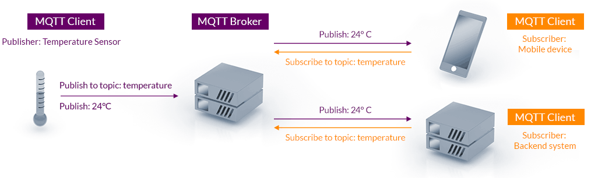

## 1. Nền tảng và khái niệm cốt lõi

### 1.1. MQTT là gì?

MQTT (Message Queuing Telemetry Transport) là giao thức truyền thông dạng publish/subscribe, được thiết kế cho các thiết bị IoT có tài nguyên hạn chế và mạng không ổn định.

Đặc điểm của MQTT:
- Nhẹ: header cố định chỉ 2 byte, gói nhỏ nhất (PINGREQ) chỉ có 2 byte. Thư viện client có thể chạy trên MCU vài chục KB RAM.
- Hoạt động trên TCP/IP (mặc định port 1883, TLS port 8883). TCP đảm bảo dữ liệu đến đúng thứ tự và không lỗi, MQTT chỉ lo phần định tuyến message.
- Mô hình publish/subscribe: thiết bị không cần biết nhau, chỉ cần biết broker.
- Có sẵn các cơ chế cho mạng chập chờn: QoS, Keep Alive, Last Will, Persistent Session, Retained message.
- Chuẩn mở, được chuẩn hóa bởi OASIS và ISO/IEC 20922.

Hai phiên bản đang dùng phổ biến:
- MQTT 3.1.1 (2014): được hỗ trợ ở hầu hết broker và thư viện, đặc biệt trên MCU.
- MQTT 5.0 (2019): bổ sung reason code, session expiry, message expiry, user properties, shared subscription, request/response,...

Tài liệu này trình bày theo MQTT 3.1.1, chỗ nào MQTT 5 khác biệt quan trọng sẽ được ghi chú.

### 1.2. So sánh với các giao thức khác

| Tiêu chí | MQTT | HTTP | CoAP | AMQP | WebSocket |
| --- | --- | --- | --- | --- | --- |
| Mô hình | Publish/Subscribe qua broker | Request/Response | Request/Response (+ Observe) | Queue, exchange, routing | Kênh 2 chiều, không định nghĩa message |
| Transport | TCP | TCP | UDP | TCP | TCP |
| Header | 2 byte trở lên | Hàng trăm byte (text) | 4 byte | 8 byte trở lên | 2-14 byte |
| Kết nối | Giữ kết nối lâu dài | Thường ngắn (mỗi request) | Không kết nối | Giữ kết nối lâu dài | Giữ kết nối lâu dài |
| Phù hợp | Telemetry, điều khiển thiết bị, mạng chập chờn | REST API, web, tải file | Thiết bị rất yếu, mạng 6LoWPAN, NB-IoT | Backend doanh nghiệp, hàng đợi giao dịch | Ứng dụng web realtime |

Khi nào nên chọn MQTT:
- Có nhiều thiết bị gửi dữ liệu nhỏ, thường xuyên lên server.
- Một dữ liệu cần gửi tới nhiều nơi cùng lúc (dashboard, database, rule engine,...).
- Mạng không ổn định, cần biết thiết bị online hay offline.

Khi nào không nên chọn MQTT:
- Tải file lớn (firmware, ảnh): dùng HTTP.
- Thiết bị chỉ chạy được UDP hoặc quá yếu để giữ kết nối TCP: dùng CoAP hoặc MQTT-SN.
- Cần hàng đợi giao dịch phức tạp ở backend: dùng AMQP (RabbitMQ) hoặc Kafka.

:::warning Lưu ý
WebSocket không phải đối thủ của MQTT mà là một transport. Trình duyệt không mở được TCP socket thô, nên website sẽ chạy MQTT over WebSocket (ví dụ port 9001 trên mosquitto) để kết nối đến broker.
:::

### 1.3. Kiến trúc Publish/Subscribe

Để giao thức hoạt động được, cần có ba thành phần:
- **MQTT Broker**: là thành phần trung gian điều phối bản tin giữa các MQTT Client trong hệ thống:
  + Nhận message từ client
  + Xem message đó thuộc topic nào
  + Gửi message đó cho những client nào đã subscribe topic tương ứng
  + Ngoài ra broker còn quản lý session, xác thực, phân quyền, lưu retained message và LWT.
- **MQTT Client**: là các thiết bị hoặc ứng dụng kết nối đến Broker để thực hiện truyền nhận dữ liệu. Một client có thể vừa là publisher vừa là subscriber.
  + Publisher: gửi dữ liệu lên broker.
  + Subscriber: đăng ký topic và nhận dữ liệu từ broker.
- **Topic**: là chuỗi text phân cấp bằng dấu `/` được Broker sử dụng để phân loại message.



Điểm quan trọng của Pub/Sub là publisher và subscriber được tách rời (decoupling) nhau:
- **Về không gian**: publisher không cần biết IP, port hay số lượng subscriber. Thêm hay bớt subscriber không phải sửa code publisher.
- **Về thời gian**: publisher và subscriber không nhất thiết phải online cùng lúc. Với retained message và persistent session, broker sẽ giữ message và giao lại khi subscriber kết nối.
- **Về đồng bộ**: publish là thao tác bất đồng bộ, publisher không phải chờ subscriber xử lý xong. Subscriber nhận message qua callback.

## 2. Topic và thiết kế topic

### 2.1. Cấu trúc topic

Topic là chuỗi UTF-8 phân cấp bằng dấu `/`, mỗi phần là một tầng (level):

```
home / livingroom / temp
 |         |          |
level 1  level 2   level 3
```

Topic không cần tạo trước: client publish lên topic nào thì broker tự hiểu topic đó tồn tại.

Quy tắc cần nhớ:
- Phân biệt chữ hoa, chữ thường: `Home/Temp` khác `home/temp`.
- Không nên bắt đầu bằng `/`: `/home/temp` tạo ra một tầng rỗng ở đầu, khác với `home/temp`.
- Không dùng khoảng trắng, ký tự đặc biệt hoặc tiếng Việt có dấu để tránh lỗi khi debug.
- Ký tự `+`, `#` chỉ dùng khi subscribe, không được dùng trong topic publish.

### 2.2. Wildcard

Wildcard là cách để subscribe nhiều topic cùng lúc bằng ký tự đặc biệt. MQTT hỗ trợ 2 loại wildcard:

| Wildcard | Tên gọi               | Range                  | Vị trí được dùng                            |
| -------- | --------------------- | ---------------------- | ------------------------------------------- |
| `+`      | Single-level wildcard | Chỉ khớp 1 tầng        | Ở bất kỳ tầng nào, nhưng phải chiếm trọn tầng đó |
| `#`      | Multi-level wildcard  | Khớp 0 hoặc nhiều tầng | Chỉ được dùng ở cuối topic                  |

**Ví dụ 1**

```bash
sensor/+/temp
```

→ Khớp các topic như:
- `sensor/room1/temp`
- `sensor/room2/temp`
- `sensor/lab/temp`

→ Không khớp:
- `sensor/room1/child/temp` (vì dư 1 tầng)
- `sensor/temp` (thiếu 1 tầng)

**Ví dụ 2**

```bash
sensor/#
```

→ Khớp vào các topic như:
- `sensor` (vì `#` khớp cả 0 tầng)
- `sensor/temp`
- `sensor/humi`
- `sensor/lab/temp`
- `sensor/lab/floor2/light`

**Các cách viết không hợp lệ**

| Topic filter | Lý do |
| --- | --- |
| `sensor/+temp` | `+` phải chiếm trọn một tầng |
| `sensor/#/temp` | `#` chỉ được nằm cuối |
| `sensor#` | `#` phải đứng sau `/` hoặc đứng một mình |

:::warning Lưu ý
Subscribe `#` sẽ nhận toàn bộ message trên broker. Cách này tiện để debug, nhưng không nên dùng trong hệ thống thật vì tải rất lớn.
:::

### 2.3. Topic hệ thống `$SYS/`

Các topic bắt đầu bằng `$` được dành riêng cho broker. `$SYS/` là nơi broker publish thông tin thống kê của chính nó. Với mosquitto:

| Topic | Ý nghĩa |
| --- | --- |
| `$SYS/broker/version` | Phiên bản broker |
| `$SYS/broker/uptime` | Thời gian broker đã chạy |
| `$SYS/broker/clients/connected` | Số client đang kết nối |
| `$SYS/broker/messages/received` | Tổng số message đã nhận |
| `$SYS/broker/load/messages/received/1min` | Số message nhận trung bình trong 1 phút |

```bash
mosquitto_sub -h localhost -t '$SYS/#' -v
```

:::warning Lưu ý:
- Wildcard `#` hay `+` đứng ở tầng đầu tiên sẽ không khớp với các topic bắt đầu bằng `$`. Subscribe `#` không nhận được `$SYS/...`, phải subscribe `$SYS/#` riêng.
- Phải đặt topic trong dấu nháy đơn khi dùng shell để `$SYS` không bị hiểu là biến môi trường.
- Chu kỳ cập nhật được cấu hình bằng `sys_interval` trong `mosquitto.conf` (mặc định 10 giây).
:::

### 2.4. Thiết kế topic cho dự án thật

Topic là API của hệ thống, đổi topic sau khi đã có hàng nghìn thiết bị ngoài thực tế rất tốn kém. Vì vậy cần thiết kế ngay từ đầu.

Một cấu trúc thường dùng:

```
<site>/<location>/<device-id>/<category>/<name>
```

Trong đó `category` tách riêng các loại dữ liệu khác nhau:

| Category | Hướng | Ví dụ | Mô tả |
| --- | --- | --- | --- |
| `telemetry` | Thiết bị -> server | `home/livingroom/esp32-01/telemetry/temp` | Dữ liệu cảm biến gửi định kỳ, thường QoS 0 |
| `cmd` | Server -> thiết bị | `home/livingroom/esp32-01/cmd/led` | Lệnh điều khiển, thường QoS 1 |
| `state` | Thiết bị -> server | `home/livingroom/esp32-01/state/led` | Trạng thái thực tế sau khi thực hiện lệnh, retained |
| `status` | Thiết bị -> server | `home/livingroom/esp32-01/status` | `online` / `offline`, dùng với LWT, retained |

Ví dụ luồng bật đèn:

```
App    --- PUBLISH .../cmd/led    "ON" --->  Broker  ---> Device
Device --- PUBLISH .../state/led  "ON" --->  Broker  ---> App   (retained)
```

Tách `cmd` và `state` giúp app biết lệnh đã thực sự được thực hiện hay chưa, thay vì chỉ biết lệnh đã được gửi đi.

Một vài nguyên tắc:
- Đặt phần cố định ở bên trái, phần thay đổi ở bên phải để subscribe bằng wildcard thuận tiện, ví dụ `home/+/+/telemetry/#` lấy toàn bộ telemetry.
- Dùng ID duy nhất của thiết bị (MAC, serial) trong topic, cùng giá trị với Client ID. Điều này giúp viết ACL dạng thiết bị chỉ được ghi vào topic của chính nó (xem phần 6).
- Topic ngắn gọn nhưng đọc được. Trên mạng băng thông thấp (NB-IoT, LoRa gateway) có thể rút gọn tên nhưng phải thống nhất trong tài liệu.
- Có thể thêm phiên bản vào topic (`v1/...`) nếu dự đoán sau này sẽ đổi định dạng payload.

## 3. Các cơ chế quan trọng của giao thức

### 3.1. Quality of Service

QoS trong MQTT quyết định độ tin cậy khi gửi PUBLISH trên từng chặng:
- Client → Broker: dùng QoS mà publisher chọn.
- Broker → Subscriber: dùng QoS nhỏ hơn giữa QoS của message và QoS mà subscriber đăng ký khi subscribe.

Ví dụ: publisher gửi QoS 2, subscriber đăng ký QoS 0 thì subscriber chỉ nhận ở QoS 0.

| **Mức QoS** | **Tên gọi**     | **Cơ chế gửi**                                                                            | **Ưu điểm**                                                                  | **Nhược điểm**                                                                                     | **Dùng khi nào?**                                                                                                          |
| ----------- | --------------- | ----------------------------------------------------------------------------------------- | ---------------------------------------------------------------------------- | -------------------------------------------------------------------------------------------------- | -------------------------------------------------------------------------------------------------------------------------- |
| **QoS 0**   | *At most once*  | - Gửi **1 lần duy nhất** <br>- Không ACK <br>- Nếu mất gói → không retry                  | - Nhanh nhất <br>- Ít tốn RAM/CPU <br>- Phù hợp dữ liệu tốc độ cao           | - Có thể mất message <br>- Không đảm bảo độ tin cậy                                                | - Sensor gửi liên tục (temp/humi mỗi 1s) <br>- Dữ liệu tốc độ cao, không quan trọng mất gói <br>- Telemetry streaming      |
| **QoS 1**   | *At least once* | - Luôn có ACK (PUBACK) <br>- Broker hoặc client có thể gửi lại → **có thể trùng message** | - Đảm bảo message đến <br>- Độ tin cậy tốt <br>- Phù hợp cho lệnh quan trọng | - Có thể nhận trùng message → phải lọc <br>- Tốn tài nguyên hơn QoS0                               | - Giá trị sensor quan trọng <br>- Thông báo trạng thái (online/offline) <br>- Logging quan trọng <br>- OTA progress/status |
| **QoS 2**   | *Exactly once*  | - Đảm bảo **đến đúng 1 lần** <br>- 4 bước handshake (PUBLISH, PUBREC, PUBREL, PUBCOMP)    | - Chắc chắn nhất <br>- Không mất message <br>- Không trùng message           | - Chậm nhất <br>- Tốn băng thông nhất <br>- Phức tạp, nặng với embedded <br>- Rất ít hệ thống dùng | - Banking/Billing <br>- Đơn hàng, giao dịch tài chính <br>- Không được dùng cho IoT streaming                              |

**Luồng gói tin**

QoS 0: gửi rồi quên, không có gói phản hồi.

```
Sender                     Receiver
  | ---- PUBLISH (QoS 0) ---> |
```

QoS 1: bên gửi giữ message cho đến khi nhận PUBACK. Nếu hết thời gian chờ hoặc kết nối lại, bên gửi gửi lại PUBLISH với cờ DUP = 1. Nếu PUBACK bị mất thì bên nhận sẽ nhận message 2 lần.

```
Sender                              Receiver
  | ---- PUBLISH (QoS 1, id=10) ---> |  xử lý message
  | <--- PUBACK  (id=10) ----------- |
  |  xóa message khỏi bộ nhớ         |
```

QoS 2: thêm một vòng xác nhận để bên nhận biết chắc chắn bên gửi đã ngừng gửi lại, nhờ vậy không bị trùng.

```
Sender                              Receiver
  | ---- PUBLISH (QoS 2, id=11) ---> |  lưu id=11, chưa giao lên ứng dụng
  | <--- PUBREC  (id=11) ----------- |  "đã nhận"
  | ---- PUBREL  (id=11) ----------> |  "tôi sẽ không gửi lại nữa" -> giao message, xóa id
  | <--- PUBCOMP (id=11) ----------- |  "hoàn tất"
```

Packet Identifier (`id` ở trên) là số 16 bit mà bên gửi gán cho mỗi message QoS 1/2 để ghép cặp với gói ACK. Số lượng message QoS > 0 đang chờ ACK cùng lúc (in-flight) bị giới hạn, trên mosquitto cấu hình bằng `max_inflight_messages`.

:::tip Lưu ý
Trên thực tế IoT, QoS 1 kết hợp với xử lý idempotent (nhận trùng 2 lần cũng không sao, ví dụ lệnh "đặt LED = ON" thay vì "đảo trạng thái LED") gần như luôn tốt hơn QoS 2.
:::

### 3.2. Retained Message

Retained message là message mới nhất mà broker giữ lại (cache) để gửi cho mọi subscriber mới ngay khi chúng subscribe.

Nói cách khác:
- Bình thường: subscriber chỉ nhận những message được gửi sau khi nó subscribe.
- Với retained: khi client subscribe một topic, nó sẽ nhận ngay message mới nhất mà broker đã lưu cho topic đó.

Ví dụ, ta có một website hiển thị trạng thái các sensor chậm thay đổi. Khi reload trang, website sẽ hiển thị trạng thái mặc định và không cập nhật trạng thái thực tế cho đến khi có dữ liệu mới. Nếu thiết bị publish trạng thái với cờ retain, website sẽ nhận được trạng thái ngay khi subscribe.

Đặc điểm:
- Mỗi topic chỉ có tối đa 1 retained message, message mới sẽ ghi đè message cũ.
- Để xóa retained message, publish một message rỗng (payload 0 byte) với cờ retain lên topic đó.
- Dùng cho dữ liệu kiểu trạng thái hiện tại (`state`, `status`, `config`), không dùng cho dữ liệu kiểu sự kiện (nút bấm, cảnh báo) vì subscriber mới sẽ nhận lại một sự kiện cũ.

```bash
# Publish retained
mosquitto_pub -h localhost -t home/livingroom/esp32-01/state/led -m "ON" -r

# Xóa retained (-n: payload rỗng)
mosquitto_pub -h localhost -t home/livingroom/esp32-01/state/led -n -r
```

### 3.3. Last Will & Testament

LWT là một message mà broker sẽ tự động gửi khi client mất kết nối bất thường.

Client đăng ký LWT (topic, payload, QoS, retain) ngay trong gói CONNECT. Broker giữ LWT này và:
- Nếu client gửi DISCONNECT bình thường: broker xóa LWT, không gửi.
- Nếu client chết bất thường, ví dụ như mất nguồn, mất WiFi, crash, treo task, app bị kill,... $\rightarrow$ client không kịp gửi DISCONNECT $\rightarrow$ broker phát hiện mất kết nối (lỗi socket hoặc hết Keep Alive) $\rightarrow$ broker gửi LWT cho các subscriber.

Mẫu thường dùng để theo dõi online/offline:

```
1. CONNECT với LWT: topic = .../status, payload = "offline", retain = 1
2. Ngay sau CONNACK: PUBLISH .../status "online", retain = 1
3. Mất kết nối bất thường: broker publish .../status "offline" (retained)
4. Trước khi tắt có chủ đích: PUBLISH .../status "offline" rồi mới DISCONNECT
```

Nhờ có retain, bất kỳ app nào subscribe `.../status` lúc nào cũng biết được trạng thái hiện tại của thiết bị.

### 3.4. Keep Alive và PING

TCP không tự báo khi kết nối bị đứt mà không có gói FIN/RST (ví dụ rút dây mạng, router mất điện). Hai đầu có thể tưởng kết nối vẫn còn trong rất lâu. Keep Alive giải quyết vấn đề này:
- Client khai báo Keep Alive (giây) trong CONNECT, ví dụ 60 giây.
- Nếu trong khoảng đó client không gửi gói nào, client phải gửi PINGREQ, broker trả lời PINGRESP.
- Nếu broker không nhận được gói nào từ client trong 1.5 lần Keep Alive, broker đóng kết nối và gửi LWT.
- Nếu client gửi PINGREQ mà không nhận được PINGRESP trong thời gian hợp lý, client coi kết nối đã chết và kết nối lại.

```
Client                     Broker
  | --- PUBLISH ----------> |   có dữ liệu thì không cần ping
  |        ... 60s không gửi gì ...
  | --- PINGREQ  ---------> |
  | <-- PINGRESP ---------- |
  |        ... mất mạng ...
  |                         |   sau 90s (1.5 x 60) không nhận gì
  |                         |   -> đóng kết nối, publish LWT
```

Chọn Keep Alive:
- Nhỏ (10-30 giây): phát hiện mất kết nối nhanh, nhưng tốn băng thông và pin.
- Lớn (60-300 giây): tiết kiệm, nhưng LWT đến chậm. Lưu ý các router NAT hoặc mạng di động thường xóa kết nối TCP sau vài phút không có dữ liệu, Keep Alive phải nhỏ hơn thời gian này.
- Keep Alive = 0: tắt cơ chế này, không nên dùng.

### 3.5. Clean Session và Persistent Session

Session là trạng thái broker lưu cho từng client, gắn với Client ID:
- Danh sách subscription.
- Các message QoS 1/2 chưa được giao cho client (khi client offline).
- Các message QoS 1/2 đang dở dang (chưa nhận đủ ACK).

Cờ Clean Session trong CONNECT quyết định session có được giữ lại hay không:

| | Clean Session = 1 | Clean Session = 0 (Persistent Session) |
| --- | --- | --- |
| Khi kết nối | Xóa session cũ, tạo session mới | Dùng lại session cũ nếu có |
| Khi ngắt kết nối | Xóa session | Giữ session, tiếp tục xếp hàng message QoS 1/2 |
| Subscription | Phải subscribe lại mỗi lần kết nối | Broker nhớ subscription |
| Dùng khi | Client chỉ quan tâm dữ liệu realtime | Thiết bị không được bỏ lỡ lệnh khi offline |

```
Device (clean session = 0, QoS 1 subscription)
  |  online ---- offline ------------------ online
  |                  |                         |
  App publish cmd/led "ON" (QoS 1)             |
  Broker xếp hàng message cho device           |
                                               Broker giao "ON" ngay sau CONNACK
```

Lưu ý:
- Message QoS 0 không được xếp hàng (mosquitto có tùy chọn `queue_qos0_messages` để bật).
- Gói CONNACK có cờ `Session Present` cho biết broker còn giữ session cũ hay không. Nếu bằng 0 thì client phải subscribe lại.
- Broker cần giới hạn số message xếp hàng (`max_queued_messages` trên mosquitto), nếu không một thiết bị offline lâu ngày sẽ làm đầy RAM broker.
- Trên mosquitto, muốn session vẫn còn sau khi restart broker thì phải bật `persistence true`.
- MQTT 5 tách thành hai phần: `Clean Start` (có dùng lại session cũ không) và `Session Expiry Interval` (session được giữ bao lâu sau khi ngắt kết nối).

### 3.6. Client ID

Client ID là định danh của client đối với broker, broker dùng nó để tìm session tương ứng. Vì vậy Client ID phải duy nhất trên một broker:
- Nếu client thứ hai kết nối với cùng Client ID, broker sẽ ngắt kết nối client đang online (session takeover).
- Nếu cả hai client đều có cơ chế tự kết nối lại, chúng sẽ lần lượt "đá" nhau ra liên tục. Log broker sẽ thấy dòng `Client xxx already connected, closing old connection` lặp lại liên tục, đây là lỗi rất hay gặp khi flash cùng một firmware có Client ID cố định cho nhiều thiết bị.

Cách đặt Client ID:
- Dùng giá trị duy nhất của phần cứng: MAC address, serial number, chip ID. Ví dụ `esp32-a4cf12b3c4d5`.
- Client ID cố định giữa các lần khởi động, nếu không persistent session sẽ vô nghĩa.
- MQTT 3.1.1 chỉ bắt buộc broker hỗ trợ Client ID dài 1-23 ký tự gồm `[0-9a-zA-Z]`. Đa số broker chấp nhận dài hơn, nhưng nên giữ ngắn gọn để tương thích.
- Client ID rỗng: broker tự sinh ID ngẫu nhiên, chỉ được phép khi Clean Session = 1.

## 4. Cấu trúc gói tin

Broker và Client giao tiếp với nhau thông qua các bản tin MQTT (Control Packet) được định nghĩa trong chuẩn OASIS. Dữ liệu trong các bản tin là chuỗi binary chứ không phải chuỗi văn bản như HTTP.

### 4.1. Cấu trúc chung

Mỗi gói gồm 3 phần:

```
+--------------------------------------+
| Fixed header     (2-5 byte, mọi gói) |
+--------------------------------------+
| Variable header  (tùy loại gói)      |
+--------------------------------------+
| Payload          (tùy loại gói)      |
+--------------------------------------+
```

**Fixed header**

```
Bit:      7   6   5   4   3   2   1   0
        +---------------+---------------+
Byte 1  | Packet type   | Flags         |
        +---------------+---------------+
Byte 2+ | Remaining Length (1-4 byte)   |
        +-------------------------------+
```

- Packet type (4 bit cao): loại gói.
- Flags (4 bit thấp): chỉ có ý nghĩa với PUBLISH, các gói khác có giá trị cố định.
- Remaining Length: số byte của variable header + payload (không tính fixed header).

**Variable header**: chứa thông tin riêng của từng loại gói, ví dụ Packet Identifier, tên topic, cờ kết nối,...

**Payload**: dữ liệu chính, ví dụ nội dung message của PUBLISH, danh sách topic của SUBSCRIBE, Client ID của CONNECT.

Các kiểu dữ liệu dùng trong gói:
- Số nguyên 16 bit: big-endian (byte cao trước).
- Chuỗi UTF-8: 2 byte độ dài (big-endian) + nội dung, không có ký tự `\0` kết thúc. Ví dụ `"MQTT"` = `00 04 4D 51 54 54`.

### 4.2. Các loại gói

| Giá trị | Gói | Hướng | Flags | Mô tả |
| --- | --- | --- | --- | --- |
| 1 | CONNECT | Client -> Broker | `0000` | Yêu cầu kết nối |
| 2 | CONNACK | Broker -> Client | `0000` | Trả lời kết nối |
| 3 | PUBLISH | Hai chiều | `DUP QoS QoS RETAIN` | Gửi message |
| 4 | PUBACK | Hai chiều | `0000` | ACK cho QoS 1 |
| 5 | PUBREC | Hai chiều | `0000` | QoS 2, bước 1 |
| 6 | PUBREL | Hai chiều | `0010` | QoS 2, bước 2 |
| 7 | PUBCOMP | Hai chiều | `0000` | QoS 2, bước 3 |
| 8 | SUBSCRIBE | Client -> Broker | `0010` | Đăng ký topic |
| 9 | SUBACK | Broker -> Client | `0000` | Trả lời đăng ký |
| 10 | UNSUBSCRIBE | Client -> Broker | `0010` | Hủy đăng ký |
| 11 | UNSUBACK | Broker -> Client | `0000` | Trả lời hủy đăng ký |
| 12 | PINGREQ | Client -> Broker | `0000` | Keep Alive |
| 13 | PINGRESP | Broker -> Client | `0000` | Trả lời Keep Alive |
| 14 | DISCONNECT | Client -> Broker (MQTT 5: hai chiều) | `0000` | Ngắt kết nối bình thường |
| 15 | AUTH | Hai chiều | `0000` | Chỉ có ở MQTT 5, xác thực mở rộng |

Vì vậy byte đầu tiên của các gói thường gặp là: CONNECT `0x10`, CONNACK `0x20`, PUBLISH `0x30`-`0x3F`, SUBSCRIBE `0x82`, SUBACK `0x90`, PINGREQ `0xC0`, PINGRESP `0xD0`, DISCONNECT `0xE0`.

**CONNECT**

Variable header:

| Trường | Kích thước | Giá trị |
| --- | --- | --- |
| Protocol Name | 6 byte | `00 04 'M' 'Q' 'T' 'T'` |
| Protocol Level | 1 byte | `4` = MQTT 3.1.1, `5` = MQTT 5 |
| Connect Flags | 1 byte | Xem bên dưới |
| Keep Alive | 2 byte | Số giây |

Connect Flags:

```
Bit:   7         6         5            4  3       2          1              0
     +---------+---------+------------+---------+----------+--------------+----------+
     | User    | Pass    | Will       | Will    | Will     | Clean        | Reserved |
     | name    | word    | Retain     | QoS     | Flag     | Session      | (0)      |
     +---------+---------+------------+---------+----------+--------------+----------+
```

Payload theo thứ tự: Client ID, Will Topic, Will Message, Username, Password (chỉ có các trường mà cờ tương ứng bằng 1).

Ví dụ CONNECT với Client ID `dev1`, Clean Session = 1, Keep Alive = 60:

```
10 10                     Fixed header: CONNECT, Remaining Length = 16
00 04 4D 51 54 54         Protocol Name "MQTT"
04                        Protocol Level 4 (3.1.1)
02                        Connect Flags: Clean Session = 1
00 3C                     Keep Alive = 60
00 04 64 65 76 31         Client ID "dev1"
```

**CONNACK**

```
20 02 00 00
      |  |
      |  +-- Return code
      +----- Session Present (bit 0)
```

| Return code | Ý nghĩa |
| --- | --- |
| 0 | Kết nối thành công |
| 1 | Broker không hỗ trợ phiên bản giao thức |
| 2 | Client ID không hợp lệ |
| 3 | Broker không sẵn sàng |
| 4 | Sai username/password |
| 5 | Không có quyền kết nối |

MQTT 5 thay bằng Reason Code chi tiết hơn (ví dụ `0x86` Bad User Name or Password, `0x87` Not authorized).

**PUBLISH**

- Flags: DUP (bit 3, gửi lại), QoS (bit 2-1), RETAIN (bit 0).
- Variable header: Topic Name (chuỗi UTF-8), Packet Identifier (2 byte, chỉ có khi QoS > 0).
- Payload: dữ liệu ứng dụng, broker không quan tâm nội dung. Độ dài payload = Remaining Length - độ dài variable header.

Ví dụ PUBLISH QoS 0, topic `a/b`, payload `hi`:

```
30 07                     PUBLISH, QoS 0, không retain, Remaining Length = 7
00 03 61 2F 62            Topic "a/b"
68 69                     Payload "hi"
```

Cùng message đó với QoS 1, retain, Packet ID = 1:

```
33 09                     0x30 | QoS 1 (0x02) | RETAIN (0x01), Remaining Length = 9
00 03 61 2F 62            Topic "a/b"
00 01                     Packet Identifier = 1
68 69                     Payload "hi"
```

**SUBSCRIBE / SUBACK**

```
SUBSCRIBE:
82 08                     SUBSCRIBE (flags 0010), Remaining Length = 8
00 01                     Packet Identifier = 1
00 03 61 2F 23            Topic filter "a/#"
01                        Requested QoS = 1

SUBACK:
90 03                     SUBACK, Remaining Length = 3
00 01                     Packet Identifier = 1
01                        Granted QoS = 1 (0x80 = bị từ chối)
```

Một gói SUBSCRIBE có thể chứa nhiều topic filter, SUBACK trả về mỗi topic một return code theo đúng thứ tự.

**PINGREQ, PINGRESP, DISCONNECT**: chỉ có fixed header, Remaining Length = 0: `C0 00`, `D0 00`, `E0 00`.

### 4.3. Mã hóa Remaining Length

Remaining Length dùng kiểu Variable Byte Integer: mỗi byte chứa 7 bit dữ liệu, bit 7 (MSB) là cờ "còn byte tiếp theo". Byte đầu tiên chứa 7 bit thấp nhất.

```
Bit:   7            6 5 4 3 2 1 0
     +------------+---------------+
     | Continue   | 7 bit giá trị |
     +------------+---------------+
```

| Số byte | Khoảng giá trị | Ví dụ |
| --- | --- | --- |
| 1 | 0 - 127 | 64 = `40` |
| 2 | 128 - 16 383 | 321 = `C1 02` |
| 3 | 16 384 - 2 097 151 | 16 384 = `80 80 01` |
| 4 | 2 097 152 - 268 435 455 | 268 435 455 = `FF FF FF 7F` |

Giải thích ví dụ 321: 321 = 2 x 128 + 65. Byte đầu = 65 | 0x80 = `0xC1` (còn byte sau), byte thứ hai = 2 = `0x02`.

Vì vậy một gói MQTT tối đa khoảng 256 MB, nhưng trên thực tế broker và client luôn giới hạn nhỏ hơn rất nhiều.

Code mã hóa và giải mã (dùng khi tự viết client trên MCU):

```c
/* Mã hóa len vào buf, trả về số byte đã ghi (1-4) */
int mqtt_encode_len(uint8_t *buf, uint32_t len)
{
    int i = 0;

    do {
        uint8_t byte = len % 128;
        len /= 128;
        if (len > 0)
            byte |= 0x80;  /* còn byte tiếp theo */
        buf[i++] = byte;
    } while (len > 0 && i < 4);

    return i;
}

/* Giải mã từ buf, trả về số byte đã đọc, -1 nếu lỗi */
int mqtt_decode_len(const uint8_t *buf, uint32_t *len)
{
    uint32_t multiplier = 1;
    uint32_t value = 0;
    int i = 0;
    uint8_t byte;

    do {
        if (i >= 4)
            return -1;  /* quá 4 byte -> gói lỗi */
        byte = buf[i++];
        value += (byte & 0x7F) * multiplier;
        multiplier *= 128;
    } while (byte & 0x80);

    *len = value;
    return i;
}
```

### 4.4. Debug gói tin

Bắt gói tin bằng tcpdump trên board rồi mở bằng Wireshark trên máy host:

```bash
tcpdump -i any port 1883 -w mqtt.pcap
```

Trong Wireshark dùng filter `mqtt`, Wireshark sẽ tự giải mã từng trường của gói. Với TLS (port 8883) thì chỉ thấy dữ liệu đã mã hóa.

Ngoài ra `mosquitto_sub` và `mosquitto_pub` có option `-d` để in ra các gói gửi và nhận:

```bash
mosquitto_sub -h localhost -t sensor/temp -d
```

```
Client null sending CONNECT
Client null received CONNACK (0)
Client null sending SUBSCRIBE (Mid: 1, Topic: sensor/temp, QoS: 0, Options: 0x00)
Client null received SUBACK
Subscribed (mid: 1): 0
```

## 5. Broker

### 5.1. Các broker phổ biến

| Broker | Ngôn ngữ | Đặc điểm |
| --- | --- | --- |
| Mosquitto | C | Nhẹ, dễ học, chạy tốt trên board nhúng, không hỗ trợ clustering |
| EMQX | Erlang | Clustering, hàng triệu kết nối, rule engine, dashboard web |
| HiveMQ | Java | Thương mại (có bản Community), clustering, hướng doanh nghiệp |
| VerneMQ | Erlang | Mã nguồn mở, clustering |
| NanoMQ | C | Rất nhẹ, tối ưu cho edge gateway, đa luồng |

Broker cloud:
- AWS IoT Core, Azure IoT Hub: tích hợp sẵn với hệ sinh thái cloud, bắt buộc TLS và xác thực bằng certificate, có một số giới hạn so với chuẩn (ví dụ Azure IoT Hub chỉ cho phép một số topic định sẵn, AWS IoT Core không hỗ trợ QoS 2).
- HiveMQ Cloud, EMQX Cloud: broker MQTT đầy đủ được quản lý sẵn, có gói miễn phí.
- Broker public để thử nghiệm: `test.mosquitto.org`, `broker.hivemq.com`, `broker.emqx.io`. Ai cũng có thể subscribe `#` nên không gửi dữ liệu thật lên đây.

Tài liệu này tập trung vào mosquitto.

### 5.2. Cài đặt mosquitto

**Trên Ubuntu/Debian**

```bash
sudo apt install mosquitto mosquitto-clients libmosquitto-dev
sudo systemctl enable --now mosquitto
```

- `mosquitto`: broker.
- `mosquitto-clients`: công cụ `mosquitto_pub`, `mosquitto_sub`.
- `libmosquitto-dev`: header và thư viện để lập trình client (phần 7).

**Trên Yocto image**

Bước 1: Clone meta-openembedded

```bash
git clone git://git.openembedded.org/meta-openembedded
```

Trong `meta-openembedded` có nhiều sublayer, trong đó:
- `meta-networking` → chứa recipe mosquitto (broker + libmosquitto).
- `meta-oe` → các recipe mà `meta-networking` phụ thuộc.

Bước 2: Thêm các layer vào `bblayers.conf`

Mở file: `build/conf/bblayers.conf` và thêm:

```conf
BBLAYERS += " \
  /.../meta-openembedded/meta-networking \
  /.../meta-openembedded/meta-oe \
"
```

Hoặc có thể thêm bằng cách sử dụng:

```bash
bitbake-layers add-layer ../meta-openembedded/meta-oe
bitbake-layers add-layer ../meta-openembedded/meta-networking
```

Bước 3: Thêm library mosquitto vào yocto image (rootfs)

Library mosquitto thường được tách ra thành package dạng `libmosquitto` hoặc `libmosquitto1` tùy branch. Ta có thể check package nào được sử dụng bằng cách:

```bash
bitbake -e mosquitto | grep ^PACKAGES=
```

hoặc:

```bash
oe-pkgdata-util list-pkgs | grep mosquitto
```

Giả sử ta thấy có `libmosquitto1`, thì trong `conf/local.conf`:

```conf
IMAGE_INSTALL:append = " libmosquitto1"
```

Nếu muốn sử dụng broker mosquitto ngay trên board thì ta cần package `mosquitto`. Ngoài ra, để có thể test mosquitto thì cần package `mosquitto-clients`:

```conf
IMAGE_INSTALL:append = " mosquitto libmosquitto1 mosquitto-clients"
```

Bước 4: Đưa library vào SDK để cross compile

Để build app C trên máy host bằng cross compiler của Yocto, ta cần thêm các package có file header và .so vào trong SDK. Để biết đúng package nào cần thêm ta làm như sau:

```bash
# Liệt kê các package mà recipe mosquitto tạo ra -> lấy package có đuôi "-dev" hoặc "-staticdev"
bitbake -e mosquitto | grep ^PACKAGES=

# Tìm đúng package chứa header và .so
oe-pkgdata-util find-path /usr/include/mosquitto.h
oe-pkgdata-util find-path /usr/lib/*mosquitto.so*
```

Khi tìm thấy package ta thêm nó vào cấu hình `TOOLCHAIN_TARGET_TASK` trong file `conf/local.conf`:

```bash
TOOLCHAIN_TARGET_TASK:append = " mosquitto-dev"
```

Sau đó, ta sẽ build lại sdk:

```bash
bitbake <tên-image> -c populate_sdk
```

Lệnh này tạo 1 file `.sh`, khi cài đặt sẽ chứa gcc cross + headers + .so + pkg-config tương ứng với các package đã đưa thêm vào image.

Cài SDK:

```bash
tmp/deploy/sdk/poky-glibc-*-core-image-minimal-*.sh
# chọn path cài, ví dụ /opt/poky
```

Mỗi lần build app:

```bash
source /opt/poky/environment-setup-*-poky-linux-gnueabi
```

Kiểm tra xem trong SDK đã có file header và file .so chưa:

```bash
find $SDKTARGETSYSROOT -name "libmosquitto.so*"
find $SDKTARGETSYSROOT -name "mosquitto.h"
```

Lúc này, ta sẽ có môi trường để cross compile.

### 5.3. Cấu hình mosquitto broker

File cấu hình mặc định là `/etc/mosquitto/mosquitto.conf`. Từ mosquitto 2.0, nếu không khai báo `listener` thì broker chỉ nhận kết nối từ `localhost` và nếu không có cấu hình xác thực thì broker từ chối client ẩn danh. Vì vậy cần thêm cấu hình sau:

```conf
listener 1883
protocol mqtt

# Nếu muốn kết nối từ website thì phải thêm cấu hình này
listener 9001
protocol websockets

# Cho phép client không cần user/pass (chỉ dùng khi thử nghiệm, xem phần 6)
allow_anonymous true

# Lưu session, retained message xuống file để không mất khi restart broker
persistence true
persistence_location /var/lib/mosquitto/

# Giới hạn tài nguyên
max_queued_messages 1000
message_size_limit 262144
```

Một số tùy chọn hay dùng khác:

| Tùy chọn | Ý nghĩa |
| --- | --- |
| `max_inflight_messages` | Số message QoS 1/2 đang chờ ACK cùng lúc cho mỗi client |
| `max_queued_messages` | Số message tối đa xếp hàng cho client offline |
| `message_size_limit` | Kích thước payload tối đa (byte), vượt quá sẽ bị broker bỏ |
| `max_keepalive` | Keep Alive tối đa client được phép khai báo |
| `sys_interval` | Chu kỳ cập nhật `$SYS/` (giây) |
| `include_dir` | Đọc thêm các file `.conf` trong thư mục, ví dụ `/etc/mosquitto/conf.d` |

Kiểm tra xem broker mosquitto đã chạy chưa:

```bash
ps aux | grep mosquitto
```

Nếu đang chạy thì cần restart mosquitto như sau:

```bash
# Hệ thống có systemd
systemctl restart mosquitto

# Hoặc chạy tay
killall mosquitto
mosquitto -c /etc/mosquitto/mosquitto.conf -v &
```

Kiểm tra đã có port 1883 cho mosquitto chưa:

```bash
netstat -tulpn | grep 1883
```

Nếu có kết nối từ website thì kiểm tra thêm port websocket:

```bash
netstat -tulpn | grep 9001
```

### 5.4. Xem log

Cấu hình log trong `mosquitto.conf`:

```conf
log_dest file /var/log/mosquitto/mosquitto.log
log_dest stdout
log_type error
log_type warning
log_type notice
log_type information
# log_type all     # in cả từng gói PUBLISH/SUBSCRIBE, dùng khi debug
connection_messages true
log_timestamp_format %Y-%m-%dT%H:%M:%S
```

Xem log:

```bash
tail -f /var/log/mosquitto/mosquitto.log
# hoặc nếu chạy bằng systemd
journalctl -u mosquitto -f
```

Một số dòng log quan trọng:

```
New client connected from 192.168.1.20:52144 as esp32-01 (p2, c1, k60).
Client esp32-01 has exceeded timeout, disconnecting.
Client esp32-01 already connected, closing old connection.
Client <unknown> disconnected, not authorised.
```

- `p2`: protocol level (p2 = MQTT 3.1.1, p5 = MQTT 5), `c1`: clean session = 1, `k60`: Keep Alive 60 giây.
- `exceeded timeout`: hết 1.5 lần Keep Alive mà không nhận được gói nào, LWT sẽ được gửi.
- `already connected`: trùng Client ID (xem phần 3.6).

### 5.5. Bridge giữa các broker

Bridge cho phép một broker mosquitto kết nối tới broker khác như một client và chuyển tiếp message theo topic. Mô hình hay gặp là broker local trên gateway nhà máy bridge lên broker cloud:

```
+---------+       +------------------+                  +--------------+
| Sensors | ----> | Mosquitto local  | ==== bridge ===> | Cloud broker |
+---------+       | (gateway)        |   TLS, 8883      |              |
                  +------------------+                  +--------------+
```

Lợi ích: thiết bị trong mạng LAN vẫn hoạt động khi mất Internet, chỉ một kết nối TLS ra ngoài thay vì mỗi thiết bị một kết nối, broker local có thể buffer message khi mất kết nối lên cloud.

Cấu hình trên broker local:

```conf
connection bridge-to-cloud
address cloud.example.com:8883

# topic <pattern> <in|out|both> <qos> <local-prefix> <remote-prefix>
# Gửi dữ liệu local "sensors/..." lên cloud thành "factory1/sensors/..."
topic sensors/# out 1 "" factory1/
# Nhận lệnh từ cloud "factory1/cmd/..." về local thành "cmd/..."
topic cmd/# in 1 "" factory1/

remote_clientid factory1-gateway
remote_username factory1
remote_password secret
bridge_cafile /etc/mosquitto/certs/ca.crt

# Giữ session trên cloud để không mất message khi bridge mất kết nối
cleansession false
# Trạng thái bridge (1/0) được publish lên topic này
notifications true
```

### 5.6. Mở rộng quy mô và clustering

Mosquitto là broker đơn tiến trình, không hỗ trợ clustering. Một instance mosquitto có thể phục vụ hàng chục nghìn kết nối, đủ cho đa số hệ thống vừa và nhỏ. Khi cần lớn hơn hoặc cần high availability:
- Chuyển sang broker có clustering (EMQX, HiveMQ, VerneMQ): nhiều node chia sẻ session và subscription, client kết nối vào node nào cũng được, thường đặt sau một load balancer TCP.
- Shared subscription (`$share/<group>/<topic>`, có trong MQTT 5 và mosquitto từ bản 1.6): nhiều subscriber cùng group chia nhau message thay vì mỗi subscriber nhận một bản. Dùng để chạy nhiều instance backend xử lý dữ liệu song song.
- Chia thiết bị theo vùng cho nhiều broker độc lập, rồi bridge về broker trung tâm.

```bash
# 2 worker cùng group "db", mỗi message chỉ được giao cho 1 trong 2
mosquitto_sub -t '$share/db/home/+/+/telemetry/#' -V mqttv5
```

### 5.7. Test mosquitto trên BBB

**Test subscribe**

Cú pháp:

```bash
mosquitto_sub -h <host> -p <port> -t <topic> -v
```

Giải thích tham số:

| Option | Ý nghĩa                     |
| ------ | --------------------------- |
| `-h`   | IP hoặc hostname của broker |
| `-p`   | port (mặc định 1883)        |
| `-t`   | topic cần subscribe         |
| `-v`   | hiện cả tên topic + payload |
| `-q`   | QoS khi subscribe           |
| `-c`   | tắt clean session (persistent session), cần đi kèm `-i` |
| `-i`   | Client ID                   |

**Test publish**

Cú pháp:

```bash
mosquitto_pub -h <host> -p <port> -t <topic> -m "<message>"
```

Giải thích tham số:

| Option | Ý nghĩa                     |
| ------ | --------------------------- |
| `-h`   | IP hoặc hostname của broker |
| `-p`   | port (mặc định 1883)        |
| `-t`   | topic cần publish           |
| `-m`   | message cần publish         |
| `-q`   | QoS                         |
| `-r`   | retained                    |
| `-n`   | gửi payload rỗng            |

**Ví dụ: Giả sử broker chạy trên BBB**

Terminal 1:

```bash
mosquitto_sub -h localhost -t sensor/temp
```

Terminal 2:

```bash
mosquitto_pub -h localhost -t sensor/temp -m "28.5"
```

Kết quả → terminal 1 sẽ in ra:

```bash
28.5
```

**Ví dụ: Test LWT**

Terminal 1 theo dõi trạng thái:

```bash
mosquitto_sub -h localhost -t dev1/status -v
```

Terminal 2 tạo một client có LWT với Keep Alive 5 giây:

```bash
mosquitto_sub -h localhost -t dummy -i dev1 -k 5 \
    --will-topic dev1/status --will-payload "offline" --will-retain
```

Nhấn Ctrl+C ở terminal 2: client gửi DISCONNECT nên không có LWT. Thay vào đó, dùng `kill -9` tiến trình ở terminal 2 hoặc ngắt mạng client: terminal 1 sẽ in ra `dev1/status offline`.

## 6. Bảo mật

Mặc định MQTT truyền mọi thứ dạng plain text, kể cả username/password trong gói CONNECT. Một hệ thống thật cần đủ ba lớp: xác thực (ai được kết nối), phân quyền (được đọc/ghi topic nào) và mã hóa (TLS).

### 6.1. Xác thực bằng username/password

Tạo file password:

```bash
# -c: tạo file mới (ghi đè nếu đã có), chỉ dùng cho user đầu tiên
mosquitto_passwd -c /etc/mosquitto/passwd admin
mosquitto_passwd /etc/mosquitto/passwd esp32-01
```

Password được lưu dưới dạng hash. Cấu hình trong `mosquitto.conf`:

```conf
allow_anonymous false
password_file /etc/mosquitto/passwd
```

Test:

```bash
mosquitto_sub -h localhost -t '#' -u admin -P <password>
```

### 6.2. ACL phân quyền theo topic

ACL (Access Control List) quy định user nào được đọc (`read`), ghi (`write`) hoặc cả hai (`readwrite`) trên topic nào.

```conf
# mosquitto.conf
acl_file /etc/mosquitto/acl
```

```conf
# /etc/mosquitto/acl

# pattern áp dụng cho mọi client: %c = Client ID, %u = username
# Mỗi thiết bị chỉ được ghi telemetry/state/status của chính nó và đọc lệnh của chính nó
pattern write home/+/%c/telemetry/#
pattern write home/+/%c/state/#
pattern write home/+/%c/status
pattern read  home/+/%c/cmd/#

# User backend được đọc/ghi toàn bộ
user admin
topic readwrite #

# User dashboard chỉ được đọc
user dashboard
topic read home/#
topic read $SYS/#
```

Mặc định, quyền nào không được liệt kê trong ACL thì bị từ chối. Nhờ topic có chứa Client ID (phần 2.4), một thiết bị bị chiếm quyền cũng không thể giả mạo dữ liệu hay gửi lệnh tới thiết bị khác.

:::warning Lưu ý
Khi client publish lên topic không có quyền, MQTT 3.1.1 không có cơ chế báo lỗi: broker vẫn trả PUBACK nhưng âm thầm bỏ message. Nếu thấy message biến mất, hãy kiểm tra ACL và log broker.
:::

### 6.3. TLS/SSL

TLS mã hóa toàn bộ kết nối, đồng thời giúp client xác minh đúng là broker thật (chống man-in-the-middle). Port chuẩn của MQTT over TLS là 8883.

Các thành phần:
- CA (Certificate Authority): chứng chỉ gốc dùng để ký các chứng chỉ khác. Client giữ `ca.crt` để kiểm tra broker.
- Server certificate: chứng chỉ của broker, được CA ký. CN hoặc SAN phải khớp với hostname/IP mà client dùng để kết nối.
- Client certificate (tùy chọn): chứng chỉ của từng thiết bị, broker dùng để xác thực thiết bị thay cho password.

Tạo chứng chỉ tự ký để thử nghiệm:

```bash
# 1. CA
openssl req -new -x509 -days 3650 -nodes -keyout ca.key -out ca.crt -subj "/CN=MyCA"

# 2. Server certificate, CN = địa chỉ broker
openssl req -new -nodes -keyout server.key -out server.csr -subj "/CN=192.168.1.10"
openssl x509 -req -in server.csr -CA ca.crt -CAkey ca.key -CAcreateserial \
    -out server.crt -days 365

# 3. Client certificate, CN = Client ID của thiết bị
openssl req -new -nodes -keyout esp32-01.key -out esp32-01.csr -subj "/CN=esp32-01"
openssl x509 -req -in esp32-01.csr -CA ca.crt -CAkey ca.key -CAcreateserial \
    -out esp32-01.crt -days 365
```

Cấu hình broker:

```conf
listener 8883
cafile   /etc/mosquitto/certs/ca.crt
certfile /etc/mosquitto/certs/server.crt
keyfile  /etc/mosquitto/certs/server.key
tls_version tlsv1.2

# Bắt buộc client có certificate do CA ký
require_certificate true
# Dùng CN trong client certificate làm username (để áp ACL)
use_identity_as_username true
```

Test:

```bash
mosquitto_sub -h 192.168.1.10 -p 8883 -t 'home/#' \
    --cafile ca.crt --cert esp32-01.crt --key esp32-01.key
```

Lưu ý:
- File `ca.key` là thứ quan trọng nhất, không được để trên broker hay thiết bị.
- Chứng chỉ có thời hạn, client phải có thời gian đúng (NTP/SNTP) thì mới kiểm tra được. Thiết bị khởi động với đồng hồ 1970 sẽ báo chứng chỉ "chưa có hiệu lực".
- Có thể dùng một listener 1883 chỉ bind `localhost` cho các dịch vụ nội bộ trên cùng máy, và listener 8883 cho bên ngoài.

### 6.4. Hạn chế bảo mật trên MCU tài nguyên thấp

TLS là phần tốn tài nguyên nhất của một MQTT client trên MCU:
- RAM: handshake TLS với mbedTLS thường cần khoảng 30-50 KB heap. Riêng buffer record TLS mặc định là 16 KB cho mỗi chiều. Có thể giảm bằng extension Max Fragment Length (nếu broker hỗ trợ) hoặc cấu hình `MBEDTLS_SSL_IN_CONTENT_LEN` / `MBEDTLS_SSL_OUT_CONTENT_LEN`.
- CPU và thời gian: handshake RSA 2048 trên Cortex-M4 có thể mất vài giây. Dùng ECC (ECDSA P-256) nhanh hơn và chứng chỉ nhỏ hơn nhiều.
- Lưu chứng chỉ: CA và client certificate nằm trong flash, private key cần được bảo vệ. Tốt nhất dùng secure element (ATECC608, SE050) hoặc vùng flash mã hóa để key không bao giờ rời khỏi chip.
- Thời gian thực: cần SNTP hoặc RTC để kiểm tra hạn chứng chỉ.
- Mỗi lần kết nối lại là một lần handshake: thiết bị chạy pin nên dùng TLS session resumption để tránh handshake đầy đủ.

Một vài lựa chọn khi MCU quá yếu:
- TLS-PSK: dùng khóa chia sẻ trước thay cho certificate, nhẹ hơn nhiều (mosquitto hỗ trợ `psk_hint`, `psk_file`).
- Để thiết bị yếu kết nối plain text trong mạng LAN tới gateway, gateway bridge lên cloud bằng TLS.
- Chọn MCU có hỗ trợ tăng tốc phần cứng cho AES/SHA/ECC (ESP32, STM32 có module crypto).

## 7. Lập trình client với libmosquitto

### 7.1. Luồng hoạt động

```
mosquitto_lib_init()
        |
        v
mosquitto_new()                     tạo client: Client ID, clean session
        |
        v
mosquitto_*_callback_set()          đăng ký callback: connect, message, disconnect,...
mosquitto_will_set()                LWT, username/password, TLS (trước khi connect)
        |
        v
mosquitto_connect()                 kết nối tới broker
        |
        v
mosquitto_loop_*()                  vòng lặp xử lý mạng: gửi/nhận gói, ping, reconnect
        |       mosquitto_publish(), mosquitto_subscribe()
        v
mosquitto_disconnect()
mosquitto_destroy()
mosquitto_lib_cleanup()
```

### 7.2. Các API chính

**Khởi tạo và hủy**

```c
int mosquitto_lib_init(void);
int mosquitto_lib_cleanup(void);

struct mosquitto *mosquitto_new(const char *id, bool clean_session, void *obj);
void mosquitto_destroy(struct mosquitto *mosq);
```

- `id`: Client ID. Nếu `NULL` thì thư viện sinh ID ngẫu nhiên, khi đó `clean_session` phải là `true`.
- `obj`: con trỏ dữ liệu người dùng, được truyền lại vào mọi callback.

**Cấu hình trước khi kết nối**

```c
int mosquitto_username_pw_set(struct mosquitto *mosq, const char *username, const char *password);

int mosquitto_will_set(struct mosquitto *mosq, const char *topic,
                       int payloadlen, const void *payload, int qos, bool retain);

int mosquitto_tls_set(struct mosquitto *mosq, const char *cafile, const char *capath,
                      const char *certfile, const char *keyfile,
                      int (*pw_callback)(char *buf, int size, int rwflag, void *userdata));

/* Thời gian chờ giữa các lần reconnect: delay, 2*delay, 4*delay,... tối đa delay_max */
int mosquitto_reconnect_delay_set(struct mosquitto *mosq, unsigned int reconnect_delay,
                                  unsigned int reconnect_delay_max, bool exponential_backoff);
```

**Kết nối**

```c
int mosquitto_connect(struct mosquitto *mosq, const char *host, int port, int keepalive);
int mosquitto_connect_async(struct mosquitto *mosq, const char *host, int port, int keepalive);
int mosquitto_disconnect(struct mosquitto *mosq);
```

- `mosquitto_connect()`: block cho đến khi kết nối TCP xong (chưa chờ CONNACK). Kết quả kết nối MQTT được báo qua callback connect.
- `mosquitto_connect_async()`: không block, dùng cùng `mosquitto_loop_start()`.

**Publish và subscribe**

```c
int mosquitto_publish(struct mosquitto *mosq, int *mid, const char *topic,
                      int payloadlen, const void *payload, int qos, bool retain);

int mosquitto_subscribe(struct mosquitto *mosq, int *mid, const char *sub, int qos);
int mosquitto_unsubscribe(struct mosquitto *mosq, int *mid, const char *sub);
```

- `mid`: message ID thư viện gán cho gói, dùng để đối chiếu trong callback publish/subscribe. Truyền `NULL` nếu không cần.
- Các hàm này chỉ đưa gói vào hàng đợi rồi trả về ngay, việc gửi thật sự do vòng lặp mạng đảm nhận.

**Callback**

```c
void mosquitto_connect_callback_set(struct mosquitto *mosq,
        void (*on_connect)(struct mosquitto *, void *obj, int rc));

void mosquitto_disconnect_callback_set(struct mosquitto *mosq,
        void (*on_disconnect)(struct mosquitto *, void *obj, int rc));

void mosquitto_message_callback_set(struct mosquitto *mosq,
        void (*on_message)(struct mosquitto *, void *obj, const struct mosquitto_message *msg));

void mosquitto_publish_callback_set(struct mosquitto *mosq,
        void (*on_publish)(struct mosquitto *, void *obj, int mid));

void mosquitto_subscribe_callback_set(struct mosquitto *mosq,
        void (*on_subscribe)(struct mosquitto *, void *obj, int mid,
                             int qos_count, const int *granted_qos));
```

| Callback | Được gọi khi | Tham số quan trọng |
| --- | --- | --- |
| `on_connect` | Nhận CONNACK | `rc`: return code của CONNACK, 0 = thành công |
| `on_disconnect` | Mất kết nối | `rc`: 0 = do gọi `mosquitto_disconnect()`, khác 0 = bất thường |
| `on_message` | Nhận PUBLISH | `msg->topic`, `msg->payload`, `msg->payloadlen`, `msg->qos`, `msg->retain` |
| `on_publish` | QoS 0: đã gửi đi; QoS 1: nhận PUBACK; QoS 2: nhận PUBCOMP | `mid` |
| `on_subscribe` | Nhận SUBACK | `granted_qos` |

Lưu ý `msg->payload` không có ký tự `\0` kết thúc, phải dùng `payloadlen` khi xử lý. `msg` và dữ liệu bên trong bị giải phóng sau khi callback trả về, muốn giữ lại thì phải copy.

**Vòng lặp mạng**

3 cách chạy vòng lặp mạng:

| Hàm | Cách hoạt động | Dùng khi |
| --- | --- | --- |
| `mosquitto_loop_forever(mosq, -1, 1)` | Block luồng hiện tại, tự reconnect | Chương trình chỉ làm việc MQTT |
| `mosquitto_loop_start(mosq)` / `mosquitto_loop_stop(mosq, force)` | Tạo một thread riêng chạy vòng lặp, tự reconnect | Luồng chính còn việc khác (đọc sensor, UI) |
| `mosquitto_loop(mosq, timeout, 1)` | Xử lý một lần rồi trả về, ứng dụng tự gọi lặp lại và tự reconnect | Tích hợp vào vòng lặp `select()`/`poll()`/`epoll` sẵn có, kết hợp `mosquitto_socket()`, `mosquitto_loop_read()`, `mosquitto_loop_write()`, `mosquitto_loop_misc()` |

Khi dùng `mosquitto_loop_start()`, callback chạy trong thread của thư viện, cần dùng mutex nếu callback truy cập dữ liệu dùng chung với luồng chính.

**Tiện ích**

```c
const char *mosquitto_strerror(int mosq_errno);         /* mã lỗi MOSQ_ERR_* -> chuỗi */
const char *mosquitto_connack_string(int connack_code);  /* return code CONNACK -> chuỗi */
int mosquitto_topic_matches_sub(const char *sub, const char *topic, bool *result);
```

`mosquitto_topic_matches_sub()` rất hữu ích trong `on_message` khi subscribe bằng wildcard và cần phân loại message theo topic.

### 7.3. Ví dụ hoàn chỉnh

Chương trình mô phỏng một thiết bị:
- Kết nối với persistent session và LWT `offline`.
- Sau khi kết nối: publish `online`, subscribe topic lệnh.
- Mỗi 5 giây publish nhiệt độ.
- Nhận lệnh `cmd/led` và phản hồi trạng thái vào `state/led`.
- Tự kết nối lại khi mất mạng.

```c
#include <stdio.h>
#include <stdlib.h>
#include <string.h>
#include <signal.h>
#include <unistd.h>
#include <mosquitto.h>

#define BROKER_HOST  "localhost"
#define BROKER_PORT  1883
#define KEEPALIVE    60
#define CLIENT_ID    "bbb-01"

#define TOPIC_BASE   "home/livingroom/" CLIENT_ID
#define TOPIC_STATUS TOPIC_BASE "/status"
#define TOPIC_TEMP   TOPIC_BASE "/telemetry/temp"
#define TOPIC_CMD    TOPIC_BASE "/cmd/#"
#define TOPIC_CMD_LED   TOPIC_BASE "/cmd/led"
#define TOPIC_STATE_LED TOPIC_BASE "/state/led"

static volatile sig_atomic_t running = 1;

static void handle_signal(int sig)
{
    (void)sig;
    running = 0;
}

static void on_connect(struct mosquitto *mosq, void *obj, int rc)
{
    (void)obj;

    if (rc != 0) {
        printf("Connect failed: %s\n", mosquitto_connack_string(rc));
        return;
    }
    printf("Connected to broker\n");

    /* Subscribe trong on_connect để mỗi lần reconnect đều subscribe lại */
    mosquitto_subscribe(mosq, NULL, TOPIC_CMD, 1);

    /* Báo online, retained để client mới biết trạng thái ngay */
    mosquitto_publish(mosq, NULL, TOPIC_STATUS, strlen("online"), "online", 1, true);
}

static void on_disconnect(struct mosquitto *mosq, void *obj, int rc)
{
    (void)mosq;
    (void)obj;

    /* rc != 0: mất kết nối bất thường, thư viện sẽ tự reconnect */
    printf("Disconnected (rc=%d)\n", rc);
}

static void on_message(struct mosquitto *mosq, void *obj, const struct mosquitto_message *msg)
{
    bool match = false;

    (void)obj;
    /* payload không có '\0' -> in bằng %.*s */
    printf("Received [%s] %.*s\n", msg->topic, msg->payloadlen, (char *)msg->payload);

    mosquitto_topic_matches_sub(TOPIC_CMD_LED, msg->topic, &match);
    if (match) {
        /* Điều khiển LED thật ở đây, sau đó báo lại trạng thái thực tế */
        mosquitto_publish(mosq, NULL, TOPIC_STATE_LED,
                          msg->payloadlen, msg->payload, 1, true);
    }
}

static float read_temp(void)
{
    /* Giả lập cảm biến: 25.0 - 29.9 */
    return 25.0f + (rand() % 50) / 10.0f;
}

int main(void)
{
    struct mosquitto *mosq;
    char payload[16];
    int len;
    int rc;

    signal(SIGINT, handle_signal);
    signal(SIGTERM, handle_signal);

    mosquitto_lib_init();

    /* clean_session = false: broker giữ subscription và message QoS 1 khi offline */
    mosq = mosquitto_new(CLIENT_ID, false, NULL);
    if (!mosq) {
        fprintf(stderr, "mosquitto_new failed\n");
        mosquitto_lib_cleanup();
        return 1;
    }

    mosquitto_connect_callback_set(mosq, on_connect);
    mosquitto_disconnect_callback_set(mosq, on_disconnect);
    mosquitto_message_callback_set(mosq, on_message);

    /* LWT phải được set trước khi connect */
    mosquitto_will_set(mosq, TOPIC_STATUS, strlen("offline"), "offline", 1, true);

    /* Reconnect sau 2s, 4s, 8s,... tối đa 60s */
    mosquitto_reconnect_delay_set(mosq, 2, 60, true);

    /* connect_async + loop_start: nếu broker chưa sẵn sàng, thread mạng sẽ tự thử lại */
    rc = mosquitto_connect_async(mosq, BROKER_HOST, BROKER_PORT, KEEPALIVE);
    if (rc != MOSQ_ERR_SUCCESS)
        printf("Initial connect failed: %s, will retry\n", mosquitto_strerror(rc));

    rc = mosquitto_loop_start(mosq);
    if (rc != MOSQ_ERR_SUCCESS) {
        fprintf(stderr, "loop_start failed: %s\n", mosquitto_strerror(rc));
        mosquitto_destroy(mosq);
        mosquitto_lib_cleanup();
        return 1;
    }

    while (running) {
        len = snprintf(payload, sizeof(payload), "%.1f", read_temp());
        rc = mosquitto_publish(mosq, NULL, TOPIC_TEMP, len, payload, 0, false);
        if (rc != MOSQ_ERR_SUCCESS)
            printf("Publish failed: %s\n", mosquitto_strerror(rc));
        sleep(5);
    }

    /* Tắt có chủ đích: tự báo offline vì DISCONNECT bình thường không kích hoạt LWT */
    mosquitto_publish(mosq, NULL, TOPIC_STATUS, strlen("offline"), "offline", 1, true);
    mosquitto_disconnect(mosq);
    mosquitto_loop_stop(mosq, false);

    mosquitto_destroy(mosq);
    mosquitto_lib_cleanup();
    return 0;
}
```

Build trên máy host:

```bash
gcc main.c -o mqtt_device -lmosquitto
```

Cross compile bằng SDK Yocto:

```bash
source /opt/poky/environment-setup-*-poky-linux-gnueabi
$CC main.c -o mqtt_device $(pkg-config --cflags --libs libmosquitto)
```

Test:

```bash
# Terminal 1: theo dõi toàn bộ topic của thiết bị
mosquitto_sub -h localhost -t 'home/livingroom/bbb-01/#' -v

# Terminal 2: chạy chương trình
./mqtt_device

# Terminal 3: gửi lệnh
mosquitto_pub -h localhost -t home/livingroom/bbb-01/cmd/led -m "ON" -q 1
```

Kết quả ở terminal 1:

```
home/livingroom/bbb-01/telemetry/temp 25.3
home/livingroom/bbb-01/status online
home/livingroom/bbb-01/cmd/led ON
home/livingroom/bbb-01/state/led ON
home/livingroom/bbb-01/telemetry/temp 25.7
home/livingroom/bbb-01/status offline
```

Message nhiệt độ đầu tiên đến trước `online` vì luồng chính publish ngay, trước khi `on_connect` được gọi: thư viện đưa message vào hàng đợi và gửi ngay sau CONNECT. Dòng `offline` cuối cùng là do chương trình tự publish khi nhấn Ctrl+C.

Thử `kill -9` chương trình: sau khoảng 90 giây (1.5 x Keep Alive) terminal 1 sẽ nhận `home/livingroom/bbb-01/status offline` từ LWT.

## 8. Kỹ năng thực tế khi làm nhúng

### 8.1. Xử lý mất WiFi và tự kết nối lại

Trên MCU, MQTT nằm trên nhiều tầng có thể hỏng độc lập: WiFi, IP (DHCP), TCP, TLS, MQTT. Nên tổ chức kết nối thành một state machine thay vì gọi connect rải rác:

```
          +-------------------+
          | WIFI_CONNECTING   | <---------------------------+
          +-------------------+                             |
                    | có IP                                 | mất WiFi
                    v                                       |
          +-------------------+   lỗi: chờ backoff          |
  +-----> | MQTT_CONNECTING   | ----------------+           |
  |       +-------------------+                 |           |
  |                 | CONNACK = 0               v           |
  |                 v                    +-------------+    |
  |       +-------------------+          | WAIT_BACKOFF|    |
  |       | MQTT_CONNECTED    |          +-------------+    |
  |       | subscribe, online |                 |           |
  |       +-------------------+                 |           |
  |                 | mất kết nối / ping timeout|           |
  +-----------------+-------------<-------------+-----------+
```

Exponential backoff: mỗi lần thất bại, thời gian chờ tăng gấp đôi đến một mức tối đa, cộng thêm một khoảng ngẫu nhiên (jitter):

```c
/* Thời gian chờ: 1s, 2s, 4s,... tối đa 64s, cộng jitter ngẫu nhiên tới 1s */
uint32_t backoff_ms(uint32_t attempt)
{
    uint32_t base = 1000U << (attempt < 6 ? attempt : 6);

    return base + (rand() % 1000);
}
```

Lý do cần backoff và jitter: khi broker restart hoặc router mất điện, hàng nghìn thiết bị cùng kết nối lại một lúc. Không có backoff thì broker bị quá tải ngay khi vừa khởi động lại; không có jitter thì các thiết bị vẫn kết nối dồn cùng một thời điểm.

Lưu ý khác:
- Sau khi kết nối lại, luôn subscribe lại trong callback connect (trừ khi `Session Present` = 1).
- Đặt watchdog: nếu ở trạng thái mất kết nối quá lâu (ví dụ 30 phút) thì reset WiFi stack hoặc reset chip.
- Không dùng Client ID ngẫu nhiên mỗi lần kết nối lại, nếu không session cũ trên broker sẽ không bao giờ được dùng lại.

### 8.2. Không chặn vòng lặp chính, tích hợp với RTOS

Các thao tác mạng (DNS, TCP connect, TLS handshake) có thể block nhiều giây. Nếu gọi chúng trong vòng lặp chính hay trong task điều khiển thì các việc khác (đọc nút bấm, điều khiển motor) sẽ bị đứng.

Mô hình thường dùng trên RTOS: chỉ một task MQTT sở hữu client, các task khác giao tiếp với nó qua queue:

```
+-------------+                     +-------------+                  +--------+
| Sensor task | --- tx_queue ---->  |             |                  |        |
+-------------+                     |  MQTT task  | <--- TCP/TLS --> | Broker |
+-------------+                     |  (sở hữu    |                  |        |
| Control task| <-- cmd_queue ----  |   client)   |                  +--------+
+-------------+                     +-------------+
```

- Sensor task chỉ đưa dữ liệu vào `tx_queue` rồi làm tiếp việc của mình, không quan tâm có mạng hay không.
- MQTT task lấy dữ liệu từ `tx_queue` để publish, xử lý reconnect, keep alive.
- Khi nhận lệnh, callback của MQTT task chỉ copy dữ liệu vào `cmd_queue`, không xử lý lâu trong callback.
- Hầu hết thư viện MQTT trên MCU không thread-safe, vì vậy chỉ MQTT task được gọi API của thư viện.

Phác thảo với FreeRTOS:

```c
typedef struct {
    char topic[64];
    char payload[128];
    uint16_t len;
} mqtt_msg_t;

static QueueHandle_t tx_queue;

void sensor_task(void *arg)
{
    mqtt_msg_t msg;

    for (;;) {
        strcpy(msg.topic, "home/livingroom/esp32-01/telemetry/temp");
        msg.len = snprintf(msg.payload, sizeof(msg.payload), "%.1f", read_temp());
        /* Không chờ: queue đầy thì bỏ mẫu này */
        xQueueSend(tx_queue, &msg, 0);
        vTaskDelay(pdMS_TO_TICKS(5000));
    }
}

void mqtt_task(void *arg)
{
    mqtt_msg_t msg;

    for (;;) {
        mqtt_state_machine_step();      /* connect, reconnect, backoff */
        if (mqtt_is_connected()) {
            while (xQueueReceive(tx_queue, &msg, 0) == pdTRUE)
                mqtt_publish(msg.topic, msg.payload, msg.len, 0);
        }
        mqtt_client_process(100);       /* đọc gói tới, ping, timeout tối đa 100 ms */
    }
}
```

### 8.3. Buffer khi offline và giới hạn kích thước payload

Khi mất kết nối, dữ liệu cảm biến vẫn tiếp tục sinh ra. Một số chiến lược:
- Ring buffer trong RAM: khi đầy thì ghi đè dữ liệu cũ nhất. Phù hợp với telemetry, dữ liệu mới quan trọng hơn dữ liệu cũ.
- Lưu xuống flash (LittleFS, NVS) khi cần không mất dữ liệu trong thời gian offline dài. Lưu ý giới hạn số lần ghi của flash, nên gom nhiều mẫu rồi ghi một lần.
- Gộp nhiều mẫu vào một message khi gửi lại (batch), kèm timestamp cho từng mẫu vì thời điểm nhận ở server không còn đúng với thời điểm đo.
- Giới hạn tốc độ gửi lại để không làm nghẽn khi vừa kết nối.

Giới hạn kích thước payload:
- Phía MCU: thư viện client thường có buffer cố định, gói lớn hơn sẽ bị bỏ mà không báo lỗi rõ ràng. Ví dụ PubSubClient (Arduino) mặc định chỉ 256 byte cho cả gói, gồm cả topic.
- Phía broker: mosquitto có `message_size_limit` (MQTT 5 có thêm `max_packet_size`), message vượt quá sẽ bị bỏ.
- Nguyên tắc: giữ message dưới vài KB. Dữ liệu lớn (ảnh, log, firmware) thì upload qua HTTP và chỉ gửi URL qua MQTT.

### 8.4. Tiết kiệm năng lượng

Với thiết bị chạy pin, phần tốn năng lượng nhất là bật radio và thiết lập kết nối. Giữ kết nối MQTT liên tục (keep alive) gần như không khả thi với pin nhỏ. Mô hình thường dùng là thức dậy, gửi dữ liệu, nhận lệnh rồi ngủ lại:

```
Wake up
  |
  v
Kết nối WiFi (dùng IP tĩnh, lưu BSSID/channel để nhanh hơn)
  |
  v
CONNECT (Client ID cố định, Clean Session = 0)
  |
  +--> Broker giao các lệnh QoS 1 đã xếp hàng khi thiết bị ngủ
  |
  v
PUBLISH telemetry, PUBLISH state (retained)
  |
  v
Chờ ngắn (vài trăm ms) để nhận hết lệnh và ACK
  |
  v
PUBLISH status "sleeping" (retained), DISCONNECT
  |
  v
Deep sleep N phút
```

Kết hợp các cơ chế:
- Persistent session + QoS 1 subscription: lệnh gửi lúc thiết bị đang ngủ không bị mất, broker giao ngay khi thiết bị thức dậy.
- Retained message cho cấu hình (ví dụ `.../config` chứa chu kỳ đo): thiết bị luôn nhận cấu hình mới nhất ngay khi subscribe, kể cả khi đã dùng clean session.
- Gửi DISCONNECT trước khi ngủ: tránh broker gửi LWT `offline` mỗi lần thiết bị ngủ. Trạng thái `sleeping` kèm thời điểm thức dậy tiếp theo giúp server biết thiết bị không hỏng.
- Keep Alive không cần lớn hơn thời gian ngủ vì thiết bị đã ngắt kết nối hẳn, nhưng broker phải giữ session đủ lâu (MQTT 5: Session Expiry Interval lớn hơn chu kỳ ngủ).
- Thời gian thiết lập TLS chiếm phần lớn thời gian thức, dùng TLS session resumption để rút ngắn.

### 8.5. Định dạng payload

Broker không quan tâm nội dung payload, hai bên tự thống nhất định dạng.

| Định dạng | Ví dụ | Ưu điểm | Nhược điểm | Dùng khi |
| --- | --- | --- | --- | --- |
| Chuỗi thô | `25.3` | Đơn giản nhất, debug dễ | Chỉ một giá trị, không có metadata | Mỗi topic một giá trị, ví dụ `.../telemetry/temp` |
| JSON | `{"t":25.3,"h":60}` | Dễ đọc, mọi ngôn ngữ đều hỗ trợ | Kích thước lớn, parse tốn RAM/CPU trên MCU | Hệ thống thông thường, payload nhỏ, cần debug dễ |
| CBOR | Binary (cấu trúc tương tự JSON) | Nhỏ hơn JSON, không cần schema, có thư viện nhẹ (TinyCBOR) | Không đọc được bằng mắt | Băng thông thấp, MCU yếu |
| Protobuf | Binary theo file `.proto` | Rất nhỏ, có schema rõ ràng, tương thích ngược khi thêm trường (nanopb cho MCU) | Cần sinh code từ schema, khó debug | Hệ thống lớn, nhiều loại message, băng thông đắt (NB-IoT, cellular) |

Một vài lưu ý:
- Nên có trường phiên bản hoặc đưa phiên bản vào topic để thay đổi định dạng sau này không làm hỏng thiết bị cũ.
- Gửi kèm timestamp nếu dữ liệu có thể được gửi trễ (buffer offline).
- Với JSON trên MCU, dùng parser không cấp phát động (cJSON có thể thay bằng jsmn hoặc ArduinoJson với buffer tĩnh).
- MQTT 5 có thuộc tính `Content Type` và `Payload Format Indicator` để khai báo định dạng payload.

### 8.6. Cập nhật firmware OTA thông qua MQTT

MQTT phù hợp để điều khiển quá trình OTA (gửi lệnh, báo tiến độ), còn bản thân file firmware nên tải qua HTTPS vì kích thước lớn.

```
Server                         Broker                         Device
  |                              |                              |
  | PUBLISH .../cmd/ota (QoS 1)  |                              |
  | {"version":"1.2.0",          |                              |
  |  "url":"https://.../fw.bin", |                              |
  |  "sha256":"..."}             |                              |
  | ---------------------------> | ---------------------------> |
  |                              |                              |  kiểm tra version
  |                              |      .../state/ota           |
  | <--------------------------- | <--------------------------- |  "downloading 0%"
  |                              |                              |  tải fw.bin qua HTTPS
  |                              |                              |  ghi vào phân vùng B
  | <--------------------------- | <--------------------------- |  "downloading 100%"
  |                              |                              |  kiểm tra sha256, chữ ký
  |                              |                              |  reboot sang phân vùng B
  | <--------------------------- | <--------------------------- |  "success, version 1.2.0"
```

Những điểm cần có:
- Phân vùng A/B: firmware mới ghi vào phân vùng không chạy. Nếu firmware mới không khởi động được hoặc không kết nối được MQTT sau một khoảng thời gian thì bootloader quay lại phân vùng cũ (rollback).
- Kiểm tra toàn vẹn và nguồn gốc: hash (SHA-256) để phát hiện file lỗi, chữ ký số để đảm bảo firmware do chính nhà sản xuất phát hành. Không tin tưởng URL chỉ vì nó đến từ topic `cmd/ota`.
- ACL: chỉ backend được publish lên `.../cmd/ota`.
- Báo tiến độ và kết quả qua topic `state/ota` để server theo dõi, và để retry khi thất bại.
- Không dùng retained cho lệnh OTA: thiết bị mới cài lại sẽ nhận lại lệnh cũ. Dùng persistent session + QoS 1 để thiết bị offline vẫn nhận lệnh khi kết nối lại.
- Triển khai theo đợt (một nhóm nhỏ thiết bị trước) để tránh hỏng hàng loạt và tránh toàn bộ thiết bị tải firmware cùng lúc.

Nếu thiết bị không có HTTP client, có thể gửi firmware theo từng chunk qua MQTT (mỗi chunk một message kèm offset, thiết bị ACK từng chunk), nhưng cách này phức tạp và chậm hơn nhiều so với HTTPS.
